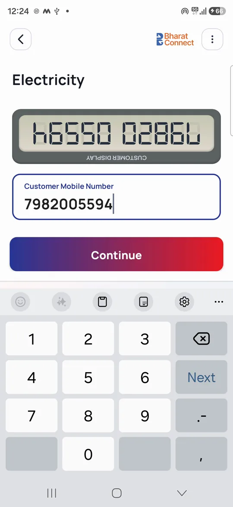
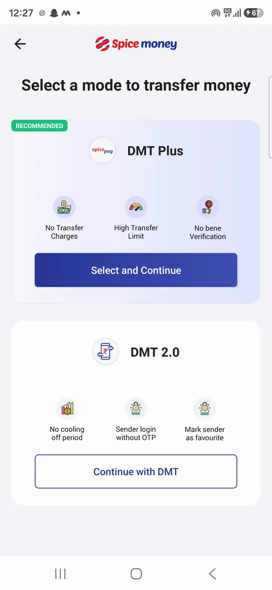
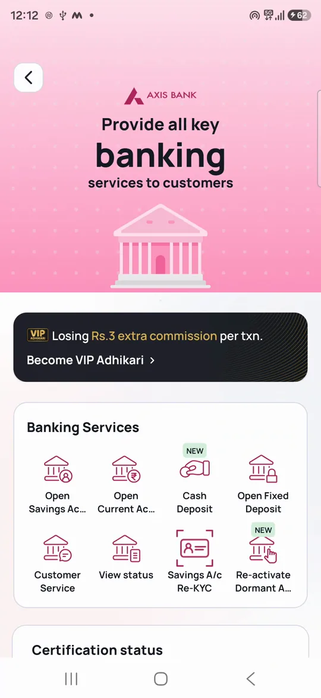
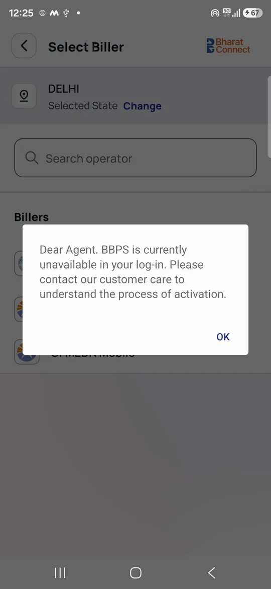

# Phase 4: live capture, session 1 (13 Oct 2026)

**Setup:** Galaxy S24 Ultra (Android 16), staging build, activated test adhikari. The phone was mirrored to the Mac with scrcpy and driven through Claude computer use.

**Recordings:** `~/spice-capture/session-000910.mp4` and `session-002319.mp4`, on Alan's Mac and not committed. Frames were pulled from them using the timestamps in `capture_log.tsv`.

## Result by flow

| Flow | How far we got | Why it stopped |
|---|---|---|
| 01 Login | Home screen after login | You logged in yourself; credentials are never typed by Claude |
| 08 Axis Re-KYC | Entry, the full landing page, the invalid-number branch, History | Staging: Send OTP and History both return "Something went wrong, Please try again later." |
| 05 BBPS | Mobile entry, customer display, state, biller | "BBPS is currently unavailable in your log-in…": BBPS is not enabled for this test ID |
| 07 UPI Cash Point | All 3 intro slides, main screen | Staging: "Unable to process your request" on load; tapping OK exits to home |
| 04 DMT | DMT Plus / DMT 2.0 chooser, BC Money Transfer, sender lookup | Staging: "Something went wrong. Please try again." on every call |

## What live capture confirmed or corrected

**Confirmed (matched phase 2 findings from the code):**
- The production build blocks the app when Developer Options are on. A staging build is needed for any assisted capture.
- BBPS shows the customer's number upside down on a digital "customer display" panel. 
- DMT shows a chooser when both server flags are on: **DMT Plus** (RECOMMENDED) vs **DMT 2.0**. 
- Axis Re-KYC rejects invalid numbers locally ("Please enter the valid mobile number"), and Send OTP enables at exactly 10 digits.
- The UPI Cash Point intro copy matches the code: "No card, no fingerprint, no ATM. Just UPI."

**New, only visible live:**
1. **The Axis Re-KYC entry point is inside the AXIS Banking hub**, not on home: Home → AXIS Banking → *Savings A/c Re-KYC*. The hub also shows a "Losing Rs.3 extra commission per txn. Become VIP Adhikari" upsell. 
2. **The Re-KYC landing page** (server-hosted, not in the APK) has:
   - benefits: Up-to-Date Record, Smooth Transactions, Personalized Offers, Boost Account Security;
   - a **4-step** process, where the in-app success screen shows 3 steps;
   - customer eligibility: a valid Aadhaar number and an Aadhaar-linked mobile;
   - commission and adhikari earnings blocks;
   - an FAQ;
   - a **generic** Spice Money help video, not one about Re-KYC.
3. **The BBPS service gate fires late.** The "not enabled" message appears only after the adhikari has entered the customer's mobile number and picked a state and a biller. It could fire on the tile instead. 
4. **UPI Cash Point's intro button steps through the slides instead of skipping them.** "Try UPI Cash Point Now" moves to the next slide and becomes "Get Started" on the last one. A config error then closes the whole feature.
5. **One generic error message hides what failed.** Axis, DMT and UPI Cash Point all show "Something went wrong"-style dialogs. The adhikari can't tell a bank outage from a network problem or a problem with their own account.
6. **Staging data is messy.** A Jharkhand electricity biller appears under Delhi.

## Next session needs
- A test ID with BBPS, AePS, DMT, UPI Cash Point and Axis enabled.
- Staging backends up for Axis (`axiscasa…/axisCasa/`), DMT and UPI Cash Point (`yblupi…/upicashnw/`).
- A whitelisted test customer mobile with a fixed OTP. You enter the OTPs; Claude stops at every final payment confirm.
