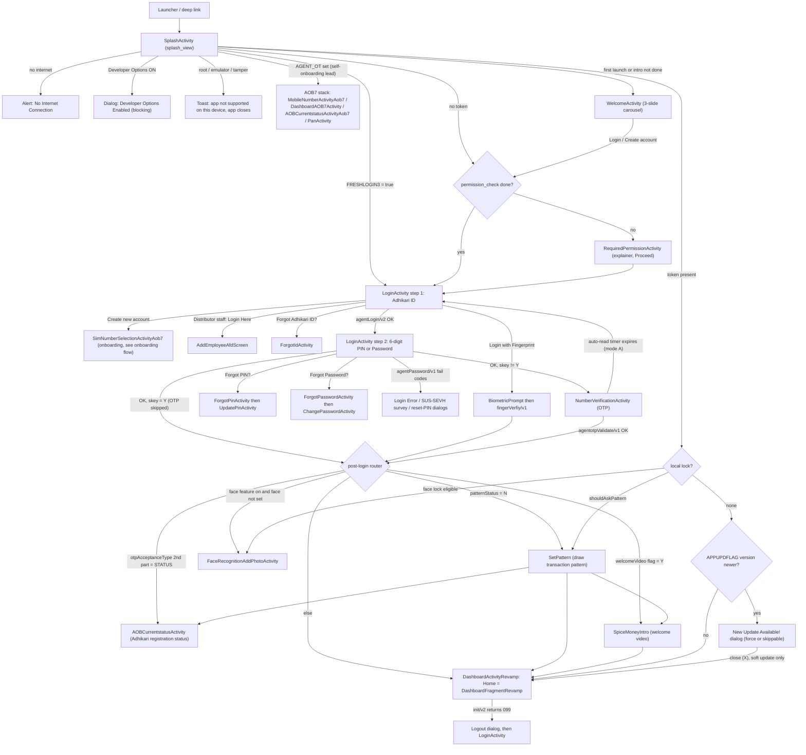

# 01 · Login & first launch

> **Confidence key:** ✅ confirmed in code · 🟡 inferred (naming, partial code) · ⬛ not visible in APK (backend, Flutter, partner SDK)

## Summary
- **Who / when:** Every adhikari, every cold start. New installs see the welcome carousel, then a permissions explainer, then Login. Returning users who already have a session token skip login and go straight to home. Self-onboarding leads arriving from a Singular acquisition link go into the AOB7 onboarding stack instead. ✅
- **Entry points:** Launcher icon → `SplashActivity`. Deep links also land on `SplashActivity`: `https://vf.spicemoney.com/{A,B,E,F,product}…`, `https://spiceapplink.sng.link/…`, and the schemes `spiceapp://` and `spicenudges://`. A Netcore push payload (`smtNotificationPayload`) skips the splash logic and goes to `DeeplinkReceiver`. A logout or session-expiry dialog anywhere in the app returns to `LoginActivity`. ✅
- **Preconditions / gates:**
  - Internet connection.
  - Device integrity: Developer Options off, not rooted, not an emulator, no tamper or hooking detected.
  - A VPN check, when the server sets the flag.
  - A one-time permissions explainer (`permission_check`).
  - Runtime permissions: location, phone state, camera, storage and Bluetooth, depending on Android version.
  - A GPS fix is required before the login API call.
  - Acceptance of the T&C / Privacy / EULA checkbox.
  - Server-side flags from `pre/login/info/V2`.
  - All of the above are ✅.
- **Successful outcome:**
  - The app holds a session token (pref `test_test`) and `bcAgentId`.
  - The user lands on `DashboardActivityRevamp` with the Home tab, which is always `DashboardFragmentRevamp`. A "Logged in Successfully" toast shows after a fresh login.
  - Before home, the user may pass through one of four screens, each chosen by the server: the transaction-pattern setup, the face lock, the welcome video, or the onboarding status screen. ✅

## Flow diagram

## Screen by screen
| # | Screen (class) | Layout | What the user sees | User action | API call(s) | Next → (condition) | Conf. |
|---|---|---|---|---|---|---|---|
| 1 | `SplashActivity` | `splash_view` | Logo. Returning users see a strip with "Welcome, \<agent name\>" and their login ID. An optional server-scheduled campaign or splash image is shown for 1–10 s. | none (waits ~1 s by default) | `API_GW_URL_SHORT + agent/optpostgres/init/v2` ("super init"), only if a token exists | See the branches. First launch or intro not done → Welcome (#3). No token → permission gate → Login (#5). Token → lock checks → update check → Home (#18). `AGENT_OT` set → AOB7 onboarding stack. `FRESHLOGIN3`=true → Login. | ✅ |
| 2 | Integrity / device gates (dialogs on Splash and on the Login tap) | system `AlertDialog` / toast | "Developer Options Enabled" dialog with "Open Settings" and "Cancel" buttons and steps to turn it off. Root, emulator, tamper or session-sync failure: "We are sorry, the app is not supported on this device. Please contact customer support at customercare@spicemoney.com", then the app closes. VPN: a popup whose text comes from the server (`vpnCheckPopUpDescription`). | Open Settings / Cancel | none (local checks). The VPN flag comes from the pre-login response. | Blocks the flow. | ✅ (the obfuscated copy was decoded locally) |
| 3 | `WelcomeActivity` | `welcome_viewpager` | 3 Lottie slides: "Bharat ka No. 1 Banking Service Network" / "Turn Your Shop into a Mini Bank with Spice Money's 25 Years of Trust" / "Become a Local Banking Agent and Empower Your Community", each with a subtitle (e.g. "Join 1.5 Million+ Spice Money Agents… Earn up to ₹25,000/Month"). Buttons: **Create account**, **Login**. | taps Login or Create account | none | Permissions not yet acknowledged → RequiredPermission (#4). Otherwise → Login (#5), with `createAccount=Y` for Create account. Login with a token already present → Home. | ✅ |
| 4 | `RequiredPermissionActivity` | `required_permissions` | "Allow permissions for best experience." Five cards: Device Information, Location & Security ("We use your location to make sure it's you…"), Camera & Media, Notifications & Offers, Accounts / Contacts. CTA: **Proceed**. | taps Proceed | none | Sets `permission_check=true`. Then → Login, or → `MobileNumberActivityAob7` (lite-onboarding lead), or → Home / face lock (returning user). This screen does **not** request any OS permission. The OS prompts come later on Login and on Home. | ✅ |
| 5 | `LoginActivity`, step 1 | `login_activity_view` | Title "Login" (or "Welcome, \<name\>" for a returning user). "Adhikari ID" field (pre-filled with the last ID). T&C checkbox "I agree to Terms & Conditions, Privacy Policy and EULA." CTA **Proceed**. Links: "Forgot Adhikari ID?" (server-toggled), "Don't have an Spice Money ID? Create new account" (server-toggled via `loginJoinUs`), "Are you Distributor's staff? Login Here", a Help icon, a chatbot FAB, and "Login with Fingerprint" (only if previously enabled). | enters ID, ticks T&C, taps Proceed | On open: `pre/login/info/V2`. On Proceed (after a Play Integrity nonce fetch): `API_GW_URL + agentLogin/v2` (`reqType=alogin`). | OK → the step 2 field appears (#6). Error → "Login Error" + server text. `NVB` → force update dialog (#16). `51`/`52` → reset PIN or password (#13/#14). `SUS`/`SEVH` → survey or suspension dialog. `099` → logout dialog. | ✅ |
| 6 | `LoginActivity`, step 2 (same screen) | `login_activity_view` | If `authFlag=M`: a 6-digit PIN box with a show/hide eye and "Forgot PIN?". Otherwise: a "Password" field with "Forgot Password?". CTA changes to **Login**. Empty-field toasts: "Enter PIN" / "Please enter password". | enters PIN or password, taps Login | `API_GW_URL + agentPassword/v1`. The PIN or password is sent as a salted hash using `hashCnt`/`randomSeed` from step 1. | `skey`=Y → post-login router (OTP skipped). Otherwise → OTP (#8). `INEX` → reset re-KYC password/PIN bottom sheet. `A001`/`A005` → error dialog with OTP attempt counts. `A0011` → dialog with a "Forget PIN" CTA. | ✅ |
| 7 | Biometric login (system BiometricPrompt over Login) | system | Android fingerprint sheet. Fallback snacks: "No fingerprints are enrolled, Please login with password" / "We found a new fingerprint added to your settings…" / "No biometric hardware available". | touches sensor | `agentLogin/v2`, then `API_GW_URL + fingerVerfiy/v1` | Same router as #6. If the server returns `fingerAuth`≠Y → biometric is disabled locally and "Please login using pin/password" shows. | ✅ |
| 8 | `NumberVerificationActivity` | `new_number_verification` | "Welcome back, \<name\>". "Enter 6 digit OTP sent to \<mobile\>" / "Trying to auto read OTP sent to…". "Ensure this \<mobile\> SIM is in Device". Countdown (default 45 s, set by the server via `waitTime`). Tips: "Turn Airplane Mode ON/OFF", "Check Network Connectivity". After the timer: "Didn't receive OTP?" with **Resend SMS** and **Get OTP on Call** (if `obdFlag`=Y). CTA **Verify OTP**. | auto-read via SMS Retriever, or types OTP | `API_GW_URL + agentotpValidate/v1`. Resend: `agentPassword/v1`. | Success → "OTP verified" animation → post-login router. Failure → server text. Auto-only mode (`A`) times out → "Unable to receive OTP. Please check your credentials and try again" → back to Login. `099` → "You have been logged out for security reasons, please re-login." | ✅ (`onCreate` was not decompiled; `processOtp` was recovered with `--show-bad-code`) |
| 9 | `SetPattern` (extends `SetPatternActivity`) | `pl_base_pattern_activity` | Opening dialog: "Thanks, we have authenticated your mobile number. Please set the transaction pattern to proceed." Pattern grid: "Set a transaction pattern for added security". Buttons Reset / Continue / Confirm. Back is disabled. | draws the pattern twice | `PATTERN_URL` (`…/ppi/agent/pattern/`) | Success: "Thanks, your pattern is now your password." Then → Status (#11) if `STATUS`, else Welcome video (#10) if the intro flag is Y, else Home. | ✅ |
| 10 | `SpiceMoneyIntro` | `activity_spice_money_intro` | Welcome video with two captions; the server supplies the video ID and texts (`welcomeVideo` = flag\|text1\|text2\|id\|key). | watches or skips | ⬛ video host | → Home | 🟡 (the video content isn't visible in the APK) |
| 11 | `firstLoginAob.AOBCurrentstatusActivity` | `activity_aobcurrentstatus` | "Adhikari registration" with name, "Request ID:", a server-driven list of onboarding steps, banner, Help, and Logout ("You will be logged out from the Spice Money app."). | taps a pending step: eKYC / profiling / CAF eSign / email verification / RBL eKYC | `AOB4` (`agentOnboarding4/`) `fetchAobstatusnew`; `agentApp/logout/v1`; `utilredirect/v1` | eKYC → Home with the `NAVIGATE_EKYC` flag ("Redirecting to E-KYC"). Other steps → their own screens. | ✅ screen / ⬛ step logic |
| 12 | `ForgotIdActivity` | `forgot_id_activity` | "Recover Adhikari ID". "Enter your registered details to find your account". Fields: Mobile Number, PAN number, Date Of Birth. Note: "We will sent OTP on your registered mobile number". CTA **Verify and send OTP**. Then an OTP bottom sheet. | fills the fields, enters OTP | `FORGOT_ID_URL` `otpInitFID` / `otpValidationFID` (paths probably `agentForgotId/v1` and `agentForgotIdValidate/v1`) | ID shown or sent ⬛ → back to Login | ✅ screen / 🟡 paths |
| 13 | `ForgotPasswordActivity` → `ChangePasswordActivity` | `layout_forgot_password` → `change_password` | "Confirm your Adhikari ID", "Verify your identity", an English/हिंदी toggle, CTA **Confirm**. Then OTP + new password. | enters ID → OTP → new password | `agentForgotPwd` (probably `agentForgotPwd/v1`, then `…Validate/v1`) | → Login or Home (`redirect`) | ✅ / 🟡 paths |
| 14 | `mpin.view.ForgotPinActivity` → `UpdatePinActivity` | `activity_forgot_pin` → `activity_update_pin_revamp` | Adhikari ID + **Proceed**. Then OTP and new 6-digit PIN entry. | enters ID → OTP → new PIN ×2 | MPin repository (probably `agentForgotmpin/v1`, `agentForgotMpinValidate/v1`, `agentmpin/v1`) | → Login | 🟡 (API interfaces were not decompiled) |
| 15 | `SimNumberSelectionActivityAob7` | `activity_aob7_sim_selection` | "Create account using" with a list of SIM cards on the device. A Hindi T&C/CAF consent checkbox ("Please accept Terms and Conditions" if unticked). Links: "Already have account? Login", "Check your application status". | picks a SIM | ⬛ (AOB7 view-models) | → `MobileNumberActivityAob7` (out of scope: onboarding flow) | ✅ |
| 16 | Update dialog (on Splash and Login) | `new_version_layout` | "New Update Available!" with server text, **Update now**, an optional "Know how to fix" help link, and an X (soft update only). Default copy on the Login version: "We are constantly working to improve your Spice Money experience. Tap UPDATE to enjoy new features." | Update now → Play Store or a browser URL; X → Home | Splash: uses `APPUPDFLAG` from the `init/v2` response. Login: response code `NVB`. | Force update (field 4 = Y, or Login `NVB`) has no X, so the user is stuck until they update. | ✅ |
| 17 | Session-expiry / forced-logout dialog (`KotlinCommonUtilityKt.u1`) | MaterialDialog | "You have been logged out for security reasons, please re-login." + OK | OK | Triggered by response code `099` from `init/v2`, `agentLogin/v2`, `agentPassword/v1`, OTP, or self-care. | Clears the token (`test_test`), CSR ID and `AGENT_OT` → `LoginActivity` (task cleared) | ✅ |
| 18 | `DashboardActivityRevamp` → Home tab `DashboardFragmentRevamp` | `dashboard_activity_revamp` | Bottom navigation with Home selected. Toast "Logged in Successfully" if arriving from login. The content comes from the server (`init/v2`). Post-login gates can overlay: Password-expiry dialog, re-KYC dialog / `RekycDashboard` (account inoperative), email-verification sheet, fingerprint-enable consent, notification popups. | — | `optimizedINITApi` (`init/v2`) and campaign/dashboard calls | Home first render. The variant is always `DashboardFragmentRevamp`; tiles and widgets come from the server. | ✅ container / ⬛ tile set |

## Branches, errors and edge states
- **First launch, language:**
  - There is **no language picker** on first launch. `LanguageActivity` is reachable only from Account Settings.
  - If the phone locale is Hindi, Splash sets Hindi. However, `navigateToWelcomeWithOutLang()` then overwrites `LANG_PREF` to English for every user who did not arrive via an acquisition link. In effect, new organic installs always start in English.
  - Language can still be toggled on Forgot Password ("हिंदी मे").
  - Evidence: `SplashActivity.myRunnable` L180–213, `navigateToWelcomeWithOutLang` L1405. ✅
- **Acquisition-link (Singular) installs:**
  - `initSingularSDK` stores `utmSource`/`utmId`. If the link is deferred or non-empty, it jumps straight to `aob_lite_onboarding.OnboardingActivity`.
  - With `utmSource` set, Splash routes by `AOB_STAGE_PARAM`: 0 → `MobileNumberActivityAob7`; 1–5 → `DashboardAOB7Activity`; >5 → `AOBCurrentstatusActivityAob7`.
  - ✅
- **Agent in AOB self-onboarding (`AGENT_OT` set):**
  - `AGENT_MAINSTAGE=FULL_ONBOARDING_COMPLETE` → `AOBCurrentstatusActivityAob7`.
  - `utmFlag` on and `panStepFlag` off → `PanActivity`.
  - `utmFlag` on, `panStepFlag` on and `utmPayementFlag` on → `continueInitSplash()` simply `return`s without scheduling the timer. **This looks like a dead end where the user stays on the splash screen.**
  - Otherwise: welcome kit / map / status routing (`handleAobNavigation`).
  - ✅ code / 🟡 real-world impact
- **Returning user ("fast login"):**
  - There is no MPIN or biometric re-prompt on cold start. If a token exists, Splash goes straight to Home, after an optional local pattern or face lock.
  - Re-authentication happens only when the server returns `099` on `init/v2`, which shows the logout dialog.
  - ✅
- **Legacy face lock:**
  - `FaceRecognitionAddPhotoActivity` is shown when the on-device Qualcomm `FacialProcessing` feature is available (`key_face`=T) and the server says `patternStatus`=Y, but no face is set.
  - On Splash, it is skipped after more than 3 failed attempts.
  - Probably inactive on most modern devices. 🟡
- **Pattern-pending flag mismatch:**
  - `SetPattern` writes `shouldAskPattern` to the plain default `SharedPreferences`.
  - Splash reads it from the encrypted `in.spicemudra.defaultpref`.
  - The migration helper `migrateOldPrefToEncrypPref` exists but is never called.
  - So "resume pattern setup on relaunch" may never fire. 🟡
- **Location is mandatory for login:**
  - `callLoginAPI` refuses to call `agentLogin/v2` if no latitude is cached. It shows "Error: Location Data Not Found for Login — Turn off your GPS and turn it on again | Restart your device and initiate the login".
  - The server's `geoLoginMandateFlag` only controls whether the location permission is requested up front.
  - ✅
- **Permissions:**
  - The explainer (#4) is cosmetic; it only sets a flag.
  - Real OS prompts fire in Login `onCreate` (location, phone, camera, storage or Bluetooth depending on API level, plus a notification prompt from Netcore) and again on Home.
  - On Login tap, READ_PHONE_STATE is required.
  - ✅
- **OTP modes (`otpAcceptanceType` = mode|newUserStatus):**
  - `M` = manual entry only.
  - `A` = auto-read only. A timeout sends the user back to Login.
  - `B` = both.
  - When the server sets `skey`=Y, OTP is skipped entirely (logged as "OTP SKIPPED FLOW"). Trusted-device logic is server-side. ⬛
  - The second part of the field, `STATUS`, sends the agent to the registration-status screen instead of Home.
  - ✅
- **Login error codes:**
  - `NVB` → force update.
  - `51` → `UpdatePinActivity` (forced PIN set).
  - `52` → OTP, then create PIN.
  - On a password-mode account, `51` or `52` → `ForgotPasswordActivity` with a "change password" message.
  - `SUS` / `SEVH` → MPIN suspension or "severe" survey dialog (`SuspiciousDialog`), with an audio or video explainer supplied by pre-login.
  - `INEX` → reset re-KYC PIN or password bottom sheet.
  - `A001` / `A005` → error dialog with OTP counters.
  - `A0011` → dialog with a "Forget PIN" CTA.
  - Anything else → "Login Error" + `responseDesc`.
  - ✅
- **Forced logout:** code `099` on any auth or init call → "You have been logged out for security reasons, please re-login." ✅
- **Init code `089`:** clears the cached init only; nothing is shown to the user. ✅
- **App update:** the Splash soft or force update is driven by `APPUPDFLAG` (version|message|channel GOOGLEPLAY or WEBBROWSER|url|force Y/N|help Y/N|help title|help url). ✅
- **Outage / lockdown:** no outage or maintenance screen exists in the Splash or Login code. Outage-version prefs are only reset on logout (`resetPref`). Service-outage messaging appears to live on Home or the tiles. 🟡
- **Notification-tap at login:** if Login opens from a push (`type` extra), a dialog shows the notification title and message, with a web, deep-link or Play Store action. ✅
- **Distributor staff:** "Are you Distributor's staff? Login Here" → `AddEmployeeAfdScreen`. Distributor-employee sessions bypass Login from Splash to `AobDistributorDashboard`. ✅

## What we could not see
- Server logic behind `pre/login/info/V2`, `agentLogin/v2`, `agentPassword/v1`, `agentotpValidate/v1` and `init/v2`: who gets MPIN vs password (`authFlag`), when OTP is skipped (`skey`), `patternStatus`, `welcomeVideo`, and `otpAcceptanceType`. ⬛
- Play Integrity / nonce verification, `SessionSyncTask` and `TamperDetection` internals: what exactly fails a device. ⬛ (only the client-side checks were decoded)
- Retrofit API interface paths for forgot ID, forgot password, forgot PIN and AOB status. These classes failed to decompile because jadx ran out of memory; the paths in rows 12–14 are matched by name from dex strings. 🟡
- Which tiles and widgets the Home renders. That is driven by the `init/v2` payload inside `DashboardFragmentRevamp` (20k lines; out of scope here). ⬛
- Video content for `SpiceMoneyIntro` and the SUS/SEVH explainers. ⬛
- The Login "Help" icon opens `NewAepsContainerActivity` with type `LOGIN` (help or chat container). Its content was not traced. 🟡

## To verify in live capture (phase 4)
1. On a fresh install with the phone language set to Hindi: does the Welcome carousel appear in English? (The code says yes.)
2. Does the Required-permissions "Proceed" button trigger any OS dialog, or do the OS prompts first appear on Login? Capture the exact order of prompts.
3. With GPS off, tap Proceed on Login: confirm the "Location Data Not Found for Login" dialog and whether it is recoverable without restarting.
4. Capture an MPIN account and a password account. Confirm the two-step reveal (ID → Proceed → PIN or password field).
5. Check which OTP mode (M/A/B) a normal agent gets. Measure the timer length. Check whether "Get OTP on Call" appears. Check whether OTP is skipped on a second login from the same device (`skey`).
6. Kill and relaunch after login: confirm Home opens with no PIN prompt, and time the splash.
7. Turn on Developer Options and relaunch: confirm the blocking dialog. Connect a VPN and tap Login: capture the VPN popup copy.
8. Interrupt pattern setup (kill the app mid-`SetPattern`) and relaunch: does the app return to `SetPattern` or go to Home? This tests the prefs mismatch.
9. Force a `099` (for example, log in on a second device): confirm the logout dialog copy and that it lands on Login with the ID pre-filled.
10. Record the Home first render after a fresh login: the toast and any overlays (password expiry, re-KYC, email verify, fingerprint consent), in the order they appear.

## Evidence
- `spice/mudra/activity/SplashActivity.java`:
  - `onStart` L1797 (no-internet alert).
  - `init` L902 (Netcore payload → `DeeplinkReceiver`).
  - `initSplash` L977 (Developer Options → `DeviceSettingsHelperKt.c`; integrity → `SessionStateKt.j`).
  - `lambda$initSplash$0/1` L1043 (TamperDetection, SessionSyncTask).
  - `continueInitSplash` L410 (AGENT_OT / FRESHLOGIN3 / campaign splash / `hitInitService`).
  - `myRunnable.run` L150–353 (root/emulator, language, intro, token, pattern/face, permission gate).
  - `getDeeplinkData` L615 (deep link → `DEEPLINK_SERVICE`).
  - `initSingularSDK` L929.
  - `handleAobNavigation` L844, `moveToLoginScreen` L1323, `navigateBasedOnAobStage` L1354, `navigateToDashboard` L1376, `navigateToWelcomeWithOutLang` L1405.
  - `launchDashboard` L1206 and `openForceUpdate` L1432.
  - `hitInitService` L860 and `onResult` L1666 (`init/v2`, `099`/`089`, `APPUPDFLAG`).
- `core/session/SessionStateKt.java`: `h()` emulator, `d()/e()/f()/g()` root/hook checks, `c()` VPN check (`enableVpnCheckFlag`), `j()` resolve.
- `core/session/AppLevelAlertsKt.java`: `b()` ("not supported on this device" + `finishAffinity`).
- `spice/mudra/utils/DeviceSettingsHelperKt.java`: `a()` (`development_settings_enabled`), `c()` (dialog).
- `spice/mudra/intro/WelcomeActivity.java`: `onClick` L164 (Login / Create account routing); `WelcomeViewModel` slides L95–97.
- `spice/mudra/activity/RequiredPermissionActivity.java`: `onCreate` (`btnContinue` → flag + route).
- `spice/mudra/activity/LoginActivity.java`:
  - `onCreate` L3327, `initViews` L2783 (links, T&C span, fingerprint button), `onClick` L3122 (Forgot ID / Password / PIN, distributor staff, help, fingerprint).
  - `lambda$onClick$14` L1198 (permission/GPS gating), `loginProcess` L3035, `proceedWithLogin` L1816.
  - `adhikariIdValidation` L457, `adhikariPinValidation` L486, `callLoginAPI` L593 (`agentLogin/v2`, location guard).
  - `mPinValidate` L1436 / `PasswordValidate` L366 (`agentPassword/v1`), `fingerprintValidate` L741 (`fingerVerfiy/v1`).
  - `preloginAPI` L1798, `onResult` L3651 (pre-login flags, `NVB`, `SUS`/`SEVH`, `51`/`52`, `INEX`, `A001`/`A0011`/`A005`, `skey` → `setLoginResponseSkip` or `NumberVerificationActivity`).
  - `setLoginResponseSkip` L2334 (post-login router), `navigateToForgetPin` L1492, `openForceUpdate` L1638, `openLocationDialog` L1712, `preRunBioAuthentication` L1766.
- `spice/mudra/activity/NumberVerificationActivity.java` (single-class re-decompile from `classes7.dex`): `setData` ~L860 (`otpAcceptanceType`, `waitTime`, `obdFlag`, timer), `processOtp` / `lambda$processOtp$6` ~L416 (router), `onResult` ~L1291, `agentotpValidate/v1` ~L1120.
- `spice/mudra/model/PayloadLogin.java`: `d()` = `patternStatus`, `j()` = `welcomeVideo`, `i()` = `token`.
- `spice/mudra/activity/SetPattern.java` (re-decompiled): `onCreate`, `lambda$onResult$1` (routing), `PATTERN_URL` call. `spice/mudra/utils/library/SetPatternActivity.java` (copy).
- `spice/mudra/activity/SpiceMoneyIntro.java` (re-decompiled): → `DashboardActivityRevamp`.
- `spice/mudra/firstLoginAob/AOBCurrentstatusActivity.java`: `getstatusApi` L312 (`AOB4` `fetchAobstatusnew`), `moveToDashboard` L666, `hitLogout` L382, `gotoProfiling` / `gottoCaf` / `gottoEmail` / `triggerForceRBLEkyc`.
- `spice/mudra/forgotId/ForgotIdActivity.java` (re-decompiled) and `forgotId/viewModel/ForgotIdViewModel.java` (`otpInitFID`, `otpValidationFID`).
- `spice/mudra/resetPassword/ForgotPasswordActivity.java` (re-decompiled): `agentForgotPwd` → `ChangePasswordActivity`.
- `spice/mudra/mpin/view/ForgotPinActivity.java` (→ `UpdatePinActivity`), `mpin/view/UpdatePinActivity.java`.
- `spice/mudra/aob7/SimNumberSelectionActivityAob7.java`: → `MobileNumberActivityAob7`.
- `spice/mudra/utils/KotlinCommonUtilityKt.java`: `u1()` (logout dialog); `defpackage/x22.java` (clears token → `LoginActivity`).
- `spice/mudra/utils/CommonUtility.java`: `Q()` / `i1()` (token in pref `test_test`); `a1()` / `W0()` / `Y0()` (permission sets).
- `spice/mudra/newDashboard/activity/DashboardActivityRevamp.java`: `onCreate` L21531 (Home tab, `FRESHLOGIN3`=false, `NAVIGATE=LOGIN` toast), `onNavigationItemSelected` L22037; `spice/mudra/newDashboard/DashboardBaseActivity.java` `replaceRevampDashboardFragment` L202 (Home = `DashboardFragmentRevamp`).
- `spice/mudra/utils/Constants.java`: `API_GW_URL`, `API_GW_URL_SHORT`, `PRE_LOGIN_INFO`, `OPTIMIZE_SUPER_INIT_REVAMP`, `PATTERN_URL`, `AOB4`, `LOGOUT_RESPONSE_CODE` (`099`), `FRESHLOGIN` (`FRESHLOGIN3`), `AOB_OT` (`AGENT_OT`), `APP_UPD_FLAG`.
- `AndroidManifest.xml`: `SplashActivity` intent filters (deep-link hosts and schemes).
- Copy: `res/values/strings.xml`; layouts `splash_view`, `welcome_viewpager`, `required_permissions`, `login_activity_view`, `new_number_verification`, `new_version_layout`, `forgot_id_activity`, `layout_forgot_password`, `activity_aob7_sim_selection`, `activity_aobcurrentstatus`, `pl_base_pattern_activity`.
