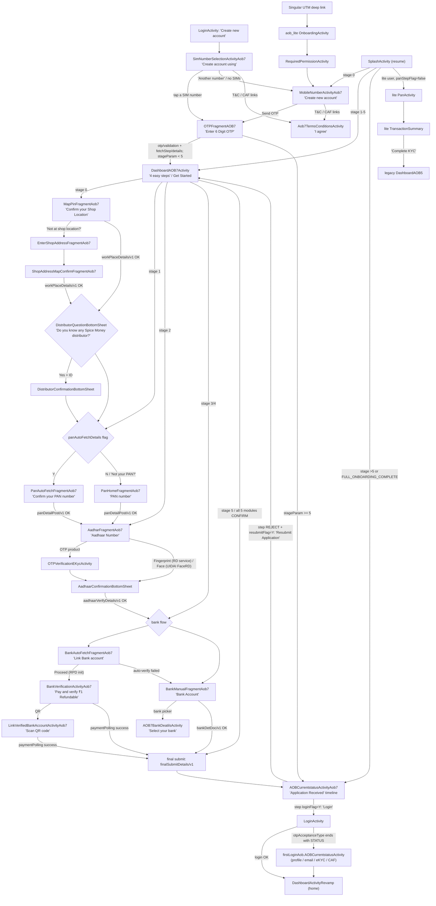

# 02 · New adhikari onboarding (AOB7)

> **Confidence key:** ✅ confirmed in code · 🟡 inferred (naming, partial code) · ⬛ not visible in APK (backend, Flutter, partner SDK)

## Summary
- **Who / when:** A prospective retailer with no Spice Money login who taps **"Create new account"** on the login screen, or who arrives through a marketing deep link with UTM data. Today's journey is `spice.mudra.aob7`: verify the mobile number, then four steps (**Shop Location → Link PAN → Verify Aadhaar → Link Bank**), plus an optional distributor mapping, a final submit and a server-driven status timeline. ✅
- **Entry points:**
  - `LoginActivity` "Create new account" (`partner_layout`) → `SimNumberSelectionActivityAob7` ✅
  - `SplashActivity` resume logic, keyed on the saved `AGENT_OT` and `AOB_STAGE_PARAM`: stage 0 → mobile screen, stages 1–5 → AOB7 dashboard, stage above 5 or `AGENT_MAINSTAGE=FULL_ONBOARDING_COMPLETE` → status screen ✅
  - A Singular deferred deep link with a UTM source → `aob_lite_onboarding.OnboardingActivity` → permissions → `MobileNumberActivityAob7` ✅
  - `SelfcareWebActivity` → `MobileNumberActivityAob7` ✅
  - "Check your application status" link on the SIM and mobile screens (same OTP flow in status mode) ✅
- **Preconditions / gates:**
  - Runtime permissions via `RequiredPermissionActivity` (location and phone), plus `READ_PHONE_NUMBERS` to list SIM numbers on Android 11+ ✅
  - The Terms/CAF checkbox must be ticked ("Please accept Terms and Conditions") ✅
  - Server static config `staticDet/v1` sets feature flags (`panAutoFetchDetails`, `bankAutoFetchDetails`, Aadhaar auth `products`) and a force-update rule ✅/🟡
  - Aadhaar fingerprint auth needs an RD-service device app (Mantra, Morpho, Startek, Tatvik, Precision, Evolute, Aratek). Aadhaar face auth needs the UIDAI FaceRD app ✅
  - The bank account must be in the agent's own name and UPI-enabled. The agent pays a refundable ₹1 penny drop ✅
- **Successful outcome:** The final submit (`finalSubmitDetails/v1`) succeeds → **status timeline** (`AOBCurrentstatusActivityAob7`). Activation is decided on the server (distributor/executive verification, ID creation ⬛). When a timeline step comes back with `loginFlag=Y`, a **Login** button appears and sends the agent to `LoginActivity`. After a normal login the agent lands on `DashboardActivityRevamp` (home). Login can instead route to the legacy post-login checklist (`firstLoginAob.AOBCurrentstatusActivity`) when the login response's `otpAcceptanceType` ends in `|STATUS`. ✅

## Flow diagram

## Screen by screen
| # | Screen (class) | Layout | What the user sees | User action | API call(s) | Next → (condition) | Conf. |
|---|---|---|---|---|---|---|---|
| 1 | `LoginActivity` | `login_activity_view` | Login form with a **"Create new account"** link | Taps "Create new account" | — | `SimNumberSelectionActivityAob7` (online, no session block) | ✅ |
| 2 | `SimNumberSelectionActivityAob7` | `activity_aob7_sim_selection` (+ `item_aob7_sim_number`) | Title **"Create account using"**. One row per SIM ("SIM card", carrier, number), then **"Another number"**. Hindi T&C/CAF consent text with a checkbox; links open T&C or CAF. **"Check your application status"**; "Already have account? **Login**" | Picks a SIM number, or "Another number" | `AOB7 + staticDet/v1` (pre-login static data, force-update flag); `AOB7 + otp/generation/v1` (on SIM tap) | OTP fragment shown in this activity; `MobileNumberActivityAob7` (Another number, or no SIMs readable); "Please accept Terms and Conditions" toast if the box is unticked | ✅ |
| 3 | `Aob7TermsConditionsActivity` | `activity_aob7_terms_conditions` | Terms or CAF text (`EXTRA_MODE` = TERMS / CAF), **"I agree"** | Reads and agrees | ⬛ (content source not traced) | Back to the caller | ✅/🟡 |
| 4 | `MobileNumberActivityAob7` | `activity_aob7_mobile_number` | **"Create new account"**, Mobile Number field, Hindi consent, **"Send OTP"**, "Check your application status", "Already have account? Login" | Types a 10-digit mobile number, taps Send OTP | `AOB7 + otp/generation/v1` | OTP fragment | ✅ |
| 5 | `OTPFragmentAOB7` (in SIM or Mobile activity) | `aob7_otpfragment` | **"Enter 6 Digit OTP sent to …"**, "Didn't receive OTP? **Resend SMS**" (resend count capped), **"Verify OTP"**. SMS Retriever and SMS user-consent autofill | Enters or auto-reads OTP | `AOB7 + otp/validation/v1` (stores the mapping/lead id, OT session, crypto key, `AGENT_MAINSTAGE`); then `AOB7 + fetchStep/details/v1` | `DashboardAOB7Activity` if `stageParam < 5`, else `AOBCurrentstatusActivityAob7` (see note on decompiler inversion) | ✅ |
| 6 | `DashboardAOB7Activity` | `activity_dashboard_aob7` + `include_aob7_four_step_progress` | **"Become Spice Money banking agent in 4 easy steps"**. Progress: **Shop Location · Link PAN · Verify Aadhaar · Link Bank**. "Your details stay **100% safe** with us", **"Get Started"**. Help icon opens a tooltip with SpiceBot chat and help | Taps Get Started | `AOB7 + loadStaticContent/v1`, `AOB7 + fetchStep/details/v1` | Step fragment by stage (`b1`): 0 shop, 1 PAN, 2 Aadhaar, 3/4 bank, 5 final submit, 6/7 status | ✅ |
| 7 | `MapPinFragmentAob7` | `ds_activity_map_pin_aob` | **"Confirm your Shop Location"** on a map pin with Shop Address and Area. Info card "We will verify your business location at the address shown below." **"Confirm"**, "**Not at shop location?** Enter Shop Location" | Confirms GPS pin, or opts to enter the address | `AOB7 + workPlaceDetails/v1` (lat/long, address, photo URL via `bankUpdate/docUrl/APP` + S3 PUT 🟡) | Success toast "Your shop location has been submitted successfully" → refetch → distributor sheet (if `HelperAOB7.j`) or PAN | ✅ |
| 8 | `EnterShopAddressFragmentAob7` → `ShopAddressMapConfirmFragmentAob7` | `activity_enter_shop_address`, `activity_shop_address_map_confirm` | **"Enter Shop Address"**: Shop Address, Shop PIN Code, District, Gram Panchayat, **Proceed**. Then the map confirm screen: "Our Distributor / Executive will visit shop location for verification", **Proceed** | Types address and PIN, then confirms the geocoded pin | `AOB7 + pincodeSearch/v1`, then `AOB7 + workPlaceDetails/v1` | Same as row 7 | ✅ |
| 9 | `DistributorQuestionBottomSheet` / `DistributorConfirmationBottomSheet` | `bottom_sheet_distributor_question`, `bottom_sheet_distributor_confirmation` | **"Do you know any Spice Money distributor?"** "Distributor is a Spice Money partner who helps with Physical verification, Devices and Business support". Yes / No, "Enter Distributor ID", **Proceed**. Confirmation: "We have mapped you with this distributor" (ID, phone), **Okay** | Answers and optionally enters a distributor ID | `AOB7 + distributor/mapping/v1` | Next step (PAN or bank) | ✅ |
| 10 | `PanAutoFetchFragmentAob7` | `fragment_pan_auto_fetch_aob7` | **"Confirm your PAN number"**, "We found your PAN details using your mobile number." List of PANs, or "No PAN found. Enter your PAN card manually." **Confirm**; "Not your PAN? Enter your PAN Number" | Picks a PAN | `AOB7 + autoFetch/panDetail/v1`; submit `AOB7 + panDetailPost/v1` (multipart, encrypted) | Aadhaar step; manual PAN screen via "Not your PAN?" | ✅ (shown only if `panAutoFetchDetails=Y`) |
| 11 | `PanHomeFragmentAob7` | `fragment_pan_verification_aob7` | **"PAN number"**, "We will fetch your PAN details automatically", "Where to find PAN number?", **Continue** | Types PAN, confirms the fetched details | `AOB7 + fetchPanDetail/v1` → `AOB7 + panDetailPost/v1` | Aadhaar step. Errors: "Please enter valid PAN" (`plz_enter_valid_pan`), "Encryption key is missing" | ✅ |
| 12 | `AadharFragmentAob7` | `aadhar_aob7` (+ `new_ekyc_revamp_authmode`) | **"Aadhaar Number"**, "We will fetch your Aadhaar details automatically", "Where to find Aadhaar number?". Auth-mode chips **Scan Finger** / **Face Scan** (OTP when allowed). "Change Device". Aadhaar consent checkbox ("I (Spice Money Adhikari) accept Aadhaar Consent"). **Send OTP** or capture | Enters Aadhaar (Verhoeff-checked), picks mode, consents | `AOB7 + ekyc/session/v1` (token); in-house `ekycsdk` against `https://api-gw.spicemoney.com/eKycSdkV2/ws/` ⬛ internals; Play Store prompts to install the RD/FaceRD app | OTP → row 13; Biometric/Face → RD intent `in.gov.uidai.rdservice.fp.CAPTURE` / `…face.CAPTURE` → row 14 | ✅ |
| 13 | `OTPVerificationEKycActivity` | `activity_otpverification_ekyc` | **"Enter OTP sent to mobile number linked with ••••XXXX"**, "Resend otp in 02:00", **"Verify OTP"** | Enters UIDAI OTP | eKYC SDK OTP verify ⬛ | Row 14 | ✅ |
| 14 | `AadhaarConfirmationBottomSheet` / `AadhaarAuthSuccessDialog` | (sheet) | Name and address read back from Aadhaar for confirmation | Confirms | `AOB7 + aadhaarVerifyDetails/v1` | Bank step | ✅/🟡 copy |
| 15 | `BankAutoFetchFragmentAob7` | `fragment_bank_auto_fetch_aob7` | **"Link Bank account"**, "Make sure the bank account is in your name and UPI enabled." Auto-fetched accounts, or "No bank account found. Enter your bank details manually." **Proceed**; "Link another bank account" | Picks an account, Proceed | `AOB7 + autoFetch/bankDetail/v1`, `validateBankAutoDetails/v1`, `bank/paymentInit/v1` | Row 16 (RPD); manual (row 18); error dialogs (Branches) | ✅ |
| 16 | `BankVerificationActivityAob7` | `activity_bank_verification_aob7` | Countdown timer (04:20 sample), **"Link a verified bank account"**, **"Pay and verify ₹1 Refundable"**, "Pay Using" list of UPI apps, **QR** option ("Use any UPI app like Gpay, Phone Pe"), "User bank account not linked to UPI" | Pays ₹1 via a UPI intent | `AOB7 + bank/paymentPolling/v1` (poll), `bank/cancelPayment/v1` ("Cancel the transaction?" Yes / No) | Success → bank step complete → final submit; QR → row 17 | ✅ |
| 17 | `LinkVerifiedBankAccountActivityAob7` | `activity_link_verified_bank_account_aob7` | **"Pay and verify account"**, "Pay ₹1.00", "Scan QR code with any UPI app", "check your payment status here", **Refresh status** | Scans QR from another phone, refreshes | `bank/paymentPolling/v1` | As row 16 | ✅ |
| 18 | `BankManualFragmentAob7` (+ `AOB7BankDeatilsActivity`) | `fragment_bank_manual_aob7`, `aob_select_bank_layout_aob7` | **"Bank Account"**, "Your Spice Money wallet will be linked to this bank account for top-ups and settlements." Bank Name (picker: "Select your bank", popular banks), Account Number + Confirm, IFSC with fetched branch/city/state, Account Type Savings/Current. **"Take photo of bank proof"** ("Ensure your name, account number, IFSC code and bank name should be visible."), **Verify** / **Proceed** | Fills details, photographs proof | `AOB7 + fetchBankIFSC/v1`, `validateBankDetails/v1`, `bankUpdate/docUrl/APP` + S3 PUT, `bankDetDoc/v1` | Final submit | ✅ |
| 19 | Final submit (inside `DashboardAOB7Activity`) | — | Progress dialog | — (auto when all 5 modules are CONFIRM or APPROVED, or stage 5) | `AOB7 + finalSubmitDetails/v1` | Success: `handleCommonResp("8","FULL_ONBOARDING_COMPLETE")` → status screen (row 20); "FL" code → session error dialog | ✅ (from fallback bytecode) |
| 20 | `AOBCurrentstatusActivityAob7` (+ `NewStatusAdapterAob7`) | `ds_activity_aobcurrentstatus`, `ds_aob_status_new` | **"Application Received"** "Verification steps are in progress before your ID is generated." "Check your application status here." A vertical timeline of server steps (Pending / Approved / **Rejected** with red reason box and green solution box, an estimated-time box). Buttons: **Call Distributor**, **Call Executive**, **Call customer care**, **Resubmit Application**, **Login**; **Refresh status** | Refreshes, calls, resubmits or logs in | `AOB7 + statusDetails/v1`; logout `AOB7 + expireOt` | Resubmit → `DashboardAOB7Activity(RE_SUBMIT)`; Login → `LoginActivity`; back twice → logout dialog | ✅ |
| 21 | `LoginActivity` → `DashboardActivityRevamp` | — | Normal login. Credentials are issued off-app ⬛ | Logs in | login APIs (see the login flow) | Home; or `SpiceMoneyIntro` / `SetPattern` / face-lock setup by login payload; or legacy status (row 22) when `otpAcceptanceType` ends with `STATUS` | ✅ |
| 22 | `firstLoginAob.AOBCurrentstatusActivity` | `activity_aobcurrentstatus` | Legacy post-login checklist. Each row's CTA comes from `buttonAction`: `email` → `EmailVerificationActivity`, `profile` → `NewCspProfilingActivity` (profiling Q&A), `ekyc` → home with `NAVIGATE_EKYC` ("Redirecting to E-KYC"), `caf` → `utilredirect/v1` (WebView, browser or download); forced RBL eKYC → `RBLekycIntroActivity` | Completes pending items | `AOB4 + ws/api/fetchProfiling/v1`, `submitProfiling/v1`, `API_GW_REDIRECTION_CORE_URL + utilredirect/v1`, `API_GW_URL + agentApp/logout/v1` | `DashboardActivityRevamp` | ✅/🟡 copy |
| 23 | Home email gate: `EmailVerificationBottomSheetAob7` → `EmailOtpVerificationActivityAob7` | `bottom_sheet_email_verification_aob7`, `activity_email_otp_verification_aob7` | **"Verify Email Address"**, "Please complete email verification to continue using your account." Email field, **Send OTP**, **Logout**. Then OTP entry with "Resend OTP" and **Verify OTP** | Verifies email | `CORE_URL_GW_SMACORE4 + emailVerification/send`, `…/validate` | Home (shown when the login response has `emailVisibleFlag` = Y and the agent has not skipped it) | ✅ |

## Branches, errors and edge states
- **Resume after killing the app** → `SplashActivity.navigateBasedOnAobStage`: stage 0 → mobile screen, 1–5 → AOB7 dashboard, >5 → status screen. `AOB_STATUS_SCREEN=true` (set when the status screen opens) always reopens the status screen. · `SplashActivity.continueInitSplash / handleAobNavigation` ✅
- **Rejected module(s) + "Resubmit Application"** (shown when a timeline step is REJECT and `resubmitFlag=Y`) → `DashboardAOB7Activity` with `RE_SUBMIT`. `D0()` reads `fetchStep` payload statuses (`panDtls`, `bankDtls`, `addressDtls`, `aadhaarDtls`, `distMap`) and reopens the **first rejected module in the order ADDRESS → PAN → AADHAAR → BANK → DISTRIBUTOR**. Address resubmit opens the map in "logout on back" mode. `h1()` encodes the rejected combination into `AOB_REJECTED_MODULES` (1–15). ✅
- **Bank auto-verify outcomes** (RPD response codes, `RpdPaymentStatusResponse`):
  - `AX01` bank already exists → dialog "We couldn't auto-verify your bank records" with "Verify another account" / Enter Bank Details ✅
  - `BN_FL01` name match failed ✅
  - RPD limit exhausted → `dialog_aob7_bank_limit_exhaust` ("Enter Bank Details" / Cancel) ✅
  - Technical failure → "Reason: Technical issue", **Upload Bank proof** (→ manual) ✅
  - "Payment Already In Progress" → toast ✅
- **Cancel the ₹1 payment** → "Cancel the transaction? Are you sure you want to cancel this transaction?" Yes → `bank/cancelPayment/v1`. ✅
- **Aadhaar device issues**:
  - RD app not installed → Play Store redirect ✅
  - Morpho not registered → "Dear agent, it seems your Morpho Biometric device is not registered. Please contact Spice Money customer care at 01203986786…" ✅
  - Invalid UID/VID → `valid_uid_number` / `valid_vid_number` copy ✅
  - Consent not ticked → "Please accept Aadhaar consent terms" ✅
- **Which Aadhaar modes appear** comes from the server `products` preference (`AUTHBIO`, `AUTHOTP`, `AUTHFACE`, `DEMOBIO`, `DEMOOTP`, `DEMOFACE`, `BFD`, `AUTHMOB`). The UI defaults to FACE. ✅/⬛ for the server rule
- **Session expiry**: response code `FL` on any AOB7 call → `KotlinCommonUtilityKt.S/T/U` error dialog. Logout clears all `AOB_*` prefs and returns to `LoginActivity` (`DashboardAOB7Activity.M0`). ✅
- **Back on the dashboard or status screen** → toast "Press back again to logout", then a Logout confirmation dialog. ✅
- **OTP errors**: messages containing `FL10` / `INVL` are handled specially; others show a dialog and clear the OTP field. Resends are capped by `MAX_RESEND_ATTEMPTS`. ✅
- **Force update**: a static flag `"Y|<minVersionCode>"` with an older app → update prompt (`SimNumberSelectionActivityAob7.K0`). 🟡 (exact copy not traced)
- **Which onboarding variant runs:**
  - **aob7**: everyone via "Create new account" and Splash resume. This is the live default. ✅
  - **aob_lite_onboarding**: only when a Singular deferred deep link carries a UTM source (`utmSource` pref). Splash then checks `utmFlag`, `panStepFlag` and `utmPayementFlag`. With `panStepFlag=false` it opens `PanActivity` ("Provide your PAN number", "STEPS 2/4"). `PanActivity` → `TransactionSummary` ("Your Lead ID has been successfully created", next steps Complete KYC → Distributor Approval → Agent ID Created). Its **"Complete KYC" opens the legacy `DashboardAOB5`**, not AOB7. The lite UPI-payment screens (`UpiVerificationActivity`, `PaymentInitiateActivity`, `UpiTimerActivity`: `upiPayment/init/v1`, `validateVPA`, `polling`) have no inbound launcher in code other than each other. ✅/🟡
  - **aob5** (`DashboardAOB5`, `AOB5StatusActivity`, `AOB5SucessActivity`, `AOBSignActivity`): reachable only from lite `TransactionSummary` and its own loop. It is effectively legacy. ✅
  - **aob_FSE_onboarding**: a distributor adding a field-sales employee (`AddEmployeeActivity` from `aob_for_distributor.FragmentDashEmployees`). Not adhikari self-onboarding. ✅
  - **aob_for_distributor**: the distributor dashboard for assisted leads (`AobDistributorDashboard`), opened from Splash when the distributor-employee flag is set. ✅
  - **firstLoginAob**: the *post-login* status checklist (row 22), not a signup flow. ✅
- **Not part of AOB7 in this build:**
  - `esignmodule` activities have no launcher. Only its dialogs are used, on home, for distributor legal status (`DIST_LEGAL_STATUS`). ✅
  - Video KYC (`DoVideoKycActivity`) is launched only from home, settings and service screens after activation. ✅
  - `csplocationcapture` is the post-activation shop/profile update (from wallet, AEPS and profile screens). AOB7 uses its own `shoplocation` fragments. ✅
  - HyperVerge is imported in the Aadhaar fragment only for a constant (`ApiAction.FAIL`). Aadhaar runs on the in-house `spice.mudra.ekycsdk`. ✅
- **No plan or fee selection in AOB7.** The only money step is the refundable ₹1 penny drop. The lite path's UPI payment screens imply a fee or welcome-kit payment for UTM leads ⬛ (amount server-driven).

## What we could not see
- How the backend decides stage values, verification SLAs, distributor/executive physical verification, and **when the agent ID is created and credentials are sent**. The app only renders `statusDetails/v1` `finalStatusListPojo` and waits for `loginFlag=Y`. ⬛
- The `ekycsdk` server exchange, UIDAI responses and face-liveness logic. ⬛
- Contents of the T&C and CAF pages, and the wording of server-driven timeline steps, reasons and solutions. ⬛
- Static-config values (`staticDet/v1`, `loadStaticContent/v1`) that turn PAN or bank auto-fetch on and choose Aadhaar products. ⬛
- The UTM lite-path payment amount and where `UpiVerificationActivity` is launched from (no launcher found). ⬛

## To verify in live capture (phase 4)
- New number: confirm OTP → **4-step dashboard** (stage 0). Note any status screen after OTP. The default jadx output shows the branch inverted (see Evidence).
- Whether the PAN and bank auto-fetch screens appear (flags on or off in production) and what the auto-fetch lists contain.
- Aadhaar: which auth chips are shown by default (Face vs Finger vs OTP), and the FaceRD install prompt on a clean phone.
- ₹1 penny drop: refund timing, timer length, the QR path from a second device, and each error dialog.
- Status timeline: step names and order, estimated time, Call Distributor/Executive numbers, the resubmit loop after a deliberate rejection.
- How credentials reach the agent after approval (SMS?), and the first-login route (home vs legacy checklist vs email gate).
- UTM deep link: does the agent really land on legacy `DashboardAOB5` after "Complete KYC", and then on AOB7 on the next app open?

## Evidence
- `spice/mudra/activity/LoginActivity.java`
  - `partner_layout` click (~2811–2846) → `SimNumberSelectionActivityAob7`
  - `setLoginResponseSkip` (~2334–2520): the `"STATUS"` route to `firstLoginAob.AOBCurrentstatusActivity`; `otpAcceptanceType` (~4749)
  - `emailVisibleFlag ` pref (~3773)
- `spice/mudra/activity/SplashActivity.java`
  - `continueInitSplash` (~410–450), `handleAobNavigation` (~844), `navigateBasedOnAobStage` (~1354), `moveToLoginScreen` (~1323)
  - Singular link handler → `OnboardingActivity` (~920–950)
- `spice/mudra/activity/RequiredPermissionActivity.java` (~90–97): `MoveLiteOnboarding` → `MobileNumberActivityAob7`
- `spice/mudra/aob7/SimNumberSelectionActivityAob7.java`
  - `F0` (SubscriptionManager SIM list), `G0` (→ Mobile), `E0` (static-response handling), `K0` (force-update)
  - T&C/CAF intents (~768–835)
- `spice/mudra/aob7/MobileNumberActivityAob7.java` (T&C intents ~823–883)
- `spice/mudra/aob7/fragments/otp/OTPFragmentAOB7.java`
  - `fetchApiResp` observer (~440–560), `openDashboard` (~973), `openStatusScreen` (~1013)
  - **Note:** the default jadx output reads `if (i3 < 5) openStatusScreen()`. A fallback-mode (bytecode) re-decompile shows `if (r5 < 5) goto openDashboard` (`flow02/fb/...`), i.e. **stage < 5 → dashboard**.
- `spice/mudra/aob7/DashboardAOB7Activity.java`
  - `onCreate` (~4008), `b1` step router (~3429), `D0` resume/rejection router (~2230)
  - `h1` rejected-module encoding (~3587), `U0` bank flow choice (~2122), `W0` PAN auto/manual choice (~3288)
  - `Q0` refetch (~3050), `q1` → status (~4513), `L0`/`M0` fetch/logout handlers
  - Final-submit handler `P0` / shop-submit handler `N0`: success branches recovered with `--show-bad-code`
- `spice/mudra/aob7/AOBCurrentstatusActivityAob7.java`: **missing from the jadx sources dir**; re-decompiled from `classes7.dex`
  - `onCreate`, `getstatusApi`, `statusResp`, `onActivityResult`
  - `refreshData` → `loadLocalTestData()` reads a non-shipped asset `aob_status_test_data.json`
  - `moveToDashboard` has no caller
- `spice/mudra/aob7/adapters/NewStatusAdapterAob7.java` (re-decompiled): `loginFlag` → Login button → `LoginActivity`; `resubmitFlag` → `DashboardAOB7Activity(RE_SUBMIT)`; PENDING / APPROVE / REJECT rendering
- `spice/mudra/aob7/viewmodels/AOB7ViewModel.java` (methods b–n), `AOB7OTPViewModel.java`, `AOB7PancardViewModel.java`, `AOB7PanAutoFetchViewModel.java`, `AOB7BankAutoFetchViewModel.java`, `fragments/bank/viewmodel/BankDetailsViewModel_AOB7$*.java`, `Repository/AOB7Repository$submitWork$1.java`, `distributerMapping/viewmodel/DistributerMappingViewModel_AOB7$submitDistributer$2.java`
- `spice/mudra/network/ApiInterface.java` (re-decompiled from `classes8.dex`; missing from the sources dir): Retrofit paths for all AOB7 calls. Base `Constants.AOB7 = AOB7DOMAIN + "/agentOnboarding7/ws/"` (`spice/mudra/utils/Constants.java` ~8743–8759)
- `spice/mudra/aob7/fragments/shoplocation/MapPinFragmentAob7.java` (distributor sheet ~789), `EnterShopAddressFragmentAob7.java`, `ShopAddressMapConfirmFragmentAob7.java`
- `spice/mudra/aob7/fragments/pancard/PanHomeFragmentAob7.java`, `PanAutoFetchFragmentAob7.java`
- `spice/mudra/aob7/fragments/aadhar/AadharFragmentAob7.java`: `x0` → `OTPVerificationEKycActivity`; RD intents; products `M` (~438, ~2281); `ekycsdk` imports
- `spice/mudra/aob7/OTPVerificationEKycActivity$observer$3$2$1$2$1.java` → `AadhaarConfirmationBottomSheet`
- `spice/mudra/aob7/fragments/bank/BankAutoFetchFragmentAob7.java` (RPD codes ~405–560, `BankVerificationActivityAob7.Companion.a` ~684), `BankVerificationActivityAob7.java`, `LinkVerifiedBankAccountActivityAob7.java`, `BankManualFragmentAob7.java`, `AOB7BankDeatilsActivity.java`; `spice/mudra/aob7/model/RpdPaymentStatusResponse.java` (codes)
- `spice/mudra/aob7/distributerMapping/DistributorQuestionBottomSheet.java`, `DistributorConfirmationBottomSheet.java`
- `spice/mudra/aob7/emailVerification/EmailVerificationBottomSheetAob7.java`, `EmailOtpVerificationActivityAob7.java`; trigger in `spice/mudra/newDashboard/activity/DashboardActivityRevamp.java` `onCreate$lambda$5` (~7590)
- `spice/mudra/firstLoginAob/AOBCurrentstatusActivity.java` (`gotoProfiling`, `gottoEmail`, `gotoEKYC`, `gottoCaf`, `triggerForceRBLEkyc`), `NewStatusAdapter.java` (`buttonAction` email / profile / ekyc / caf)
- `spice/mudra/aob_lite_onboarding/ErrorHandlingUtilKt.java` + `defpackage/bl1.java`, `kh1.java` (pref keys `utmSource`, `utmFlag`, `panStepFlag`, `utmPayementFlag`); `activity/PanActivity.java` and `TransactionSummary.java` (re-decompiled; `btnCompleteKYC` → `DashboardAOB5`)
- `spice/mudra/aob5/StatusAdapterAob5.java`, `defpackage/l.java`, `oz3.java` (the aob5 loop); `spice/mudra/aob_FSE_onboarding/adapter/StatusAdapter.java`, `defpackage/ur1.java`
- Resources: `res/layout/activity_aob7_sim_selection.xml`, `activity_aob7_mobile_number.xml`, `aob7_otpfragment.xml`, `activity_dashboard_aob7.xml`, `include_aob7_four_step_progress.xml`, `ds_activity_map_pin_aob.xml`, `activity_enter_shop_address.xml`, `activity_shop_address_map_confirm.xml`, `fragment_pan_*_aob7.xml`, `aadhar_aob7.xml`, `activity_otpverification_ekyc.xml`, `fragment_bank_*_aob7.xml`, `activity_bank_verification_aob7.xml`, `activity_link_verified_bank_account_aob7.xml`, `dialog_aob7_*.xml`, `ds_activity_aobcurrentstatus.xml`, `ds_aob_status_new.xml`, `bottom_sheet_distributor_*.xml`, `bottom_sheet_email_verification_aob7.xml`, `upi_transation_summary.xml`, `pan_journey_fragment.xml`; `res/values/strings.xml`
