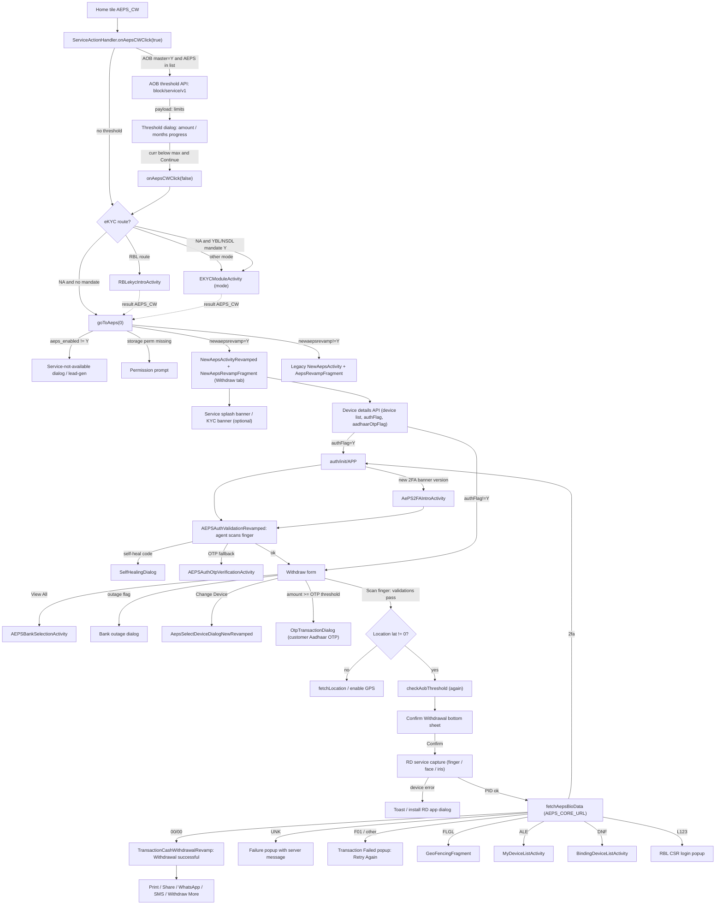

# 03 · AePS cash withdrawal

> **Confidence key:** ✅ confirmed in code · 🟡 inferred (naming, partial code) · ⬛ not visible in APK (backend, Flutter, partner SDK)

## Summary
- **Who / when:** Any adhikari (BC agent) with AePS enabled who pays out cash to a walk-in customer against the customer's Aadhaar-linked bank account. Customer authenticates with fingerprint, face or iris. This is the core "micro-ATM" money-out use case. ✅
- **Entry points:** Home tile `AEPS_CW` → `ServiceActionHandler.handle()` → `onAepsCWClick(true)` ✅. The same AePS screen opens for `AEPS_BE` (selected_item 2), `AEPS_MS` (4), `AEPS_CD` (6) and SHG (≥7), and the agent can switch between them using in-screen tabs ✅. Results returning from the eKYC screens come back through `ServiceActionHandler.handleResult()` (AEPS_CW → `aepsClicked(0)`) ✅. I found no caller of that method outside the class, so how the result is wired to the dashboard is 🟡.
- **Preconditions / gates (in order):**
  1. **Onboarding (AOB) threshold:** runs when `AOBThresholdMasterFlag=Y` and `AOBthresholdservice` contains `AEPS` ✅
  2. **eKYC mandate:** YBL or NSDL (`EKYC_MANDATE_YBL` / `EKYC_MANDATE_NSDL` = `Y|<resume>|<mode>`), or the RBL eKYC route (`RBL_EKYC_ROUTES`) ✅/🟡
  3. **Service flags:** `aeps_enabled=Y` and a non-empty `CSR_ID` ✅
  4. **Permissions:** storage permission below Android 13 ✅
  5. **Device / binding:** the server's device-details response returns the allowed device list and `authFlag` ✅
  6. **Daily agent 2FA:** agent biometric through `auth/init/APP` ✅
  7. **GPS location:** lat ≠ 0; mandatory when `AEPS_LOCATION_MANDATORY=Y` ✅
  8. **Bank outage check:** when `AEPS_OUTAGE_FLAG=Y` ✅
  9. **High-value check:** optional customer Aadhaar OTP when the amount is at or above `otpTxnAmount` and `aadhaarOtpFlag=Y` ✅
- **Successful outcome:** Agent sees "Withdrawal successful" with the amount, customer account balance, bank, masked Aadhaar, RRN and date/time. From there they can print (Bluetooth printer or PDF), share on WhatsApp or SMS, and use "Withdraw More". The agent's wallet is credited (balance refresh is triggered) ✅. Commission and settlement are server-side ⬛.

## Flow diagram

## Screen by screen
| # | Screen (class) | Layout | What the user sees | User action | API call(s) | Next → (condition) | Conf. |
|---|---|---|---|---|---|---|---|
| 1 | Home tile router `ServiceActionHandler.onAepsCWClick` | — (home) | Nothing yet; sets `AEPSConstants.q="CW"`, `serviceType="CW"` | Taps AePS Withdraw tile | `AOB_SERVICE_THRESHOLD + block/service/v1` (`https://aobapp.spicemoney.com/agentOnboarding4/ws/`), body `udf1=AEPS` (only when the threshold flags are on) | Threshold dialog (#2) or the eKYC gate (#3) | ✅ |
| 2 | AOB threshold dialog (`DashboardFragmentRevamp.showThresholdDialog`) | `aob_threshold_dialog` | Server-driven title/description, steps 1–2, note, and two progress bars: current vs max **amount** (₹) and current vs max **months** | Taps confirm | — | If curr < max on both bars: re-enters `onAepsCWClick(false)`. Otherwise the dialog just closes (blocked) | ✅ dialog / 🟡 wiring (the response handler for the threshold call is not in `ServiceActionHandler.onResult`; only `DashboardFragmentRevamp` and the AePS fragment render it) |
| 3 | eKYC gate: `RBLekycIntroActivity` or `EKYCModuleActivity` | (eKYC flows, see their own flow docs) | Mandatory eKYC intro/flow before AePS | Completes or skips eKYC | ⬛ (eKYC module) | Returns with `AEPS_SERVICE_NAME=AEPS_CW` → `handleResult` → `aepsClicked(0)` | ✅ routing / ⬛ screens |
| 4 | Service-not-available dialog (`serviceNotAvailable`) | common alert | Message from `AEPS_MESSAGE`. If `AEPS_LEAD=Y`, CTA = `AEPS_BUTTON_LEAD` text, which starts a lead-gen request | OK / lead CTA | `LEAD_GEN_REQUEST_API` (lead variant) | Browser or WebView with lead URL | ✅ |
| 5 | `NewAepsActivityRevamped` shell (flag `newaepsrevamp=Y`; else legacy `NewAepsActivity`) | `new_aeps_revamp_activity` | Header with overflow menu (Move to bank, Commission, Transaction history, Manage staff, DBT). Optional service splash image ("You can skip in N seconds") or `KycBannerDialog`. Optional Web-QR login strip | — | `AEPS_CORE_URL + rbl/initApp` (`https://aepsapp.spicemoney.com/aeps/`), `API_GW_URL + fetchVoiceFeature/v1`, `VOICE_ALERT + voice/plan` | Hosts the fragment (#6). If `CSR_ID` is empty: "Dear adhikari AePS (micro-ATM) is currently unavailable in your log-in. Please contact our customer care…" | ✅ (onResult not decompiled, so the initApp response handling is 🟡) |
| 6 | `NewAepsRevampFragment` – Withdraw tab | `new_aeps_revamped_fragment` (+ `revamp_edittext_aadhaar_vid`, `revamp_edittext_mobile_no`, `revamp_edittext_amount`, `new_aeps_revamp_authmode`) | Tabs **Withdraw / Mini Statement / Deposit / Balance Enquiry**. "Select bank" with 5 top-bank chips + "View All". "Aadhaar or VID Number" (QR-scan icon, eye toggle). "Mobile Number". "Amount to withdraw" with ₹500/1000/2000/5000 chips and "Initiate OTP" (conditional). One/two-finger choice (conditional). Aadhaar consent checkbox. "AUTHENTICATION MODE": Face Scan / Fingerprint / Eye Scan. Device row with "Change Device". CTA **"Scan finger"** (becomes "Scan face" or "Scan Eye") | Fills form, taps CTA | Device details (Retrofit `callDeviceDetailsAPI`, `serviceId=100`, `newrevamp=Y`; path ⬛). Bank list `AEPS_CORE_URL + bank/iin/list/app` 🟡 | Validations (#7). Then location check, AOB threshold re-check, Confirm (#12) | ✅ |
| 7 | Inline validation toasts (`onClick` R.id.btnStartCapture) | — | In order: "Please select Bank name". "Please enter valid Aadhaar or VID Number" (<12). "Please enter valid Customer Aadhaar Number" (Verhoeff fail). "Please enter valid VID number" (<16). "Please enter Customer Mobile Number" / "Please enter valid Customer Mobile Number". "Please enter amount". "Invalid Amount" (0). "Amount should be between {min} and {max}". Server-configured multiple-of message. "Please accept Aadhaar consent terms" | Corrects input | — | Back to #6 | ✅ |
| 8 | Daily agent 2FA intro `AePS2FAIntroActivity` | `activity_aeps2fa_intro` | "As per new NPCI guidelines, for every cash withdrawal transaction you have to confirm your identity". "On the first login, click on the AEPS tile and confirm your identity daily". FAQ section, "I understood" | Taps I understood | `AEPS 2FA AuthIntro FAQ` 🟡 | #9 | ✅ trigger / 🟡 internals (class not decompiled) |
| 9 | Agent 2FA `AEPSAuthValidationRevamped` | `aeps_bio_auth_validation_revamped` | Agent's own biometric: "Scan finger", "Change Device", auth-mode picker. **"Note: As per bank guidelines, ₹0.94 will be deducted for 2FA to use AEPS"** | Agent scans own finger/face | `AEPS_CORE_URL + auth/init/APP` (AEPS_AUTH_LOGIN when the device says `authFlag=Y`; AEPS_AUTH on a mid-transaction `2fa` code). Then Retrofit `fetchAepsAuthStatus` / `fetchAepsBioAuthData` (paths ⬛; dex has `auth/bio/APP`, `auth/status/app` 🟡) | Returns OK → #6 or retries the transaction (`callTransactionAPI(authReqId)`). Failure leads to #10, #11, YBL re-KYC or an alert | ✅ |
| 10 | Self-healing dialog `SelfHealingDialog` (via `SelfHealingUtil`) | `dialog_selfhealing_error` | Server-sent title/body/image, optional skip | CTA | — | `SH-TC` opens Android Date settings. `SH-RDI` opens the RD-service app/Play Store for the selected device (Mantra, SecuGen, Startek, Morpho, Precision, Tatvik, Evolute, Aratek, Next…). `SH-DC`: no-op | ✅ (only wired into 2FA screens, not into the customer transaction) |
| 11 | Agent 2FA OTP fallback `AEPSAuthOtpVerificationActivity` | ⬛ | OTP entry | Enters OTP | Retrofit `hitOtpInitAuth` / `hitOtpValidateAuth` (dex: `auth/otp/initiate/APP`, `auth/otp/val/APP` 🟡) | Back to #6 | 🟡 (class not decompiled) |
| 12 | Bank picker `AEPSBankSelectionActivity` (+ `AEPSAllBankListFragment`, `AEPSFavBankListFragment`) | `aeps_favbank_activity` | "Select bank", search, favourite and all-bank lists | Picks bank | Retrofit `markFavBanks` ⬛ | Back to #6 (requestCode 101). If `AEPS_OUTAGE_FLAG=Y`: outage check first | ✅ |
| 13 | Bank outage dialog (`showOutageDialog`) | — | "{bank}" + server outage message | Dismiss | Retrofit outage check (`FetchDeviceListViewModle.x`; dex has `bankOutage/check/v1` 🟡) | Agent picks another bank | ✅ / 🟡 path |
| 14 | Device picker `AepsSelectDeviceDialogNewRevamped` | `aeps_device_list_new_revamped` | "Select biometric device", "Currently Active", list (Mantra MFS100-L0 / MFS110-L1, Mantra MIS 100V2 iris, Morpho L0/L1, Precision PB510/PB1000, Startek FM220U L0/L1, Secugen, Tatvik, Evolute L0/L1/eScan L1, VisionTek V600 L1, Marc 11, Aratek, Next, Face scan), "Add new device" | Picks device | — | Back to #6; or `MyDeviceListActivity` / `BindingDeviceListActivity` (#20) | ✅ |
| 15 | High-value customer OTP `OtpTransactionDialog` | ⬛ (dialog) | Customer Aadhaar OTP entry; on success the form shows "✅ Aadhaar OTP captured" | Enters OTP | Retrofit `transactionOtp` / `validateOTP` ⬛ | Back to #6; OTP id is sent with the transaction | ✅ trigger / 🟡 dialog |
| 16 | Location gate (`openLocationDialog` / `fetchLocation`) | `permission_dialog` | Location permission or "enable GPS" prompts | Grants / enables | — | Re-tap the CTA | ✅ |
| 17 | Confirm sheet `NewAepsActivityRevamped.confirmCashWid` | `aeps_confirmation_dialog_new_aeps_revamp` | "Confirm **Withdrawal** of ₹{amt}". Bank logo. Mobile Number +91-xxxx. "Aadhaar Number" / "Virtual ID" masked (XXXX-XXXX-1234). Authentication Mode. "Play Voice Alert – Applies for this transaction only" toggle. Cancel / Confirm | Confirm | — | Biometric capture (#18). Two-finger popup (`useMultiFingerPrompt`) once when `AEPS_FINGER_ENABLED=Y` | ✅ (the decompiled CW/CD text branch looks inverted, so which copy shows is 🟡) |
| 18 | Biometric capture (external RD service app) | external | Vendor RD-service capture UI. Intents `in.gov.uidai.rdservice.fp.CAPTURE` / `…face.CAPTURE`; Evolute uses Bluetooth `Act_BTDiscovery` | Customer places finger / face / eye | — | PID returned → transaction (#19). Errors: "Device not connected,Please connect the device properly", "Device not registered,Please register the device", "RD Service information empty", "Device not Ready", "No RD Service Available", Morpho "not registered" / "open Morpho app and click Refresh" alerts, install-RD-app dialog (`check_mantra_rd_services`) | ✅ / ⬛ vendor UI |
| 19 | Processing (loader on fragment) | `loading_state` | Loader; CTA disabled for 2 s to stop double taps | — | Retrofit `fetchAepsBioData(headers, json)` on `AEPS_CORE_URL` with `newrevamp=Y`, `otpRequestId`, optional `authReqId`, `enType=GCM`. Exact path ⬛ (dex candidates `rbl/initiateAepsBuisApp`, `rbl/fetchAepsBuisApp` 🟡). A second leg exists: `fetchAepsLeg2BioData` 🟡 | Routed by `respCode` / `errorCode` (see Branches) | ✅ |
| 20 | Device binding `MyDeviceListActivity` / `BindingDeviceListActivity` | `my_device_list_aeps`, `activity_binding_device_list` | "No device found" / "Tap on Add new device…"; "Enter device ID", "Device ID is written on the back of your device", "Proceed to register" | Registers / binds device | `AEPS_CORE_URL + device/map/init/app`, `device/map/validate/app` 🟡 | Back to AePS | ✅ |
| 21 | Success `TransactionCashWithdrawalRevamp` | `trans_success_cash_withdrawal_revamp` | "Withdrawal successful", amount, "+ ₹x" earning, "Account Balance", bank, Aadhaar Number, RRN, Date & Time, "Customer Receipt". Optional "Earn ₹1 extra / You have won this reward for using QR code". "Your milestones". "Withdraw More". PRINT / Share / WhatsApp / SMS. History / Help / Home. "Facing issues! Raise complaint here". Banners (VIP, subsidy, 5pe5, survey, shop location) | Prints / shares / withdraws more / goes home | `AEPS_TOP_BANKS_URL + withdraw-more-money`, `WALLET_HISTORY_URL + historyService/download/history/pdf` (print PDF), `AEPS_CORE_URL + sendRemarks/app`, `AEPS_CORE_URL + divyang/form/upload/app`, `GRAHAK_APP_URL + account/submitQuestions` | Bluetooth printer (`DeviceListActivity`, `dialoge_printer`), `WithdrawMoreDialog`, `EarningDashboardActivity`, cross-sell to `FullPPIActivity`, `NSDLeKYCVerification`, `DoVideoKycActivity` (conditional) | ✅ |
| 22 | Failure / unknown popup `showBalDialog` | `new_aeps_revamp_failure_popup` | Header "Transaction Failed" + server message (default copy "Fingerprint not matched. Please ensure your finger and device lens are clean…"), "Retry Again" | Retry | — | Back to the form | ✅ |
| 23 | Geo-fencing `GeoFencingFragment` | `fragment_geo_fencing` | Title/message/solution list from prefs `GEO_FENCING_*`, "Okay" | Okay | — | Back to the form | ✅ |

## Branches, errors and edge states
- **Threshold blocked (AOB):** if current amount ≥ max or current month ≥ max, the dialog only dismisses and AePS does not open. The same check runs again inside the AePS screen before Confirm (`checkAobThreshold` → `NewAepsRevampFragment.showThresholdDialog`) · ✅
- **eKYC mandate:** `EKYC_MANDATE_YBL` = `Y|<resume>|<mode>`. Field 2 controls whether the app auto-resumes CW after eKYC: the service name is attached only when it is not `Y`. The NSDL variant works the same way. Edge case: `C1()` returns (true,true) when the pref has no `|`, but `hitEkycMandatePOPUp` then does nothing, so the tile tap would silently no-op · ✅ code / 🟡 real-world impact
- **RBL eKYC route** (`RBL_EKYC_ROUTES` contains `#AEPS#`) → `RBLekycIntroActivity` instead. `KotlinCommonUtilityKt.O0()` is partly mis-decompiled · 🟡
- **AePS disabled** (`aeps_enabled≠Y`) → service-not-available dialog, or lead-gen CTA if `AEPS_LEAD=Y` · ✅
- **Agent not provisioned** (`CSR_ID` empty) → "Dear adhikari AePS (micro-ATM) is currently unavailable in your log-in…" · ✅
- **Daily 2FA required:** the device-details response has `authFlag=Y`, which triggers `auth/init/APP`, then intro (only when the server banner version > local), then agent biometric. The transaction can also come back with `respCode=2fa`, which re-runs 2FA and then retries the transaction automatically with `authReqId` · ✅
- **2FA failure** → self-heal dialog (`selfHealCode`), YBL re-KYC (`YblRekycClass`) or a plain alert · ✅
- **Transaction response codes** (`NewAepsRevampFragment` observer around lines 5150–6260):
  - `respCode=00 && errorCode=00` → success screen (CW: `TransactionCashWithdrawalRevamp`) plus a voice confirmation of the amount ✅
  - `UNK` (unknown/pending) → the same red "Transaction Failed" popup with the server message. No status polling in this flow ✅
  - `F01` → failure popup ✅
  - `errorCode=FLGL` → geo-fencing sheet ✅
  - `errorCode=L123` → RBL CSR-ID/password login popup + toast "Default password is 1234" ✅
  - `isLogout=1 && respCode=AGRE` → failure popup with a callback ✅
  - `ALE` → opens My Devices ✅
  - `DNF` → opens device binding with `fromTransaction=true` ✅
  - `balU` flag → triggers a wallet balance refresh ✅
  - Fraud-management categories (`fmCategoryId` 3/4, `BlockingCats`) change the message handling 🟡
- **Amount rules:** min/max come from the server (`updateMinMaxAmount`). An optional multiple-of rule (`multipleCheck` = `Y|<n>|<msg>`) · ✅
- **High-value OTP:** amount ≥ `otpTxnAmount` and `aadhaarOtpFlag=Y` → "Initiate OTP" appears; the customer OTP is collected before the biometric · ✅
- **Face-only agents:** `faceOnly` flag from device details plus face-auth nudges (`FadAuthInitResponse.showFaceNudges`) · ✅
- **Location:** the CTA is blocked until lat ≠ 0. With `AEPS_LOCATION_MANDATORY=Y`, location is re-fetched on every transaction · ✅
- **Help:** a floating bot (`layBotFab`) opens SpiceBot with the last error code (e.g. `AEPS_UNK`, `AEPS_2fa`, `AEPS_BANK_OUTAGE`) · ✅
- **Legacy path** (`newaepsrevamp≠Y`): `NewAepsActivity` → `AepsRevampFragment` → `AEPSAuthValidation` → success `TransactionConfirmationEkyc` (CW) / `TransactionSummaryCD` (CD). Same gates, older UI · ✅ routing only
- **How BE / MS / CD differ from CW:**
  - **BE (tab 2):** no amount and no confirm sheet; goes straight from validation to capture. Result: `TransactionBalanceEnquirySuccess`. Can be disabled per tab via `AEPS_BAL_ENABLED` / `AEPS_BAL_MESSAGE`. UNK/F01 show a popup and a "Retry" event · ✅
  - **MS (tab 4):** like BE. Result: `TransactionMiniStatementSuccess`. Tile gate also checks `AEPS_MS_ENABLED`. Its eKYC resume name is `AEPS_MINI`, which `handleResult` does not match, so MS may not auto-resume after eKYC · ✅ / 🟡
  - **CD (tab 6):** has an amount and a "Confirm Deposit" sheet. Separate aggregator (`AEPS_CD_AGGRE`). Result: `TransactionCashDepositRevamp`. When the RBL eKYC route applies but `aeps_enabled≠Y`, the tile opens RBL eKYC with service `PPI` · ✅

## What we could not see
- The initApp, login and voice-feature responses in `NewAepsActivityRevamped.onResult` (jadx failed to decompile it), so splash, KYC banner and CSR-login logic from `rbl/initApp` is inferred.
- Retrofit interface paths for `fetchAepsBioData`, `fetchAepsLeg2BioData`, device details, auth status/bio, transaction OTP and outage. The `RetroUtils` / ApiManager interface is missing from the jadx output; only dex string candidates are listed above.
- `AePS2FAIntroActivity`, `AEPSAuthOtpVerificationActivity` and `AEPSDeviceSelectActivity` are in the manifest but were not decompiled.
- Server logic: limits, commission, routing aggregator (`receiptAggregator`), fraud categories, geo-fence rules, UNK reconciliation and reversal. Vendor RD-service screens.
- When the "Leg 2" bio call is used (likely 2-step / auth-then-debit for some aggregators) · 🟡

## To verify in live capture (phase 4)
- Tap AePS Withdraw on a fresh day: confirm the 2FA intro and agent scan appear before the form, and whether ₹0.94 is actually debited.
- With an AOB-limited (newly onboarded) agent: capture the threshold dialog copy and what the confirm button says.
- Enter an amount above the OTP threshold: does "Initiate OTP" appear, and at what amount?
- Force a timeout or unknown result: confirm it shows the red "Transaction Failed" header (misleading for a pending txn) and check where the agent can see the final status (overflow → Transaction history).
- Confirm sheet: verify the copy reads "Confirm Withdrawal" for CW (decompiled branch looks inverted).
- Withdraw tab with no device bound / unregistered Morpho: capture `ALE` / `DNF` routing.
- Check whether the eKYC-mandate prefs ever arrive without a `|` (silent no-op on tile tap).
- Success screen: Print (Bluetooth vs PDF), WhatsApp share content, Withdraw More options, cross-sell banners.

## Evidence
- `spice/mudra/newDashboard/utility/serviceHandling/ServiceActionHandler.java`: `handle()` (AEPS_CW → `onAepsCWClick(true)` ~l.2979), `onAepsCWClick` (l.1688), `hitThresholdApi` (l.458), `hitEkycMandatePOPUp` (l.854), `hitNSDLEkycMandatePOPUp` (l.905), `goToAeps` / `goToAeps$lambda$0` (l.320), `handleResult` (l.740), `aepsMinistatement` (l.147), `onAepsCDClick` (l.1540), `onAepsMSClick` (l.1799), `onResult` (l.2444)
- `spice/mudra/newDashboard/fragments/DashboardFragmentRevamp.java`: `showThresholdDialog` (l.10218), `showThresholdDialog$lambda$1` (l.10378), `onAepsCWClick` (l.13785)
- `spice/mudra/utils/KotlinCommonUtilityKt.java`: `C1()` (l.637), `B1()` (l.528), `O0()` (l.2560)
- `spice/mudra/aeps/newAepsRevamp/utility/AepsRevampUtility.java`: `c()` (flag `newaepsrevamp`)
- `spice/mudra/aeps/newAepsRevamp/activity/NewAepsActivityRevamped.java`: `onCreate`, `setupAepsFragment`, `aepsClicked`, `getAEPSData` (`rbl/initApp`), `getParamsforLogin` (`rbl/loginV1`), `confirmCashWid`, `lambda$confirmCashWid$41`, `fetchLocation`, `setupMenuClicks`
- `spice/mudra/aeps/newAepsRevamp/fragment/NewAepsRevampFragment.java`: `onClick` (btnStartCapture validations ~l.14328–14470; btn_otp_init l.13791; relBioDevice l.13900; tvViewBank), `attachObservers` + lambdas (device details / authFlag ~l.1300–1400; auth status ~l.1235), `authenticateAeps` (`auth/init/APP`), `moveFor2FAAuthentication` (l.12719), `checkAobThreshold` (l.10977), `proceedTran` (l.15104), `triggerToCapturePID` (l.17322), `startCapture*` (l.16877–17300), `callFetchAepsBioData` / `callTransactionAPI` (~l.9953), transaction observer (~l.5150–6260), `showBalDialog`, `openGeoFencingDialog`, `bankOutageService` (l.1437), `hitAmountOtpApi`, `onActivityResult` (l.12829)
- `spice/mudra/aeps/ViewModle/FetchDeviceListViewModle.java`: `l()` (fetchAepsBioData), `m()` (fetchAepsLeg2BioData), `j()` (fetchAepsAuthStatus), `k()` (fetchAepsBioAuthData), `g()` (callDeviceDetailsAPI)
- `spice/mudra/aeps/newAepsRevamp/activity/AEPSAuthValidationRevamped.java`: `SelfHealingUtil` call (~l.670), OTP fallback (~l.795)
- `spice/mudra/aepsSelfHealingUtil/SelfHealingUtil.java`, `SelfHealingDialog.java`; `defpackage/ht1.java` case 16 (SH-TC / SH-RDI / SH-DC)
- `spice/mudra/aeps/newAepsRevamp/activity/TransactionCashWithdrawalRevamp.java`: `onCreate` (layout `trans_success_cash_withdrawal_revamp`), withdraw-more, print/PDF, sendRemarks, divyang form
- `spice/mudra/aeps/newAepsRevamp/bottomsheets/AepsSelectDeviceDialogNewRevamped.java`; `spice/mudra/aeps/aepsrevamp/activity/AEPSBankSelectionActivity.java`; `spice/mudra/aeps/aepsdevicebinding/activity/{MyDeviceListActivity,BindingDeviceListActivity}.java`; `spice/mudra/aeps/fragments/GeoFencingFragment.java`
- Legacy: `spice/mudra/aeps/activity/NewAepsActivity.java`, `spice/mudra/aeps/aepsrevamp/fragment/AepsRevampFragment.java`
- Resources: `res/layout/{new_aeps_revamped_fragment,revamp_edittext_*,new_aeps_revamp_authmode,aeps_confirmation_dialog_new_aeps_revamp,new_aeps_revamp_failure_popup,activity_aeps2fa_intro,aeps_bio_auth_validation_revamped,aeps_device_list_new_revamped,trans_success_cash_withdrawal_revamp,aob_threshold_dialog}.xml`; `res/values/strings.xml` (`aeps_auth_note`, `with_suc`, `aeps_error`, validation strings); `utils/Constants.java` (`AEPS_CORE_URL`, `AOB_SERVICE_THRESHOLD`, pref keys)
