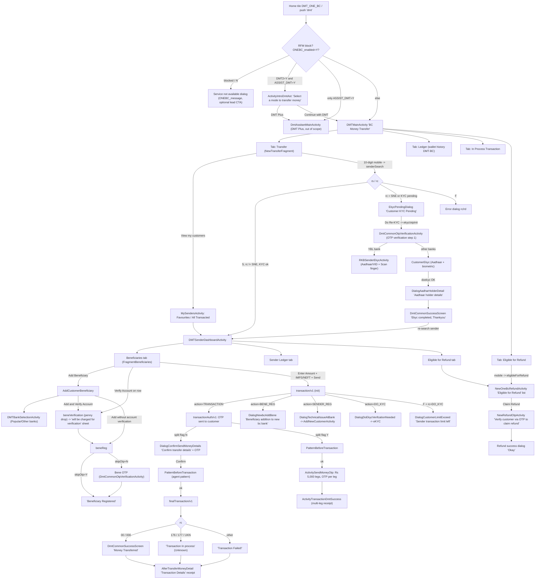
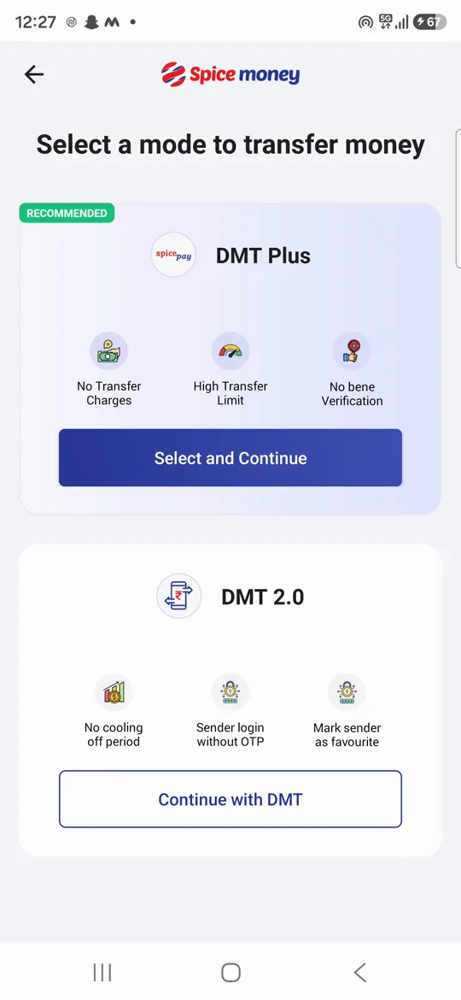
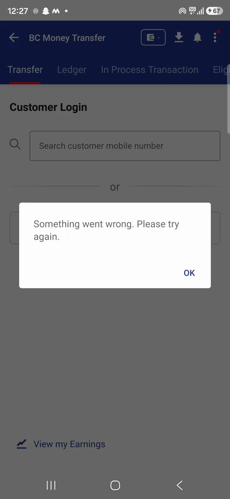
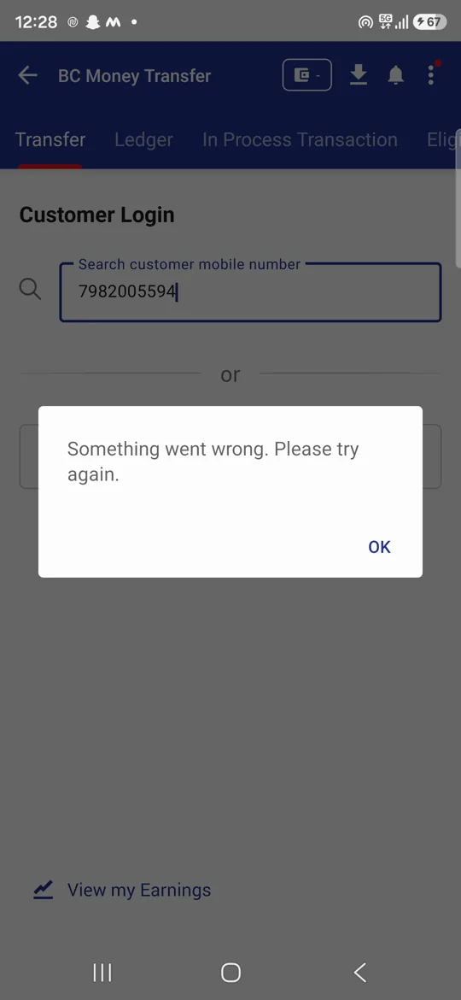

# 04 · Domestic money transfer (DMT)

> **Confidence key:** ✅ confirmed in code · 🟡 inferred (naming, partial code) · ⬛ not visible in APK (backend, Flutter, partner SDK)

## Summary
- **Who / when:** Any adhikari doing walk-in cash-to-account remittance. The adhikari takes cash from a customer (the "sender" or "remitter") and pushes IMPS or NEFT to a beneficiary's bank account. The adhikari earns a commission, and the debit comes from the adhikari's own wallet ("Adhikari cost"). The in-app product is called **"BC Money Transfer" / DMT 2.0**. It is a "One BC" front-end. The server picks which partner BC bank carries each customer (`configBc` / `bcModule`: YBL, RBL, NSDL, IBL, Fino, Federal…) ✅
- **Entry points:**
  - Home tile with service code `DMT_ONE_BC`, labelled "Money Transfer" ✅. `S00058` seems to fall through to the same handler 🟡 (jadx mangled the string switch).
  - Push or deep-link action `dmt` ✅
  - Generic in-app action `actType=DMT_ONE_BC` (banners and notifications) via `KotlinCommonUtilityKt.D1`. This path skips the variant chooser ✅
  - DMT is **not** handled by the new `ServiceActionHandler`. It still goes through the legacy switch in `DashboardFragmentRevamp.onDMtOneBcClick` ✅
- **Preconditions / gates:**
  1. **RFM risk block.** `DashboardActivityRevamp.needToStopSMA("DMT_ONE_BC")` reads the "phi" pre-home model and can stop the tile silently ✅
  2. **Service switch.** `ONEBC_enabled` must be `Y`. It is parsed from the tile's `homeServiceDtls` pipe string: `visibility|enabled|message|lead|leadButton|browserWeb`. Otherwise the app shows a "service not available" dialog with `ONEBC_message`, plus an optional lead CTA ✅
  3. **Variant flags.** `DMT2` and `ASSIST_DMT` come from a dashboard config key/value list ✅:
     - Both `Y` → chooser screen
     - Only `ASSIST_DMT=Y` → Assisted "DMT Plus" (a separate PPI-wallet product)
     - Otherwise → DMT 2.0 ✅
  4. **Money moves:** the adhikari's wallet balance (`cBal`) caps split transfers ✅. A biometric RD device is needed for customer eKYC ✅. The adhikari's Spice Money pattern is required before every transfer ✅
- **Successful outcome:** Money is sent to the beneficiary. The app shows a "Money Transferred" interstitial and then a receipt ("Transaction Details") with legs, charges and GSTN. The receipt has Share, Print (Bluetooth printer), WhatsApp and Download actions. There is an optional voice confirmation ✅

**Variants and what decides them**

| Package / class | What it is | Decided by |
|---|---|---|
| `dmt2_0` (DMTMainActivity…) | **Current DMT 2.0 / One BC** journey (this doc) | default, `ONEBC_enabled=Y` ✅ |
| `dmtassistant` (ActivityIntroDmtAst, DmtAssitantMainActivity…) | **"DMT Plus" / Assisted DMT**: a PPI-wallet-based full-KYC transfer product (`dmtppi/*` endpoints, Wibmo config) | `ASSIST_DMT=Y` (alone → direct; with `DMT2=Y` → chooser) ✅. It also has its own tile `ASSIST_DMT` ✅ |
| `onebcdmt` | Refund and "in-process" modules **inside** DMT 2.0 (tabs) | always present ✅ |
| `onebc` (OneBcRefundActivity → RefundOtpActivity) | Older refund screens; no launcher found in decompiled code | legacy 🟡 |
| `activity/accessdmtonweb` | Settings page that issues a code so the adhikari can use services on **adhikari.spicemoney.com** from a desktop | Settings → Account settings ✅ (it does not change the app flow) |
| `activity/TakeRefundActivity` (+Otp) | Refund of a customer's **PPI wallet balance** (`requestBy=PPI_REFUND`) | No launcher found → legacy or orphaned 🟡 |

## Flow diagram

## Screen by screen
| # | Screen (class) | Layout | What the user sees | User action | API call(s) | Next → (condition) | Conf. |
|---|---|---|---|---|---|---|---|
| 1 | Home tile → `DashboardFragmentRevamp.onDMtOneBcClick` | — | Tile "Money Transfer" (`money_transfer_label`, icon `nd_tile_money_transfer`) | Taps tile | none (flags come from earlier dashboard config) | Chooser (DMT2=Y & ASSIST_DMT=Y); DmtAssitantMainActivity (ASSIST_DMT=Y only); DMTMainActivity (else). Not-available dialog if `ONEBC_enabled≠Y`. Silent stop if RFM blocks | ✅ |
| 2 | `dmtassistant.ActivityIntroDmtAst` | `activity_intro_dmt_ast` | "Select a mode to transfer money" · "Now you can transfer upto ₹75,000/month". **DMT Plus** card ("RECOMMENDED"): "No Transfer Charges", "High Transfer Limit", "No bene Verification charges" → "Select and Continue". **DMT 2.0** card: "No cooling off period", "Sender login without OTP", "Mark sender as favourite" → "Continue with DMT". "Compare both products" | Picks a mode | DMT Plus side fetches Wibmo static config (FULLKYC_DASHBOARD) if not cached; "Data not found" toast if empty | DmtAssitantMainActivity or DMTMainActivity | ✅ routing / 🟡 which button maps to which card |
| 3 | `dmt2_0.DMTMainActivity` | `activity_dmtmain` | Title "BC Money Transfer"; wallet balance chip (`cBal`); notifications badge. Tabs: **Transfer · Ledger · In Process Transaction · Eligible for Refund** | Switches tabs | `GET initData/v1`; `POST fetchBanksList/v1` and `GET staticContent/v1`. The last two are cached and re-fetched only when versions in initData change. Base `https://dmtbc.spicemoney.com/commonbcdmt/ws/` | Tab fragments | ✅ (init call path 🟡) |
| 4 | `fragments.NewTransferFragment` (Transfer tab) | `fragment_new_transfer` (+`temp_down`) | "Customer Login" · field "Search customer mobile number". "View my customers". "Updates" outage strip ("Last Updated… Refresh"). MTD business cards ("DMT Business / Travel Union Business / Free DMT eligible Business – Month Till Date"). "View my Earnings". Offers carousel (if campaign flag). **"Add Customer" button is `invisible` and its click is a no-op** | Types a 10-digit mobile; search fires automatically on the 10th digit | `POST senderSearch/v1`; `POST bankOutageList/v1` | Sender dashboard (rs=S and rc≠`SNE`); EkycPendingDialog (rc=`SNE` or KYC pending); error dialog (rs=F/FL) | ✅ |
| 5 | `MySendersActivity` | `activity_my_senders` | "My Customers" with tabs **Favourites · All Transacted** | Picks a customer | `GET senderFav/v1`; `GET transactingSenders/v1` | Sender dashboard | ✅ |
| 6 | `bottomsheets.EkycPendingDialog` | `fragment_ekyc_pending_dialog` | "Attention · Customer KYC Pending · As per RBI guidelines, customers are required to complete KYC". Steps: "1 Validate Customer using OTP – Bank will send OTP to your customer mobile number"; "2 Aadhar verification using Biometric". Buttons "Cancel" / "Do Re-KYC" | Do Re-KYC | `POST ekyc/otpInit/v1` (or YBL: `…/paywsapp/bcRkb/sn/otp/init/v1`) | OTP screen | ✅ |
| 7 | `DmtCommonOtpVerificationActivity` (shared OTP screen) | `activity_dmt_common_otp_verification` | Stepper "1 OTP verification → 2 Customer eKYC"; "Enter OTP", "Submit", "Didn't get the OTP? Resend OTP" | Enters customer OTP | eKYC OTP validate; sender `senderValidateOtp/v1` / `senderResendOtp/v1`; bene `beneResendOtp/v1`; delete-bene `beneDeleteValidate/v1` | YBL → RKBSenderEkycActivity; others → CustomerEkyc; sender/bene reg → success screen | ✅ |
| 8 | `CustomerEkyc` / `RKBSenderEkycActivity` | `activity_customer_ekyc` / `rkb_sender_ekyc_activity` | "Customer Aadhaar Number", Aadhaar-consent checkbox ("I Accept to Aadhaar Consent"), "Change/Add device", "Skip". RKB variant offers Aadhaar / VID / UID-token entry and "Scan finger" | Scans the customer's finger on an RD device | `POST fetchWadh/v1` + `POST doekyc/v1` (YBL: `bcRkb/rdService/init/v1`) | DialogAadharHolderDetail ("Aadhaar holder details · Data received from UIDAI", Name/Gender/DOB/Address, "Proceed") → DmtCommonSuccessScreen "Ekyc completed, Thankyou" → sender re-searched → dashboard | ✅ (RKB final API 🟡) |
| 9 | `DMTSenderDashboardActivity` | `activity_sender_dashboard` | Sender header with ★ favourite toggle. Tabs **Beneficiaries · Sender Ledger · Eligible for Refund** | Taps star | `POST senderUnFav/v1` (action ADD/REMOVE) | Tab fragments | ✅ |
| 10 | `fragments.FragmentBeneficiaries` | `fragment_beneficiaries`, row `row_item_bank_detail_in_bene_sender_dashboard` | "Do eKYC" banner (benefits of eKYC); "Search Beneficiary"; list rows show bank, "Verified" or "Verify Account", "Enter Amount", payment-mode toggle (IMPS/NEFT), "Send"; empty state "No beneficiary added yet"; FAB "Add Beneficiary". Optional "₹2000 notes" count field (`twoknotesFeature`) | Enters amount, picks IMPS/NEFT, taps Send | `POST transaction/v1` with `msid, flag5k, beneId, txnAmt, remitMode, bcmd` | See branches 13–18 | ✅ |
| 11 | `AddCustomerBeneficiary` + `DMTBankSelectionActivity` | `activity_add_customer_benficiary`, `aeps_favbank_activity`, `fragment_dmt_all_banks` | "Add customer's beneficiary": Beneficiary Bank ("Select bank" → "Search a bank", "Popular banks", "Other banks"), Account Number, IFSC Code (+"View branch details"), Beneficiary Name. CTAs "Add without account verification" / "Add and Verify Account" | Fills form | `GET fetchIfscDetails/v1` (fires automatically at 11 chars); `POST beneReg/v1` | `skipOtp=Y` → "Beneficiary Registered"; `skipOtp=D` → silent validate with empty OTP; else → OTP screen (7) → success | ✅ |
| 12 | Penny-drop sheets: `DialogVerifyNewBeneAccountDisclaimer` → `DialogVerifyAccountAndAdd` | `newbene_desclaimsheet`, `bene_verified_sheet` | Bank/Name/Account/IFSC + "Charges" → Confirm. Result sheet: "… will be charged for verification", Transaction ID, Charges, Date Time, "Proceed" | Confirms the paid verification | `POST beneVerification/v1` | Proceed → `beneReg/v1`; rc `BENE_REG` on failure → auto beneReg; other failure → error | ✅ |
| 13 | Init outcome sheets | `dialog_addbene_sheet`, `bottom_sheet_technical_issue_at_bank`, `bs_do_ekyc_verfication_needed`, `bs_customer_limit_exceed` | `BENE_REG`: "Beneficiary addition to new bc bank – We need to register beneficiary on another BC bank to complete this transaction". `SENDER_REG`: "Oops! There seems to be a technical issue at BC bank" + customer name/mobile → Confirm. `DO_KYC`: Sender's Name / DOB / Gender → "Send OTP". Limit: "Sender transaction limit left ₹{aLmt}" → "Do eKYC" | Confirm | beneReg / senderReg / ekyc OTP | AddNewCustomerActivity (SENDER_REG); eKYC (DO_KYC / limit) | ✅ |
| 14 | `AddNewCustomerActivity` | `activity_add_new_customer` | "Add New Customer" · "Basic transfer limit for min-KYC customer will be ₹25000" · mobile, OTP, Name, DOB, Address, PIN Code (auto state/city), "Optional eKYC: Customer Aadhaar Number" → "Proceed" | Submits | `POST senderReg/v1` 🟡 (repository class not decompiled; only senderReg method fits); `POST pincode/v1` | OTP (7) → "Customer registered" → sender dashboard | ✅ screen / 🟡 API |
| 15 | `bottomsheets.DialogConfirmSendMoneyDetails` (single-transfer mode) | `bottom_sheet_confirm_send_money_details` | "Confirm transfer details" · "We have sent an OTP to customer on (+91) xxxxx" · Enter OTP / Resend. Beneficiary Bank, Name, Account, IFSC, Transfer mode, Customer Wallet. **Customer pays · Total Adhikari Cost · Adhikari commission** · "Powered by {bank}". Cancel / Confirm | Enters the customer's OTP, taps Confirm | `POST transactionAuth/v1` (authMode `OTP`, remitType `M`) was sent before the sheet opens | Pattern screen | ✅ |
| 16 | `dmt2_0.pattern.PatternBeforeTransaction` | base pattern activity | "Please your Spice Money pattern to proceed." (sic) · "Incorrect Pattern" toast · "Forgot Pattern" | Draws the adhikari's pattern | — | OK → `finalTransaction/v1` (single) or ActivitySendMoneyOtp (split). Too many attempts → returns error and no transfer. Forgot → logout to LoginActivity | ✅ |
| 17 | `DmtCommonSuccessScreen` → `AfterTransferMoneyDetail` | `activity_common_dmt_success_screen` → `activity_after_transfer_money_detail` | Status icon + title "Money Transferred" / "Transaction In process" / "Transaction Failed!"; after 1.5s auto-forwards to "Transaction Details": Powered by bank, Beneficiary Bank/Name/Account/IFSC, Transfer mode, Transaction ID, Date \| Time, GSTN Number, Customer Charges, "Your Money is SAFE!", Transaction legs, Note; Share / Print / WhatsApp / Download / Back to Home; VIP nudge + survey block | Prints or shares | `POST finalTransaction/v1` (`sid, txnId, bid, twoknotes, otp`) | Home | ✅ |
| 18 | `ActivitySendMoneyOtp` (split mode, `DMT_SPLIT_FLAG=Y`) | `activity_send_money_dmt` | "Confirm transfer details" with a stepper of ₹5,000 legs; per-leg CUSTOMER PAYS / ADHIKARI COST / COMMISSION; OTP per leg; "Confirm and Continue"; on error, a "Retry" dialog | Enters OTP for each leg | `transactionAuth/v1` + `finalTransaction/v1` per leg | All legs OK → "Money Transferred"; otherwise "Your bank has not confirmed this payment. Please check back the request status in 30 minutes" → `ActivityTransactionDmtSuccess` multi-leg receipt | ✅ |
| 19 | `onebcdmt.CommonUnknownFragment` (In Process tab) | `fragment_common_unknown` | List of unknown/pending DMT txns ("No Record found" if empty) | Views status | `POST fetchUnknownTrans/v1` | — | ✅ |
| 20 | `onebcdmt.RefundMobileFragment` → `NewOneBcRefundActivity` | `fragment_refund_mobile` → `activity_one_bc_refund`, row `item_onebc_refund` | "View customers eligible for refund transactions" · "Enter customer mobile no" · "View transactions" · "Most recent eligible" list. Detail list titled "Eligible for Refund", rows with "Claim Refund" / "Help" | Claim Refund | `POST eligibleForRefund/v1` | NewRefundOtpActivity | ✅ |
| 21 | `onebcdmt.NewRefundOtpActivity` | `activity_newrefund_otp` | "Verify customer via OTP to claim refund" · "Enter OTP below" · Submit · Resend · "Customer changed mobile number? Download Indemnity form" | Enters the customer OTP | `POST refundInit/v1`, `POST refundValidate/v1`. OTP is formatted per BC: FINO (encrypted), FEDERAL, BCYBL, BCRBL, BCNSDL, BCIBL. `otpskip=Y` skips the OTP | `refund_sucessfull_dialog` "Okay" | ✅ |
| 22 | Ledger / Sender Ledger tabs (`wallethistorynew.fragment.NewHistoryFragment(0,"DMT-BC")`) | not decompiled | DMT-filtered wallet history | Browse | ⬛ (shared history module; class missing from jadx output) | — | 🟡 |
| 23 | Legacy `TakeRefundActivity` → `TakeRefundOtpActivity` | `activity_take_refund`, `activity_take_refund_otp` | "Wallet Balance · Enter amount to refund · Submit" → "Verify customer via OTP to claim refund" | — | `…/paywsapp/bc/common/app/nu/sn/refundInit/v1`, `…/sn/refundValidate/v1` (`requestBy=PPI_REFUND`) | No launcher found in code | 🟡 |
| 24 | `accessdmtonweb.AccessDMTOnWebActivity` (Settings) | `activity_access_dmt_on_web` | "Access services on Web" · "Go to: adhikari.spicemoney.com · Click on: Service title you want to use on Web" · code + "Refresh Code" · Caution about untrusted browsers | Reads code | `POST ApplicationAuth/generatec/v1` | — | ✅ |

## Branches, errors and edge states
- **Service off or RFM block.** `ONEBC_enabled≠Y` → `serviceNotAvailable(ONEBC_message)`, with a lead button when `ONEBC_lead=Y`. An RFM block stops silently · `DashboardFragmentRevamp.serviceDmtNotAvailable` ✅
- **Response contract.** Every DMT 2.0 API returns `rs`:
  - `S` / `SU` = success
  - `F` / `FL` = failure, shown via a generic error dialog with `rc`/`rd`
  - `U` = unknown ✅
- **Sender not found (`rc=SNE`) or KYC pending.** No "register" form appears. The adhikari is pushed into **eKYC-first onboarding**: OTP → biometric → UIDAI details. The add-customer FAB is invisible and does nothing ✅. The manual `AddNewCustomerActivity` form only appears after the server says `SENDER_REG` (customer must be registered on another BC bank) ✅
- **eKYC partner split.** The eKYC OTP response from the YBL RKB endpoint routes to `RKBSenderEkycActivity`; everyone else goes to `CustomerEkyc` ✅
- **Amount rules (client side)** · `AdapterBeneficiaries.MyHolder` ✅
  - Empty → "cannot be empty". Below the minimum → "Amount can't be less than {amtMn|100}". Above the per-transfer maximum → "Amount can't be more than {amtMx|5000}".
  - In split mode: maximum 25,000, and "Amount can't be more than {wallet cBal}".
  - Split mode: amounts above ₹5,000 are cut into ₹5,000 legs. A leftover between ₹1 and ₹99 → toast "Please enter in multiples of 100" · `FragmentBeneficiaries.o0` ✅
  - `₹2000 notes` field: count must be ≤ ceil(amount/2000), with error text from `twoknotesText` ✅
- **Bank down (mode-level).** The bene has IMPS and NEFT both flagged down → toast "The bank is temporarily down". IMPS down while IMPS is chosen → confirm dialog to switch to NEFT (config text `impsOtgText`). NEFT down → toast (`neftOtgText`) · `FragmentBeneficiaries.W` ✅. Bene-level outage → `BankIssueDialog` · `FragmentBeneficiaries.N` 🟡 (which flag value means "down" is unclear)
- **Init (`transaction/v1`) actions:** `TRANSACTION` → OTP; `BENE_REG` → re-register bene on another BC; `SENDER_REG` → technical-issue sheet → add customer; `DO_KYC` → eKYC sheet. Failure with `rc=DO_KYC` → "Sender transaction limit left" sheet showing `aLmt` ✅
- **Final status mapping** (`finalTransaction/v1` rc) · `FragmentBeneficiaries` observer ✅:
  - `00`/`000` → Success "Money Transferred"
  - `176`/`177`/`UKN` → Unknown, shown as **"Transaction In process"**. `KotlinCommonUtilityKt.C0` rewrites "Unknown" copy to "In process"
  - anything else → "Transaction Failed!" (rd shown)
  - All three land on the same receipt screen
- **Pattern failure.** Cancel or over-attempt → no transfer, analytics "Pattern Error" ✅. Note that the customer OTP has already been consumed at this point, so a pattern failure after the OTP leaves an authorised-but-unsent txn on the server 🟡
- **Split partial result.** Any non-success leg makes the whole result read "Your bank has not confirmed this payment… check back in 30 minutes". That string is `upi_request_pending`, reused from UPI ✅
- **Beneficiary add OTP policy is server-driven:** `skipOtp` Y / D / N ✅
- **Refund OTP bypass:** `otpskip=Y` from the refund list skips straight to validate. "Customer changed mobile number?" → indemnity-form download ✅
- **Network errors.** No internet → "no_internet_title/message" alert. Generic → `something_wrong` ✅

## What we could not see
- Server logic choosing the BC bank (`configBc`, `bcModule`), sender limits (`aLmt`, `totLmt`, `amtMn`, `amtMx`), charges and commission, and the `skipOtp` / `otpskip` rules ⬛
- `senderReg/v1` call wiring (repository lambda not decompiled) 🟡. The ledger/history fragment (`wallethistorynew.NewHistoryFragment`) was not decompiled 🟡
- RD-service biometric capture internals and UIDAI responses (partner SDK) ⬛
- Whether `S00058` is a live tile code for DMT (string switch mangled) 🟡
- The full Assisted "DMT Plus" journey (`dmtassistant`, `dmtppi/*` endpoints): out of scope here, needs its own flow doc
- What launches legacy `TakeRefundActivity` and `onebc.OneBcRefundActivity`, if anything (no references found) 🟡

## To verify in live capture (phase 4)
- With an agent that has both `DMT2` and `ASSIST_DMT` = Y, confirm the chooser appears, and which card is "DMT Plus" versus "DMT 2.0".
- Search a new mobile number: confirm there is no registration form, only "Customer KYC Pending → Do Re-KYC", and that the OTP lands on the customer's phone.
- For a YBL-routed customer, check whether the RKB biometric screen differs from the standard CustomerEkyc.
- Try ₹12,000 with split on: expect legs 5,000 / 5,000 / 2,000 and one OTP per leg. Try ₹10,050: expect the "multiples of 100" toast.
- Confirm the pattern screen appears after the customer OTP and before money moves. Copy check: "Please your Spice Money pattern to proceed."
- Force a pending result: does the receipt show "Transaction In process", and does the txn appear in the "In Process Transaction" tab and later in "Eligible for Refund"?
- Bene verification: capture the verification charge shown and whether the wallet is debited even when the name mismatches.
- Check whether the "Add Customer" FAB is truly invisible in production.
- Settings → Access on web: confirm the code is generated and expires.

## Evidence
All paths are relative to the jadx `sources/` dir. † marks classes missing from the main jadx output (jadx ran out of memory). These were re-decompiled with `jadx --single-class` from `classes7.dex` / `classes8.dex` into the scratchpad (`flow04/out7`, `flow04/out8`, `flow04/outA`).
- `spice/mudra/newDashboard/fragments/DashboardFragmentRevamp.java` — `onDMtOneBcClick` (~L15023: ONEBC_ENABLED, FROM_DMT_ENABLE/`DMT2`, FROM_DMT_AST_ENABLE/`ASSIST_DMT`), `serviceDmtNotAvailable` (~L9166), `goToDmtAstMain`, `navigateToAssistedDMTMain`, tile switch cases `DMT_ONE_BC` / `S00058` / `ASSIST_DMT` (~L2589, 2947, 3790)
- `spice/mudra/newDashboard/activity/DashboardActivityRevamp.java` — DMT_ONE_BC tile parsing (~L8282: ONEBC_visibility/enabled/message/lead/browser), config key parsing `DMT_SPLIT_FLAG` / `ASSIST_DMT` / `DMT2` (~L13025), push action `dmt` (~L1370, 2343, 21877), `needToStopSMA`
- `spice/mudra/utils/KotlinCommonUtilityKt.java` — `D1` (actType DMT_ONE_BC → DMTMainActivity), `C0` (Unknown → "In process" copy map)
- `spice/mudra/utils/Constants.java` — `BASE_URL_FOR_DMT2_0`, `DMT2_0_*` paths (L1999–2041), `DMT_AST_BASE_URL`, `YBL_RKB_CORE_URL`, `SPICEMONEY_CORE_URL`
- `spice/mudra/network/ApiInterface.java` † — Retrofit paths for searchSenderByNumber, initTransaction, otpInitiate, finalTransaction, beneVerification, initNewBene, initNewSender, newfetchRefund, newInitref, newValref, fetchUkn, hitGenerateCode
- `spice/mudra/dmt2_0/DMTMainActivity.java` + `DMTMainActivity$initViews$2` † (tabs)
- `spice/mudra/dmt2_0/fragments/NewTransferFragment.java` — sender-search observer (~L205–290), `m0` (eKYC OTP init), `initViews` (auto-search on 10 digits)
- `spice/mudra/dmt2_0/dmtconstants/DmtConstants.java` (+ `defpackage/kh1.java`, `ic1.java`) — rs codes S/SU/F/FL/U, rc `SNE`, IMPS/NEFT keys
- `spice/mudra/dmt2_0/viewmodels/DmtBaseViewModel.java`, `DMTMainViewModel.java` (`x` click map: My customers, Earnings), `DMTSenderDashboardViewModel.java` (o–w → APIs), `DMTCustomerEkycViewModel.java` (`o` → doekyc)
- `spice/mudra/dmt2_0/DMTSenderDashboardActivity.java` + `$initViews$4` † (tabs, favourite)
- `spice/mudra/dmt2_0/fragments/FragmentBeneficiaries.java` — init-action switch (~L800–900), final rc mapping (~L1040–1300), OTP-init → confirm sheet (~L1548–1640), `W` (IMPS/NEFT outage), `N` (verify), `o0` (split + init payload), `j0` / `k0` (pattern, split OTP)
- `defpackage/i71.java` case default (~L815) — pattern result → finalTransaction or split screen
- `spice/mudra/dmt2_0/adapters/AdapterBeneficiaries.java` — amount validation
- `spice/mudra/dmt2_0/AddCustomerBeneficiary.java` — `J0` (beneReg), skipOtp switch (~L236), `H0`, `N0`, IFSC auto-lookup (~L3430)
- `spice/mudra/dmt2_0/AddNewCustomerActivity.java` — registration payload (~L1380)
- `spice/mudra/dmt2_0/DmtCommonOtpVerificationActivity.java` — YBL → RKBSenderEkycActivity routing
- `spice/mudra/dmt2_0/CustomerEkyc.java` — `D0`, `l0`
- `spice/mudra/dmt2_0/bottomsheets/*` — EkycPendingDialog, DialogCustomerLimitExceed, DialogTechnicalIssueAtBank, DialogNewbcAddBene, DialogVerify*, DialogConfirmSendMoneyDetails †
- `spice/mudra/dmt2_0/pattern/PatternBeforeTransaction.java` †, `ActivitySendMoneyOtp.java` †, `DmtCommonSuccessScreen.java` † + `defpackage/hh1.java` † (DMTTRANSFER → AfterTransferMoneyDetail / ActivityTransactionDmtSuccess)
- `spice/mudra/dmt2_0/AfterTransferMoneyDetail.java` (receipt, printers)
- `spice/mudra/onebcdmt/RefundMobileFragment.java`, `NewOneBcRefundActivity.java`, `OneBcViewModel.java`, `NewRefundOtpActivity.java` †, `CommonUnknownFragment.java` †
- `spice/mudra/activity/TakeRefundActivity.java`, `TakeRefundOtpActivity.java` † (PPI_REFUND)
- `spice/mudra/activity/accessdmtonweb/AccessDMTOnWebActivity.java` †; launched from `newDashboard/activity/AccountSettingActivity.java` (~L1423) and `NewDashboardSetting.java` (~L105)
- `spice/mudra/dmtassistant/activity/ActivityIntroDmtAst.java` †, `DmtAssitantMainActivity.java` †
- Layouts and strings: `apktool/res/layout/*.xml` listed above; `res/values/strings.xml`

## Live capture (phase 4, staging, 13 Oct 2026)
Full notes: [captures/live](../captures/live/README.md).

| Step | Live result | Capture |
|---|---|---|
| Chooser | "Select a mode to transfer money". **DMT Plus** (RECOMMENDED): No Transfer Charges, High Transfer Limit, No bene Verification. **DMT 2.0**: No cooling off period, Sender login without OTP, Mark sender as favourite ✅. A staging error dialog appears on load |  |
| BC Money Transfer | Tabs: Transfer, Ledger, In Process Transaction and more. Customer Login search, "View my customers", "View my Earnings" |  |
| Sender lookup | Fires automatically at 10 digits → "Something went wrong. Please try again." on staging |  |

Not yet captured: sender eKYC, beneficiaries, pre-transfer check, confirmation, receipt. These need the staging DMT backend.
