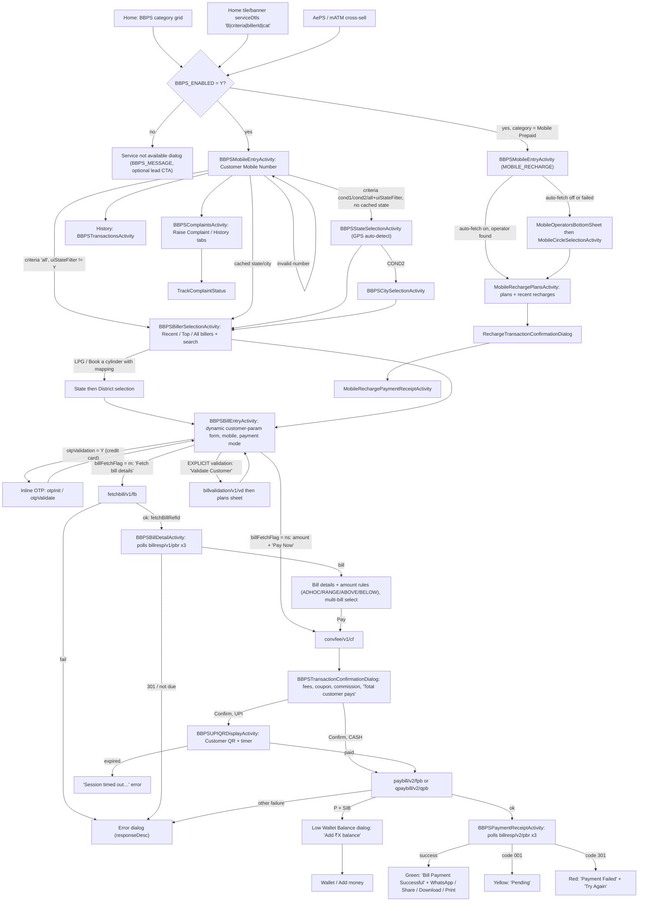
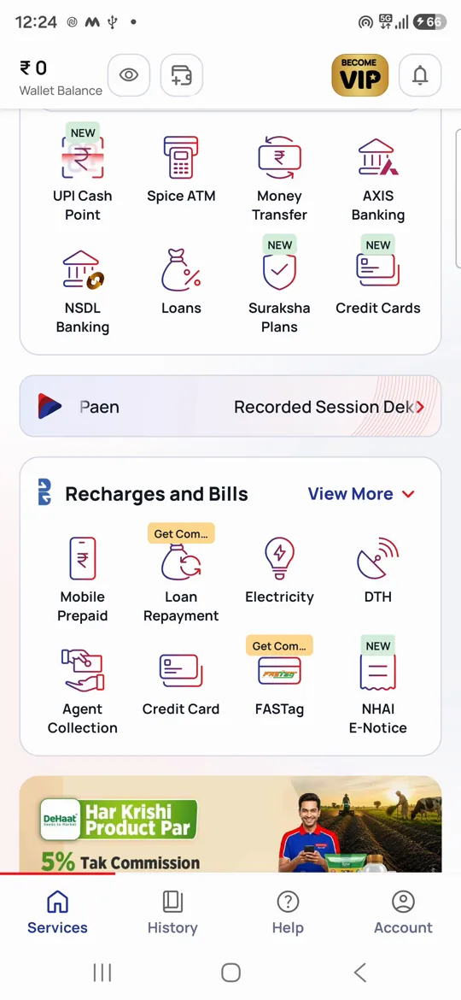
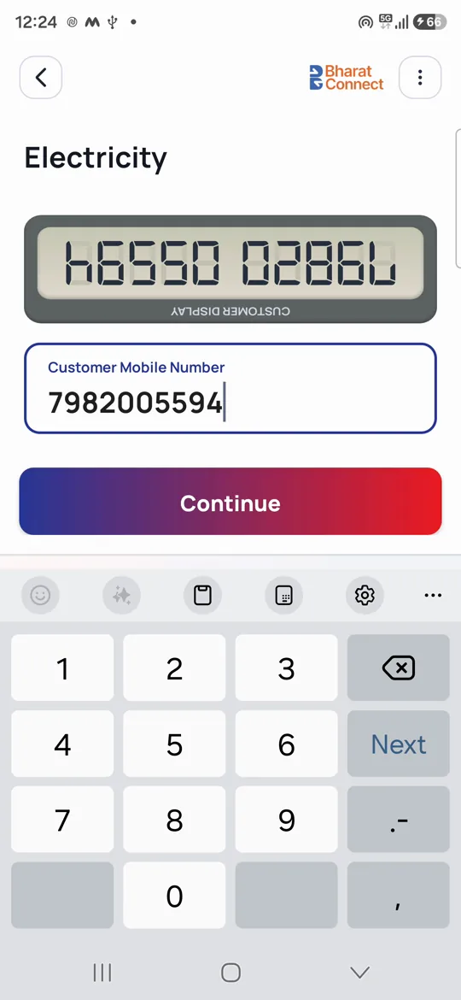
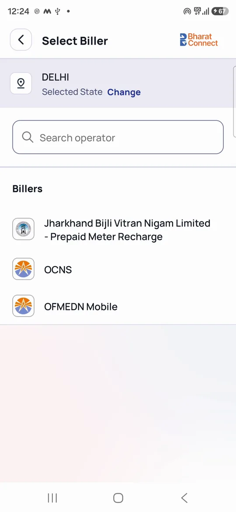
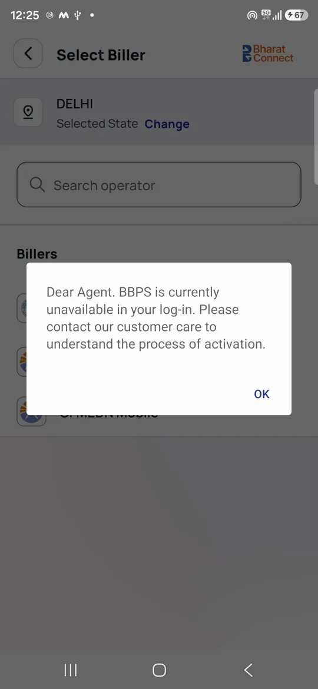

# 05 · Bill payment (BBPS)

> **Confidence key:** ✅ confirmed in code · 🟡 inferred (naming, partial code) · ⬛ not visible in APK (backend, Flutter, partner SDK)

> **Decompilation note:** jadx ran out of memory on the main pass. Several screens in this flow (`BBPSStateSelectionActivity`, `BBPSCitySelectionActivity`, `BBPSDistrictSelectionActivity`, `BBPSTransactionsActivity`, `BBPSBillPaymentPlansActivity`, `SearchTransactionActivity`, `WebviewActivityBbps`, `RechargeTransactionSummary`, `spice.mudra.network.ApiInterface`) were missing. They were re-decompiled one class at a time from `classes7.dex`/`classes8.dex` into the scratchpad (`jadx_extra/`). Evidence paths for those classes are marked *(extra)*.

## Summary
- **Who / when:** Any adhikari with the BBPS service turned on collects a walk-in customer's utility, FASTag, loan EMI, credit-card, LPG, DTH or other bill. The customer usually hands over cash, and the adhikari's Spice wallet is debited (CASH mode). If the adhikari is onboarded for UPI collection, the customer can instead scan a UPI QR. Mobile prepaid recharge uses the same front door.
- **Entry points:**
  - A BBPS category grid on the home fragment (`DashboardFragmentRevamp.onBBPSOptionSelectedListener`). ✅
  - Any configurable home tile or banner whose `serviceDtls` is `B|<criteria>|<billerId>|<categoryName>` (`ServiceActionHandler.handle` fallback; banner action `BBPS` in `DashboardFragmentRevamp`). ✅
  - The AePS / mATM post-transaction cross-sell (`NewAepsActivityRevamped`, `SpiceATMRevampActivity` call `CommonUtility.P0`). ✅
  - Re-entry from the receipt via "New Bill", which reopens the cached category (`DashboardActivityRevamp.handleBBPSResult`). ✅
  - Notifications with action `MOBILE_PREPAID` (recharge only). ✅
  - Every path ends in `CommonUtility.P0/Q0` → `BBPSMobileEntryActivity` (type `BBPS`), or `CommonUtility.y` → `BBPSMobileEntryActivity` (type `MOBILE_RECHARGE`). ✅
  - There is **no dedicated `S000xx` / `BBPS` case in `ServiceActionHandler.handle`'s switch**. BBPS tiles only work through the `B|…` serviceDtls convention. ✅
- **Preconditions / gates:**
  - **Feature flag:** home-service `BBPS` details `visibility|enabled|message|lead|buttonLead|browserWeb` are stored as `BBPS_VISIBILITY/BBPS_ENABLED/BBPS_MESSAGE/BBPS_LEAD/...` (`DashboardActivityRevamp` ~L8028). If `BBPS_ENABLED≠Y`, a "service not available" dialog shows the server message, with a lead CTA if `BBPS_LEAD=Y`. ✅
  - **Recharge:** the `RECHARGE_ENABLED/RECHARGE_LEAD/RECHARGE_MESSAGE` flags apply in the same way. ✅
  - **Training gate disabled:** a Spice Academy "certificate required" gate exists but is hard-wired off (`boolean z2 = true; … && !z2`). ✅
  - **Biller metadata:** categories and biller metadata are cached locally from `fetchmdmcategories` / `fetchbillermdm`, with version check `catVer`. ✅
  - **Location:** optional; used to auto-pick the state. ✅
  - **Bluetooth printer:** optional, for printing the receipt. ✅
- **Successful outcome:** a "Bill Payment Successful" receipt carrying the B-Connect Txn ID and the Approval/Biller reference no. The adhikari's wallet is debited by bill amount + customer convenience fee/platform fee − instant commission. The receipt can go out by WhatsApp, Share, PDF download or Bluetooth print. ✅

## Flow diagram

## Screen by screen
| # | Screen (class) | Layout | What the user sees | User action | API call(s) | Next → (condition) | Conf. |
|---|---|---|---|---|---|---|---|
| 1 | Home BBPS grid (`DashboardFragmentRevamp`) / configurable tile (`ServiceActionHandler.handle`) | home layouts | Category icons (Electricity, FASTag, DTH, LPG "Book a cylinder", Loan Repayment, Credit Card, Water, Broadband, Insurance, NHAI e-notice …, from server category MDM) | Taps a category | `bbpsservices/fetchmdmcategories/1.0/APP/{clientId}`, `bbpsservices/fetchbillermdm/1.0/APP/{clientId}` (cached, refreshed on `catVer` change) | Screen 2 (if `BBPS_ENABLED=Y`); recharge sub-flow R1 (if "Mobile Prepaid" and `RECHARGE_ENABLED=Y`); "service not available" dialog otherwise | ✅ |
| 2 | `BBPSMobileEntryActivity` (type BBPS) | `activity_bbps_mobile_entry` | Title = category display name (e.g. "FASTag", "Book a cylinder", "Insurance Premium"); input "Customer Mobile Number"; a 7-segment "digital" panel **rotated 180°** that mirrors the number so the customer across the counter can read it; promo strip "Enjoy zero convenience fee on recharges 👍"; cards Earnings ("Track Daily, Weekly, and Monthly Business Growth"), Commissions, History, Help, Complaints ("Raise and view Complaints status"), Bill Reminders; CTA "Continue" (disabled until 10 digits starting 6–9) | Types number → Continue | none (local routing) | Screen 3 or 4, by biller `selectCriteria` and cached state/city (see Branches) | ✅ |
| 3 | `BBPSStateSelectionActivity` *(extra)* | `activity_bbps_area_selection` | "Current location", state list, "No States Found" | Picks a state, or GPS reverse-geocodes `getAdminArea()` and auto-selects | none (local MDM) | `BBPSCitySelectionActivity` (criteria `COND2`); `BBPSDistrictSelectionActivity` (LPG with district mapping); else Screen 4 | ✅ |
| 3a | `BBPSCitySelectionActivity` / `BBPSDistrictSelectionActivity` *(extra)* | `activity_bbps_area_selection` (🟡 shared) | City or district list | Picks one | none | Screen 4 / Screen 5 | 🟡 |
| 4 | `BBPSBillerSelectionActivity` | `activity_bbps_biller_selection`, `item_bbps_biller`, `item_bbps_recent_biller` | "Select Biller"; "Selected State" + "Change"; search "Search an operator"; sections "Recent Billers", "Billers"; "Load more"; "NEW" badge; empty "No biller found" | Taps a biller | `bbpsservices/fetchtopbillers/1.0/APP/{clientId}` (top/recent); `fetchbillermdm` only if the local DB is empty | Screen 5; for LPG with state mapping → State then District selection | ✅ |
| 5 | `BBPSBillEntryActivity` | `activity_bbps_bill_entry` | Biller logo/name, "Change"; "Customer Details"; optional "Select consumer details you have" (param groups) or "Enter Customer Vehicle Registration Number" (NHAI); **dynamic fields** built from biller params (text, date picker, dropdown/autocomplete, sample-bill image); optional "Remitter Name"; "Customer Mobile Number" (pre-filled; "Bill Receipt will be sent on … Change"); biller disclaimer/notes; "Payment Mode": Cash / UPI; commission-slab and instant-cashback banner; "Get certified"; CTA text depends on biller (see Branches) | Fills params → CTA | `bbpsservices/fetchautofilldata/1.0/APP/{clientId}` (if biller `autofillFlag=Y`); UPI-eligibility check; instant-commission slabs (`commision-cashback/api/instant/commissionSlabs`) | 6 (fetch billers); 9 (no-fetch billers); 5b (plans/validation); 5a (OTP) | ✅ |
| 5a | Inline OTP section in `BBPSBillEntryActivity` | same | "Enter OTP", "Verify", "Resend OTP", declaration checkbox ("Please accept the declaration") | Sends/validates OTP | `bbpsservices/otpInit/1.0/APP/{clientId}`, `bbpsservices/otpValidate/1.0/APP/{clientId}`; `otpId` is then passed to fetch/pay | back to 5 | ✅ |
| 5b | `FetchPlanBbpsValidationActivity` / `BBPSBillPaymentPlansActivity` *(extra)* | `activity_bbps_bill_payment_plans`, `fragment_bbps_payment_plans` | Plan list bottom sheet ("See More Plan >>", "Select Plan") for subscription/plan billers; "Validate Customer" CTA for `billValidationImplType=EXPLICIT` billers, then additional-info text and "Pay Now" | Picks plan / validates | `bbpswsapi/app/ws/billvalidation/v1/vd`; `bbpsservices/fetchplansmdm/1.0/APP/{clientId}` | back to 5 with `valRefId`/plan → 9 | ✅ |
| 6 | Bill fetch (loading on 5) | progress dialog | "Getting Bill, Please wait!" | — | `bbpswsapi/app/ws/fetchbill/v1/fb` (billerParam, customerMobileNo, paymentMode, otpId, responseType SYNC) | Screen 7 with `fetchBillRefId`; error dialog with `responseDesc`; logout on `099` | ✅ |
| 7 | `BBPSBillDetailActivity` | `activity_bbps_bill_detail`, `item_multiple_bill_card`, `item_nhai_multiple_bill_card` | Customer Name, Customer Mobile Number, Bill Number, (Vehicle number / Vehicle Class / Company for FASTag/NHAI), "Bill Amount", editable "Amount" with "Minimum Allowed"/"Maximum Allowed", "View More" bill details, multi-bill cards (select bills, per-bill EMI amount), "PAYMENT MODE" Cash/UPI, "Total Payable", CTA "Pay" (or "Generate QR" in UPI mode) | Adjusts amount within rules → Pay | Polls `bbpswsapi/app/ws/billresp/v1/pbr` up to 3× with delays from `BBPS_API_DELAY_SECONDS` (default 20 s each) | Screen 8; error/"not due" dialog → back | ✅ |
| 8 | Convenience-fee fetch | progress | (spinner) | — | `bbpswsapi/app/ws/convfee/v1/cf` (BBPS billers); `bbpsservices/custconvfees/1.0/APP/{clientId}` (older path) | Screen 9; error dialog | ✅ |
| 9 | `BBPSTransactionConfirmationDialog` (bottom sheet) | `bbps_transaction_confirmation_dialog` | "Confirm bill payment of ₹X"; "APPLY COUPON"/"Coupon Code"; Mobile Number; Payment Mode; Bill Amount; "Biller Platform Fee (Digital Fee)"; "Customer convenience fee" (CCF, editable) + "View CCF Slab"; "Retailer Commission"; "Gst Charges"; "Coupon Cashback"; NHAI rows (E-Notice Number, Plaza Name, Vehicle number); "Enable for all future payments"; "Total customer pays"; "Confirm" | Optionally applies coupon or edits CCF → Confirm | coupon list fetch; `bbpswsapi/app/ws/updtsettings/v1/us` (if "Enable for all future payments" ticked) | CASH → 10; UPI → 11 | ✅ |
| 10 | Payment processing (on 5 or 7) | progress / `activity_bbps_upi_processing_payment` | "Processing payment, Please wait!" | — | Fetched bill: `bbpswsapi/app/ws/paybill/v2/fpb`. No-fetch ("Quick Pay"): `bbpswsapi/app/ws/qpaybill/v2/qpb` (amount, custConvFee, couponCode, billerParam, ccfTransFlag, otpId, pgOrderId for UPI). Non-BBPS biller: `bbpswsapi/app/ws/recharge/v1/rch` | Receipt 12; Low-wallet 10a (`P`+`SIB`); error dialog; logout (`099`) | ✅ |
| 10a | `BBPSLowWalletBalanceDialog` | `dialog_bbps_low_wallet_balance` | "Low Wallet Balance"; "Add ₹{shortfall} to your wallet to complete this payment."; CTA "Add ₹{shortfall} balance"; "Cancel" (shortfall = total − balance returned by the server) | Add balance | — | Wallet screen (`WalletRevampUtility.b()`); refreshes balance on return | ✅ |
| 11 | `BBPSUPIQRDisplayActivity` | `dialog_bbps_upi_qr_display` | "Customer QR", "Bill Amount", countdown timer (`expiryTimeMins` from server), "Download", "Share", "check your payment status here", "Checking payment status..."; back → "Confirm Exit / Are you sure you want to go back? Your payment process will be interrupted." | Customer scans and pays | `bbpsservices/upi/generateQr/1.0/APP/{clientId}`, `bbpsservices/upi/txnStatusChk/1.0/APP/{clientId}` | Paid → processing dialog → pay call (10) with `pgOrderId`; expired → "Session timed out. Please generate a new QR code to continue." | ✅ (QR→pay hand-off 🟡) |
| 12 | `BBPSPaymentReceiptActivity` (processing state) | `activity_bbps_bill_payment_receipt` | "Processing Payment / Please do not close this page" | — | Polls `bbpswsapi/app/ws/billresp/v2/pbr` up to 3× (`BBPS_API_DELAY_SECONDS`) | 12a/12b/12c | ✅ |
| 12a | Receipt – success | same | Green header "Bill Payment Successful", amount "Inc all taxes"; Details: Loan Number / Customer Name / Mobile / **B-Connect Txn ID** / Biller ID / **Approval/Biller reference no** / Consumer ID / Payment Mode / Payment Channel / Bill Number / Bill Date / Bill amount / Conv. Fee / Platform Fee / Total; "Adhikari BBPS ID & Name"; "Bills Breakdown"; "Customer Receipt": WhatsApp (Free) / Share / Download / Print; "Send receipt via Whatsapp"; "Repeat Bill"; bottom bar "New Bill / History / Help / Home"; milestone rewards card; voice confirmation; rate-us/survey | Shares/prints/new bill | `bbpsservices/...milestone` (if `BBPSMILESTONE_VISIBILITY=Y`) 🟡 | Dashboard → re-opens Screen 2 ("New Bill"); History | ✅ |
| 12b | Receipt – pending | same | Yellow header "Pending" (responseCode `001`); share hidden | Check later in History | — | History | ✅ |
| 12c | Receipt – failed | same | Red header "Payment Failed"; share hidden; CTA "Try Again" (responseCode `301`) | Try again | — | Bill entry | ✅ |
| 13 | `BBPSTransactionsActivity` *(extra)* → `BBPSTransactionDetailActivity` | `new_bbps_passbook_layout`, `bbps_transaction_detail_activity` | "All Transactions" list with date range and category filters (`ActivityBbpsCatFilters`); detail with invoice PDF and Bluetooth print; repeat-payment shortcut | Filter / open / repeat / print | `bbpsservices/fetchtranshistory/1.0/APP/{clientId}`; `FETCH_PDF_BBPS_API` | Detail; repeat → recharge (`CommonUtility.y`) or BBPS entry | ✅ |
| 14 | `BBPSComplaintsActivity` → tab "Raise Complaint" (`RaiseComplaintFragment`) | `bbps_complaint_layout`, `transaction_based_complaint` | Title "BBPS Complaints"; tabs "Raise Complaint" / "History"; "My complaint is Transaction based"; "Please enter B-Connect Txn ID", "Don't remember?" (→ `SearchTransactionActivity`), complaint-type spinner, "Description", "Customer Mobile Number", "Proceed" | Submits complaint | `bbpsservices/ticketraise/1.0/APP/{clientId}`; txn lookup via `fetchtranshistory` | Complaint ID / result | ✅ |
| 15 | Tab "History" (`TransactionHistoryFragment`) → `TrackComplaintStatus` / `AllComplaintResultActivity` | `all_complaint_layout`, `track_complaint_layout` | Complaint list; detail "Related to / Issue / Description", "TRACK STATUS" | Track | `bbpswsapi/app/ws/cmphistory/v1/cmph`, `cmplntstatus/v1/cs`, `cmplntresponse/v1/cr` (polled) | — | ✅ |
| R1 | `BBPSMobileEntryActivity` (type MOBILE_RECHARGE) | `activity_bbps_mobile_entry` | Same screen, title "Mobile Recharge" | Enters number → Continue | `bbpsservices/fetchoperator/1.0/APP/{clientId}` (only if `KEY_RECHARGE_OPERATOR_AUTO_FETCH_ENABLED=Y`) | Operator + circle found → R3; else R2 | ✅ |
| R2 | `MobileOperatorsBottomSheet` → `MobileCircleSelectionActivity` | `activity_mobile_recharge` (🟡) | Operator list, then circle list | Picks operator and circle | `bbpsservices/fetchautofilldata/1.0/APP/{clientId}` (circles) | R3 | ✅ |
| R3 | `MobileRechargePlansActivity` | `activity_mobile_recharge_plans` | "Select Plan", "Recent Recharges", plan tabs, search "Search a plan, eg 299 or 28 days", "No plans found", tariff disclaimer | Picks a plan | `bbpsservices/fetchplansmdm/1.0/APP/{clientId}` | R4 | ✅ |
| R4 | `RechargeTransactionConfirmationDialog` | `recharge_transaction_confirmation` | "Confirm Payment of ₹X"; Operator / Validity / Data / Details; "PAYMENT MODE" Cash/UPI; "Change Plan" | Confirm | BBPS operator: `qpaybill/v2/qpb` then `billresp/v2/pbr` poll; non-BBPS: `recharge/v1/rch`; UPI via QR as in 11 | R5; Low-wallet dialog on `P`+`SIB` | ✅ |
| R5 | `MobileRechargePaymentReceiptActivity` | `activity_mobile_recharge_payment_receipt` | "Recharge Successful", "Recharge credit can take up to 10 minutes. Look in History for the final status."; Transaction ID, Biller ID, Consumer ID, Payment Mode, Bill category; share / WhatsApp / download / print; "Recharge / History / Help / Home" | — | — | — | ✅ |

## Branches, errors and edge states
- **Mobile-number validation (Screen 2):** shows "Enter customer mobile number" when empty, "Please enter a valid 10 digit mobile number" when short, and "Mobile number must start with 9, 8, 7, or 6 (cannot start with 0)" for a bad prefix. A leading 0 is stripped as the user types. · `BBPSMobileEntryActivity` onCreate Continue listener ✅
- **Routing by biller `selectCriteria` (Screen 2 → 3/4):** · `BBPSMobileEntryActivity` Continue listener ✅
  - `all` with `uiStateFilter≠Y` goes straight to the biller list ("all" states).
  - `all` with `uiStateFilter=Y`, `cond1` (state) and `cond2` (state + city) go to state selection, or skip it when a state/city is cached on the category.
  - LPG/"Book a cylinder" always goes to the biller list first, then State then District if the biller has a mapping.
- **Bill-fetch requirement (Screen 5):** · `BBPSBillEntryActivity.onCreate`, `onClick(payBtn)` ✅
  - `billFetchFlag = m` (mandatory): CTA "Fetch bill details >", amount hidden, then fetch → bill detail.
  - `billFetchFlag = ns` (not mandatory): amount field shown (quick-pick chips ₹100/₹200/₹300, or the customer's last recharge amounts), CTA "Pay Now", then straight to the fee/confirm sheet ("Quick Pay").
  - NHAI e-notice: CTA "Fetch E-Notices".
  - `billValidationImplType=EXPLICIT`: CTA "Validate Customer".
- **Bill-entry amount validation:** "Please enter amount" or "Amount should be greater than 0". · ✅
- **Customer-mobile errors on bill entry:** "Please enter Customer Mobile Number", "Customer mobile number should be of 10 digits", "Please enter valid Customer Mobile Number". · ✅
- **Payment-mode availability:** · `setupPaymentModes`, `isUPIPaymentModeEnabled` ✅
  - Cash shows if the biller's `paymentMode` contains CASH.
  - UPI shows only if the biller allows UPI **and** the adhikari is UPI-onboarded (`isOnboarded=Y` from the UPI-eligibility API).
  - If neither applies: "This biller supports UPI payments, which will be enabled very soon — we'll keep you updated!", then exit.
- **Partial / advance payment rules (Screen 7):** the biller's `amountType` decides what the adhikari may enter. · `BBPSBillDetailActivity.validateAmount*` ✅
  - **ADHOC:** any amount between min and max. Toast: "Amount should be in between {min} and {max}".
  - **RANGE:** shows Minimum/Maximum Allowed.
  - **ABOVE:** at least the bill amount, i.e. advance allowed. Toast: "Amount entered should be equal or greater than …".
  - **BELOW:** at most the bill amount, i.e. partial allowed. Toast: "Amount entered should be equal or less than …".
  - **Multi-bill billers:** need at least one bill selected ("Please select bill to pay"), and each EMI must be valid ("Amount in bill id … is incorrect").
- **Bill fetch failure / not due:**
  - A non-success `billresp` is retried up to 3 times. After that, or immediately on code `301`, an alert shows the server's `responseDesc` (e.g. no bill due) and returns the user. A "Bill Fetch: Not Due" analytics event fires. · `handleBillDetailResponse` ✅
  - "Failed to parse bill details. Please try again." appears on an empty payload. ✅
- **Insufficient wallet balance:** there is **no client-side pre-check**. The pay API returns `responseStatus=P` + `responseCode=SIB` with the current `balance`, and the app computes the shortfall into the Low Wallet Balance dialog. This is handled the same way in bill entry, bill detail and recharge plans. ✅
- **Session expiry:** `responseCode=099` on any call logs the user out (`logoutUser` / `KotlinCommonUtilityKt.u1`). ✅
- **App killed mid-flow:** if the bill entry is restored from a saved state, it shows "Please reinitiate process again". ✅
- **Receipt polling:** the receipt state is decided by `billresp/v2/pbr` (`RESPONSE_CODE_STOP_TIMER=301` = failed; `001` = pending). After 3 unresolved polls an alert shows `responseDesc`. · `BBPSPaymentReceiptActivity` onCreate observer, `displayUI` ✅
- **UPI QR:** · `BBPSUPIQRDisplayActivity`, `BBPSBillEntryActivity.lambda$initializeQRDisplayLauncher$75` ✅
  - The QR expires on a server-set timer. Expiry shows "Session timed out. Please generate a new QR code to continue."
  - Back-press asks for confirmation.
  - QR save/share errors appear as toasts.
- **Credit-card billers (`otpValidation=Y`):** an OTP sent to the customer must be verified, and the declaration accepted, before fetch/pay. · `otpInitApi`, `otpValidateApi` ✅
- **CCF ("customer convenience fee"):** the adhikari can set the fee charged to the customer and tick "Enable for all future payments", which saves it server-side. · `BBPSTransactionConfirmationDialog` → `updtsettings/v1/us` ✅
- **FASTag:** the category sets the `FROM_FASTAG` flag. Bill detail shows vehicle number/class/company, and the receipt shows "Vehicle Registration Number". ✅
- **Non-BBPS billers (`isBBPS=N`):** recharge-type operators go through `recharge/v1/rch` instead of BBPS pay. The receipt omits the "BHARAT BILLPAY" print header and hides some sharing. ✅
- **AePS-funded bill payment (dead path):** `BBPSPaymentMethod.AEPS` and `BBPSAepsActivity` exist (pay a bill by customer fingerprint, capped by `AEPS_PAY_LIMIT`), but `getSelectedPaymentMode()` only ever returns CASH or UPI, so the path is unreachable in this build. ✅ (dead code)
- **Service-based complaints ("Adhikari or Biller related issues"):** `ComplaintCategoryActivity` is only launched from `BBPSBillerSelectionActivity` with `from=complaint`, which is itself only started from `ComplaintCategoryActivity`. `ComplaintBBPSFragment`/`ComplaintStatusFragment` (which offer "Service based vs Transaction based") are never instantiated, so only transaction-based complaints look reachable. 🟡
- **Legacy recharge screens:** `TariffPlansActivity`, `TariffPlansJIOActivity` and `RechargeTransactionSummary` (`recharge_transaction_summary` layout) have no launcher anywhere in the dex (descriptor appears only in its own class). They look orphaned and are replaced by `MobileRechargePlansActivity`. 🟡
- **Bulk loan repayment:** bill entry exposes "Single repayment / Bulk repayment" with "Click Photo of document" and "Upload Excel File" (`bulkPayment/*`: `BBPSScanningDocumentActivity`, `BBPSImportDataActivity`, `BBPSBulkBillsReviewActivity`, …). This is a separate sub-flow that is not mapped here. ✅ (exists)

## What we could not see
- Server-side biller metadata, which drives most of the UX: `billFetchFlag`, `selectCriteria`, `amountType`, `paymentMode`, `otpValidation`, `autofillFlag`, `billValidationImplType`, min/max amounts, the param list. The real per-category behaviour can only be read from live `fetchbillermdm` responses. ⬛
- Fee and commission math (CCF slabs, platform fee, GST, instant commission eligibility and minimum transaction) is computed by `convfee/v1/cf` and the commission-cashback service. ⬛
- The actual BBPS/NPCI (BBPOU) settlement, the meaning of `rudf1`, and when a transaction turns from pending to final. ⬛
- The UPI-collect PG side: who the PSP is (a "YBL" onboarding flag suggests Yes Bank), and how `pgOrderId` reconciles with the bill payment. ⬛
- Help: `NewAepsContainerActivity.b(…, "BBPS")` opens a shared help container (likely Flutter/web, not inspected). The Spice Academy certification webview (`WebviewActivityBbps`). ⬛
- Exact copy of server-driven dialogs (`BBPS_MESSAGE`, `responseDesc` for not-due/failed) and coupon texts. ⬛

## To verify in live capture (phase 4)
- Pick one category each of electricity (fetch), FASTag (fetch, vehicle fields), LPG "Book a cylinder" (district path), credit card (OTP) and DTH/prepaid (no-fetch "Pay Now"). Confirm which CTA and which route each one takes.
- Check whether GPS auto-selects the state silently, or shows the state list first.
- Make a payment with a low wallet balance. Confirm the bill is not debited, the "Low Wallet Balance" sheet shows the right shortfall, and the user returns correctly after "Add ₹X balance".
- Measure the real fetch/receipt polling time (up to 3 × `BBPS_API_DELAY_SECONDS`, default 20 s, i.e. up to ~60 s of spinner).
- Check whether the UPI payment mode shows for a non-onboarded agent (it should not). Capture the QR expiry duration.
- Confirm the "Pending" receipt copy, and whether History later flips it to success or failure.
- Check whether "Service based" complaints are reachable anywhere in the UI.
- Check whether the 180° customer-facing number panel is visible on all devices, and whether adhikaris actually use it.
- Record the receipt's Bluetooth print output, which carries the "BHARAT BILLPAY" header and "Customer Copy".

## Evidence
(paths relative to the jadx `sources/` dir; *(extra)* = single-class re-decompile in scratchpad `jadx_extra/c7|c8/sources/`)
- `spice/mudra/newDashboard/fragments/DashboardFragmentRevamp.java`: `onBBPSOptionSelectedListener` (~L14088–14330: BBPS_ENABLED/lead gate, Mobile Prepaid → recharge, disabled academy gate); banner action `BBPS` (~L1270); MDM fetches (~L12505 `BBPS_CATEGORY`, ~L12591 `BBPS_SERVICE_BILLERS`)
- `spice/mudra/newDashboard/utility/serviceHandling/ServiceActionHandler.java`: `handle` fallback parsing `B|criteria|billerId|cat` (~L3220)
- `spice/mudra/newDashboard/activity/DashboardActivityRevamp.java`: home-service `BBPS` flag parsing (~L8028); `handleBBPSResult` (~L21259); notification `MOBILE_PREPAID` (~L1165)
- `spice/mudra/utils/CommonUtility.java`: `P0`, `Q0` (BBPS entry), `y` (mobile recharge entry)
- `spice/mudra/utils/Constants.java`: `BBPS_BILLERS_BASE_URL`, `BBPS_SERVICES_BASE_URL`, `BBPS_CATEGORY`, `BBPS_SERVICE_BILLERS`, `BBPS_TOP_BILLERS`, `BBPS_FORM_FIELDS`, `BBPS_PAYMENT_PLANS`, `FETCH_PLAN_BBPS_VALIDATION`, `FETCH_BILL_API`, `FETCH_PAY_BILL_REQUEST_API`, `QUICK_PAY_BILL_REQUEST_API`, `QUICKI_PAY_NEW_URL(_RESPONSE)`, `NON_BBPS_RECHARGE_REQUEST_API`, complaint URLs, `RESPONSE_CODE_STOP_TIMER`, `LOGOUT_RESPONSE_CODE`
- `spice/mudra/bbps/v2/mobileno/entry/BBPSMobileEntryActivity.java`: `onCreate` (Continue validation + routing), `G0` (button enable), customer display rotation (~L393–465), `showMobileOperatorsBottomSheet`, `D0` (auto-fetch → plans), card listeners
- `spice/mudra/bbps/v2/location/selection/BBPSStateSelectionActivity.java` *(extra)*: `navigateActivity`, Geocoder auto-detect; `BBPSCitySelectionActivity.java`, `BBPSDistrictSelectionActivity.java` *(extra)*
- `spice/mudra/bbps/v2/billers/BBPSBillerSelectionActivity.java`: `operatorSelection`, top-biller fetch (~L979), `onClick` (change state)
- `spice/mudra/bbps/v2/bill/entry/BBPSBillEntryActivity.java`: `onCreate` (fetch-flag CTA, disclaimer, autofill, OTP), `onClick`, `fetchBill`, `checkValidationForFields`, `hitValidationApi`, `fetchPaymentPlans`, `payBill`, `quickPayBBPSPidData`, `quickPayNonBBPSBill`, `setupPaymentModes`, `getSelectedPaymentMode`, `onResult` (fetch / quick-pay / SIB / validation / plans / form fields), `lambda$initializeQRDisplayLauncher$75`, `otpInitApi`/`otpValidateApi`
- `spice/mudra/bbps/viewmodels/BBPSBillFetchRequirement.java` (`m`/`ns`); `spice/mudra/bbps/enums/BBPSPaymentMethod.java`, `BBPSServiceEnum.java`, `BBPSBillerAmountType` (ADHOC/RANGE/ABOVE/BELOW); `spice/mudra/bbps/v2/UtilsKt.java` (display names, NHAI check)
- `spice/mudra/bbps/v2/bill/detail/BBPSBillDetailActivity.java`: `handleBillDetailResponse`, `handlePayButtonClick`, `validateAmount`/`validateAdhocAmount`/`validateAboveAmount`/`validateBelowAmount`, `lambda$initializePayBillObserver$10` (SIB, success → receipt), conv-fee observer
- `spice/mudra/bbps/v2/bill/dialogs/BBPSTransactionConfirmationDialog.java`: confirm click (~L1546–1600: UPI → `generateUPIQR`, CASH → `quickPay`/`payBill`), CCF setting update (~L1299); `BBPSLowWalletBalanceDialog.java`
- `spice/mudra/bbps/v2/upi/BBPSUPIQRDisplayActivity.java`, `BBPSUPIQRDisplayViewModel.java`; `spice/mudra/bbps/viewmodels/BbpsUpiPaymentViewModel.java`
- `spice/mudra/bbps/v2/receipt/BBPSPaymentReceiptActivity.java`: `displayUI` (~L505–870 success/pending/failed), onCreate observer (~L1300 polling), `printInvoice`, WhatsApp share
- `spice/mudra/bbps/bulkPayment/repository/BBPSRepository.java`: `fetchOperator`, `fetchMobileCircles`, `fetchBBPSPaymentPlans`, conv-fee calls
- `spice/mudra/network/ApiInterface.java` *(extra, c8)*: paths `billresp/v1/pbr`, `billresp/v2/pbr`, `paybill/v2/fpb`, `convfee/v1/cf`, `custconvfees/1.0/APP/{clientId}`, `updtsettings/v1/us`, `upi/generateQr/1.0/APP/{clientId}`, `upi/txnStatusChk/1.0/APP/{clientId}`, `fetchoperator/1.0/APP/{clientId}`, `fetchautofilldata/1.0/APP/{clientId}`, `fetchplansmdm/1.0/APP/{clientId}`, `api/instant/commissionSlabs`
- `spice/mudra/bbps/v1/transactions/BBPSTransactionsActivity.java` *(extra)*; `spice/mudra/bbps/v1/transactions/BBPSTransactionDetailActivity.java`; `spice/mudra/bbps/v1/transactions/adapters/BBPSTransactionsAdapter.java` (detail / bulk / repeat routing)
- `spice/mudra/bbps/v1/complaints/BBPSComplaintsActivity.java` (tabs); `fragments/RaiseComplaintFragment.java` (`ticketraise`), `fragments/TransactionHistoryFragment.java`; `TrackComplaintStatus.java`, `AllComplaintResultActivity.java`, `ComplaintCategoryActivity.java`; `SearchTransactionActivity.java` *(extra)*
- `spice/mudra/bbps/v2/mobile/recharge/plans/MobileRechargePlansActivity.java` (quick pay / non-BBPS recharge / SIB / receipt start); `circles/MobileCircleSelectionActivity.java`; `operators/MobileOperatorsBottomSheet.java`; `confirmation/RechargeTransactionConfirmationDialog.java`; `receipt/MobileRechargePaymentReceiptActivity.java`
- Layouts / strings: `res/layout/activity_bbps_mobile_entry.xml`, `activity_bbps_area_selection.xml`, `activity_bbps_biller_selection.xml`, `activity_bbps_bill_entry.xml`, `activity_bbps_bill_detail.xml`, `bbps_transaction_confirmation_dialog.xml`, `dialog_bbps_low_wallet_balance.xml`, `dialog_bbps_upi_qr_display.xml`, `activity_bbps_bill_payment_receipt.xml`, `transaction_based_complaint.xml`, `track_complaint_layout.xml`, `activity_mobile_recharge_plans.xml`, `recharge_transaction_confirmation.xml`, `activity_mobile_recharge_payment_receipt.xml`; `res/values/strings.xml`

## Live capture (phase 4, staging, 13 Oct 2026)
Full notes: [captures/live](../captures/live/README.md).

| Step | Live result | Capture |
|---|---|---|
| Entry | Home "Recharges and Bills": Mobile Prepaid, Loan Repayment, Electricity, DTH, Agent Collection, Credit Card, FASTag, NHAI E-Notice, View More |  |
| Mobile entry | Bharat Connect branding. The **upside-down customer display** appears once the number is typed ✅ |  |
| State → biller | Select State list → Select Biller (DELHI, Change). Staging billers: a Jharkhand electricity biller, OCNS, OFMEDN Mobile |  |
| Gate | **After** the biller tap: "Dear Agent. BBPS is currently unavailable in your log-in…". The service gate comes late, after three steps of data entry |  |

Not yet captured: bill fetch, amount rules, confirmation, low-balance (`SIB`) branch, receipt. These need a test ID with BBPS enabled.
