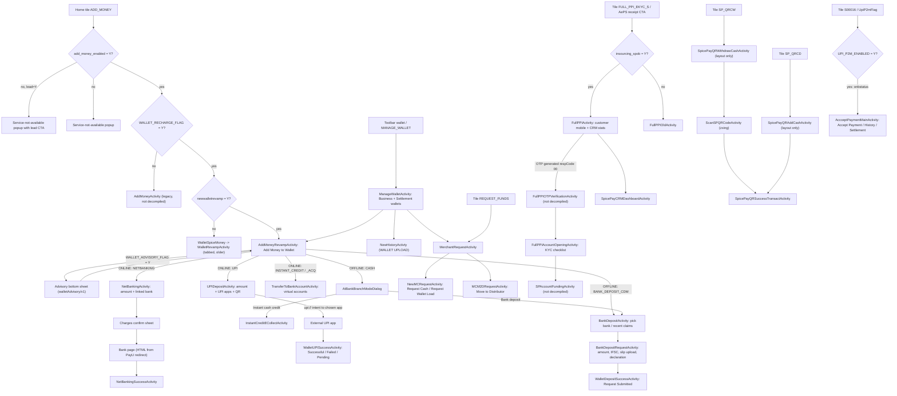

# 06 · Wallet: add money & Spice Pay QR

> **Confidence key:** ✅ confirmed in code · 🟡 inferred (naming, partial code) · ⬛ not visible in APK (backend, Flutter, partner SDK)

## Summary
- **Who / when:** (a) Every adhikari tops up the **Business Wallet** (the float used for DMT, CMS, BBPS, recharges and so on) by UPI, net banking, bank transfer to a virtual account, or cash deposited at a bank branch or CDM. The alternative is asking their distributor for a wallet load. (b) Adhikaris who sell **Spice Pay** use it to open a Full-KYC PPI wallet (issued through Wibmo) **for a customer**. They then load cash into that wallet ("Add cash") or pay out cash against a QR the customer shows ("Withdraw cash"), and they earn commission. A separate "Spice Pay Payment Service" tile is the adhikari's own **UPI P2M QR acceptance** (UPI POS). So "Spice Pay" in this app is a customer-facing PPI product sold and serviced by the agent. The agent's own wallet is not a PPI account in this sense. ✅/🟡
- **Entry points:** home tiles `ADD_MONEY` (and the toolbar wallet / `MANAGE_WALLET`), `REQUEST_FUNDS` (opens the distributor "Request Cash / Request Wallet Load" screen), `reqDistributor` (the distributor-side fund-request approvals screen). Spice Pay tiles: `FULL_PPI_EKYC_S`, `SP_QRCD` (add cash), `SP_QRCW` (withdraw cash), `SPLRUPAYSERVICE` (RuPay card linking), and `S00016` / `UpiP2mFlag` (accept UPI payments). Also: the success screens of AePS cash withdrawal and cash deposit can deep-link into Spice Pay onboarding. A Flutter `navigateTo: "Wallet"` call opens the native wallet. ✅
- **Preconditions / gates:** these SharedPreferences flags are set by the server at login: `add_money_enabled`, `WALLET_RECHARGE_FLAG`, `newwalletrevamp`, `WALLET_ADVISORY_FLAG`, `Full_PPI_ENABLED`, `insourcing_spob` (picks the old or new Spice Pay onboarding), `SPICEPAYADDCASH_enabled`, `SPICEPAYQRSCAN_enabled` and `UPI_P2M_ENABLED`. Payment modes and amount limits come from the server (`walletRevamp/ws/homeInit` and `staticInit`), as does the wallet load limit. The UPI intent route needs a UPI app installed on the phone. ✅
- **Successful outcome:** the Business Wallet is credited. For UPI and net banking the app shows a receipt screen at once. For bank deposit it shows "Request Submitted", which is a claim that ops must still verify. For Spice Pay: a customer PPI account is opened, or the customer wallet is loaded or debited, and the app shows a "Spice Pay" receipt with RRN and service request number. 🟡

## Flow diagram

## Screen by screen
| # | Screen (class) | Layout | What the user sees | User action | API call(s) | Next → (condition) | Conf. |
|---|---|---|---|---|---|---|---|
| 1 | Home tile router `ServiceActionHandler.onAddMoneyClick` | n/a | No screen of its own. If `add_money_enabled` ≠ Y, a "service not available" popup with server text (`ADD_MONEY_MESSAGE`) appears; it carries a lead-capture button if `ADD_MONEY_LEAD`=Y | taps Add Money tile | none | `AddMoneyRevampActivity` (if `WALLET_RECHARGE_FLAG`=Y and `newwalletrevamp`=Y); `WalletSpiceMoney` (if `WALLET_RECHARGE_FLAG`=Y, revamp off); legacy `AddMoneyActivity` (otherwise) | ✅ |
| 2 | `AddMoneyRevampActivity` | `activity_add_money_revamp` | Title "Add Money to Wallet"; "**Business Wallet** balance: ₹X"; a wallet-limit card; section "Add Money Online" (UPI, Net Banking, bank transfer); section "Deposit Cash & Get Credit" (cash, CDM). Section titles and services come from the server (`serviceModeId` ONLINE/OFFLINE) | picks a mode | `WALLET_REVAMP_URL` + `walletRevamp/ws/homeInit`, `walletRevamp/ws/staticInit`, `walletRevamp/ws/bankMaster`; balance via `FETCH_AGENT_BALANCE_URL` | `handleServiceClick` by service id (rows 4–10); if the payment-method list is empty or `WALLET_RECHARGE_FLAG`≠Y, falls back to legacy `AddMoneyActivity` | ✅ (exact URL-to-method mapping 🟡) |
| 3 | `BtmAdvisoryInWallet` (bottom sheet) | `bts_advisory_wallet` | Server HTML heading and body (an advisory such as a fraud or limits notice), with accept and cancel buttons | accepts or cancels | `API_GW_URL` + `walletAdvisory/v1` (action FETCH, then consent) | back to row 2 service list | ✅ |
| 4 | `UPIDepositActivity` | `activity_upi_deposit` | "Enter amount to add" with chips ₹500 / ₹1000 / ₹2000 / ₹5000; "Pay Using" grid of installed UPI apps (or "No UPI Apps Found – To complete this transaction, please install a supported UPI apps"); "Or scan and pay the QR code below"; "UPI ID Linked to QR"; Download QR / Share QR | enters amount, taps a UPI app (or scans the QR from another phone) | none server-side before handoff. Builds `upi://pay?pa=<server VPA>&pn=SPICE MONEY&mc=7322&tr/tn=Spice Money Agent <agentId>&am=…` | external UPI app, then a 2 s "Processing Payment" loader, then row 5. Validation toasts: "Please enter amount", "Enter valid amount", "Amount should be in between than {min} and {max}" | ✅ |
| 5 | `WalletUPISuccessActivity` | `wallet_upi_final_layout` | "Wallet Load Successful" / "Wallet Load Failed" / "Wallet Load Pending" (or "Transaction cancelled"); amount in figures and words; transaction ID; processing fee; Download / Share receipt; Home | Home or share | the **status shown comes from the UPI app's intent response** (`status`, `responseCode`, `txnId`), not from a server status call | Home | ✅ (whether a background balance refresh reconciles it: 🟡) |
| 6 | `NetBankingActivity` | `activity_net_banking` | "Enter amount to add" with chips; "Select your bank" ("Only banks that support Net Banking within your linked bank accounts are shown below"); "View all supported banks"; "Per transaction charges"; Continue | picks a registered bank and amount, then Continue | `WALLET_PAYU_URL` (payu.spicemoney.com): registered-bank list, live PayU banks, calculate charges (returns `totalAmt`, `charge`, `transId`), redirect-to-bank-page (returns `nbBanksPage`) | charges confirmation sheet (`NB_PROCEED_FOR_NETBANKING`), then bank page, then `NetBankingSuccessActivity`; `BankNotSupportedDialog` if the bank is unsupported | ✅ screens / 🟡 bank-page hosting (observer lambdas not decompiled) |
| 7 | `NetBankingSuccessActivity` | `activity_net_banking_success` | Bank name and logo, amount; "Deposit Type: Net Banking", "Date & Time", "Deposit Amount" | History / Home | none visible | `NewHistoryActivty` | ✅ |
| 8 | `TransferToBankAccountActivity` | `activity_transfer_to_bank_account` | Toolbar "Bank Account Transfer"; "Add below bank accounts as beneficiaries in your banking apps to instantly transfer money and load your wallet"; list of **virtual accounts** ("Available banks") | copies account details and pays from their own bank app (IMPS/NEFT) | data from `WalletNDRevampViewModel` (static/home init) | none; credit is async ⬛ | ✅ |
| 9 | `AtBankBranchModeDialog` → `InstantCreditECollectActivity` | `activity_instant_credit_ecollect` | "Instant Credit via E-Collect"; available banks; note: "To deposit over ₹10 Lakh at once, a Claim Deposit will be required (for banks with limits)" | picks a bank, deposits cash at the branch to the e-collect account | static data | none; auto-credit ⬛ | ✅ |
| 10 | `BankDepositActivity` | `activity_deposit_cash_claim` | "Search a bank", "All Banks", "Recently claimed deposits", "View Status", "Show on Map" | picks a bank, or views a map of branches and CDMs | `walletRevamp/ws/recentClaims`, `walletRevamp/ws/getOutage` (bank-down check), FTR deposit slip | `BankDepositRequestActivity`; `BankCDMMapActivity` ("Bank and CDM Points"); `BankDownRevampDialog` if the bank is in outage 🟡 | ✅ |
| 11 | `BankDepositRequestActivity` | `activity_deposit_cash` | "Enter amount to add"; Mode; "Selected Branch" / "Search IFSC Code"; "Transaction Date"; "Deposit Slip – Upload" / "Download Deposit Slip" / "View our Account Info"; "Add remarks"; "By submitting request, I agree to the declaration"; **Submit Request** | fills details, uploads the receipt photo (camera or gallery, then `ConfirmImageRevampActivity`), accepts the declaration | `walletRevamp/ws/bankDeposit` (multipart) 🟡; IFSC lookup | `WalletDepositSuccessActivity`. Errors: "Please upload bank receipt", "Please enter IFSC code", "Please accept the declaration from bottom". A Working-Capital cross-sell dialog can route to `MyProfileActivity` with `IS_WC` | ✅ |
| 12 | `WalletDepositSuccessActivity` | `activity_wallet_deposit_success` | "Request Submitted"; Deposit Type; Date & Time; Help / History / Home / **Repeat Request** | n/a | none | `NewHistoryActivty`; `BankDepositRequestActivity` (repeat) | ✅ |
| 13 | `ManageWalletActivity` (toolbar wallet / `MANAGE_WALLET`, when revamp is on; else `WalletSpiceMoney`) | `activity_manage_wallet` | "Total Wallet Balance (Business + Settlement)"; **Business Wallet** ("This is your main wallet. Amount in this wallet can be used for all Spice Money services"); **Settlement Wallet** ("Money received through MPOS, mATM, Aadhar Pay(optional) will be credited in this wallet"); Service Pack/SPP wallet; Axis TDS-free account promo; Add Money | Add Money / Check history / Request funds / Send money to distributor / Manage bank accounts | balance fetch | `AddMoneyRevampActivity`; `NewHistoryActivty` (if `HISTORY_SELECTION_VALUE`=Y, else back to dashboard history tab); `MerchantRequestActivity`; `SpiceMoneyWallet` or `IntroScreenActivity` (move to distributor, gated by `RETAILER_TILE_VISIBILITY` and T&C acceptance); eKYC screens when KYC is required | ✅ |
| 14 | `MerchantRequestActivity` (tile `REQUEST_FUNDS` or wallet "Request funds") | `activity_merchant_request` | "My Distributor"; "Need cash to do AePS business? → Request Cash"; "Need money in wallet to do CMS or DMT? → **Request Wallet Load**"; "Want to transfer a wallet to distributor? → Move to Distributor"; How it works? | picks a request type | `BASE_FR_SETTLEMENT` = `paygs…/requestFund/ws/` 🟡 | `NewMCRequestActivity` (type RequestCash / RequestWalletLoad); `MCM2DRequestActivity`; `MCTimelineActivity` (status) | ✅ |
| 15 | `NewMCRequestActivity` → `RequestWalletLoadFragment` | `fragment_request_wallet_load` | "How much wallet load you need?" with chips ₹10k to ₹40k; **Payback terms**: "I have the cash ready with me" / "I will pay back later"; request with or without PIN | submits | merchant-cash APIs ⬛ (Retrofit interface not decompiled) | distributor approves on their side (`ScreenFundRequests`, tile `reqDistributor`) | ✅ UI / ⬛ API |
| 16 | Legacy `AddMoneyActivity` + `TransactionSummaryUPI` | `activity_add_money`, `summary_upi` | "RECHARGE WALLET", "UPI Collect", "UPI Instant Pay", "PAY VIA UPI", "Other Payment Methods – Like Cash Deposit, NEFT or Net banking", "Request Your Distributor". Status screen: "Click on the notification received on your UPI bank app to proceed", countdown, "Your UPI request has been declined", "Transaction Failed!" | UPI collect; waits on a timer | `ppi/pg/upi/collect/v1`, then a timer-driven poll of `CORE_URL_OTP_TEMP` + `ppi/pg/upi/check/txn/status/v1` (interval and timeout from `UPI_STATUS_CHECK` = "total\|interval") | success "Added successfully to Wallet" / failed / timeout | 🟡 (AddMoneyActivity class not decompiled; TransactionSummaryUPI ✅) |
| 17 | `FullPPIActivity` (tile `FULL_PPI_EKYC_S`; also the AePS CW/CD receipt CTA) | `activity_full_ppiactivity` | Product name (server); customer mobile field with the note "Enter Customer’s Aadhaar – linked Mobile Number for availing seamless services in Spice Pay app"; "Open a new account"; Proceed; agent stats: "Total customers", earnings card, "Training status: 20%" / "Finish your pending training in 7 days" | enters the customer's mobile, taps Proceed | Wibmo static config (`home/wibmo/init`), user status, OTP generate on `spayreq.spicemoney.com` (`wibmo/kycpro/kycservice/…` or migrated host) | `FullPPIOTPVerificationActivity` (if `respCode`=00); `SpicePayCRMDashboardActivity` (earnings tap); toast "This service isn't available for your account…" if `Full_PPI_ENABLED`≠Y | ✅ |
| 18 | `FullPPIAccountOpeningActivity` | `activity_full_ppiaccount_opening` | "Full KYC PPI Account Opening" checklist: Aadhaar Details ("Link Aadhaar with bank account"), PAN/Form 60, Live photo ("Click a live photo of applicant", blink check), Profiling details, Income details of applicant, Link RuPay Card / Link Physical card, Set RuPay Card Pin, Account funding ("Initial funding to open account") | completes each step | Wibmo KYC-service calls: demographic save, PAN save, HyperVerge live photo, profiling, recoverable-step resume, link insta card | `SPPanFormActivity`, `SPProfileDetailsActivity`, `FullRupayVerificationActivity`, `SetRupayCardPinActivity`, `SPAccountFundingActivity`, `ScanQrCodeWithNumberActivity` (card QR), then `SPSuccessActivity` | ✅ step list / 🟡 order and sub-screens (several classes not decompiled) |
| 19 | `SpicePayCRMDashboardActivity` (+ Customers, Commission Slab, Earning Report, Refer) | `activity_spice_pay_crm_dashboard`, `activity_spice_pay_refer` | "Total Customers", "Grow more", dashboard cards, low-balance customer list, commission calculator; "Refer to your customers and earn Rs.10" with a share code | follow up with customers, share the referral code | `SPICE_PAY_CRM_URL` (academy…/unboxing/crm/) endpoints | n/a | ✅ |
| 20 | `SpicePayQRAddCashActivity` (tile `SP_QRCD`; first visit goes through the `SpicePayQRMainActivity` intro) | `activity_spicepayqr_add_cash` | "Add cash"; customer mobile; "Customer Name"; amount chips 100 / 200 / 500 / 1000; "Deposit Cash"; limit error "Customer's monthly cash deposit limit has been exceeded"; How to use | enters the customer's mobile and amount, deposits | `spayreq…`: check customer mobile, check add-cash limits, check charges, add-cash final txn (insourced or Wibmo variant) | row 22 | ✅ layout+VM / 🟡 activity (class not decompiled) |
| 21 | `SpicePayQRWithdrawCashActivity` (tile `SP_QRCW`) → `ScanSPQRCodeActivity` | `activity_spicepayqr_withdraw_cash`, `spicepayqrcode_scan_activity` | "Withdraw cash"; customer mobile; "Scan QR"; limit error "Customer's monthly cash withdrawal limit has been exceeded" | scans the customer's Spice Pay QR (zxing) | QR validate (returns amount, otpId, transId), then CW OTP init and OTP validate | row 22 | 🟡 (activity not decompiled; scanner + VM ✅) |
| 22 | `SpicePayQRSuccessTransactActivity` | `activity_spqr_success_transact` | "Spice Pay"; "Customer's Account"; name; mobile number; "RRN Number"; "Service Request No"; UPI transaction ID; Download / Share customer receipt; Need help | Home | none | Home | 🟡 |
| 23 | `AccceptPaymentMainActivity` (tiles `S00016` / `UpiP2mFlag`, "Spice Pay Payment Service") | `activity_upi_pay`, `fragment_accept_payment`, `download_qr_code_fragment` | Tabs: Accept Payment / History / Settlement; "Business Today / this Month"; enter amount → "Generate QR" / "Scan QR to pay"; Download / Share QR; settlement bank account; Increase (limit); "Don't have a Bluetooth speaker? Contact your distributor" | generates a dynamic QR, shares the static QR | `UPI_POS_URL` (yblupi…/upiptom/api/v1/) + `onbstatus`, fetch configuration, transaction init, fetch status, QR, limit update | GST success "Your monthly acceptance limit is ₹… now"; lead popup if `UPI_P2M_ENABLED`≠Y | ✅ entry / 🟡 inner flow |

## Branches, errors and edge states
- **Add Money disabled** (`add_money_enabled`≠Y) → popup with server message `ADD_MONEY_MESSAGE`; if `ADD_MONEY_LEAD`=Y the button triggers lead capture (web or browser per `ADD_MONEY_BROWSER_WEB`) · `ServiceActionHandler.onAddMoneyClick` ✅
- **Three generations of add-money UI live side by side**, chosen by flags: legacy `AddMoneyActivity`, `WalletSpiceMoney`→`WalletRevampActivity` (tabbed fragments: UPI, Netbanking, InstantCredit, BankDeposit, BOB VPA `CASH_VPA`, `ACCEPTQRCODE`), and the current `AddMoneyRevampActivity` (`newwalletrevamp`=Y) · `WalletRevampUtility.a/b` ✅
- **Advisory gate**: `WALLET_ADVISORY_FLAG`=Y shows a server-HTML advisory sheet before the mode list · `AddMoneyRevampActivity.fetchAdvisoryText` ✅
- **UPI**: no UPI app installed shows the "No UPI Apps Found" panel (the QR is still usable). The selected app cannot handle UPI → toast "App cannot handle UPI". App returns `status=pending` → "Wallet Load Pending". Returns failure or responseCode 01 → "Wallet Load Failed". Anything else non-success → "Transaction cancelled" · `UPIDepositActivity` ✅
- **Amount validation** on UPI, net banking and deposit: empty, leading zero, or outside the server min/max → inline toasts ("Please enter amount", "Enter valid amount", "Amount should be in between than X and Y", "Minimum amount value is", "Amount should be less than") ✅
- **Net banking**: bank not supported → `BankNotSupportedDialog`; charges are shown before redirect (`ModelCalculateCharges.charge`, `totalAmt`) ✅
- **Bank outage**: `walletRevamp/ws/getOutage` lets the app warn about bank downtime (`BankDownRevampDialog`, `AdapterBankOutage`) 🟡
- **Deposit over ₹10 lakh** via e-collect requires a manual "Claim Deposit" (copy on screen) ✅
- **Wallet load limit**: a limit card on Add Money with an "Increase limit" journey (`IncreaseWLTypeSelectionRevampActivity` → `IncreaseWalletLoadLimitRevampActivity` → `IncreaseLimitStatusRevampActivity`, API `increaseWalletLimit/status`) ✅ (screens) / 🟡 (rules)
- **Session expiry**: a balance or advisory response with `LOGOUT_RESPONSE_CODE` → forced logout ✅
- **Move to distributor** blocked if `RETAILER_TILE_VISIBILITY`≠Y (server message `MOVE_TO_DIST_SERVICE_MSG`); first use → T&C intro `IntroScreenActivity` ✅
- **Spice Pay disabled**: `Full_PPI_ENABLED`≠Y → toast "This service isn't available for your account. Please contact customer care for assistance." `SPICEPAYADDCASH_enabled` / `SPICEPAYQRSCAN_enabled` ≠ Y → popup with server message. On first use, an intro screen `SpicePayQRMainActivity` (flag `…_intro_seen`) ✅
- **Spice Pay vendor switch**: `insourcing_spob` / `insourcing_flag` routes onboarding to `FullPPIActivity` (insourced, "Migrated" APIs) vs `FullPPIOldActivity` (Wibmo). Add-cash and withdraw-cash each have parallel `…Insource` and `…Wibmo` API variants ✅
- **Spice Pay customer limits**: monthly cash-deposit and cash-withdrawal limits per customer, shown as inline errors ✅ (copy) / ⬛ (thresholds)
- **Spice Pay resume**: a "recoverable step" API resumes partially completed KYC onboarding (`hitRecoverableStepWibmo`) ✅
- **UPI P2M disabled** (`UPI_P2M_ENABLED`≠Y) → lead popup (`UPI_P2M_LEAD`, `UPI_P2M_MESSAGE`) ✅

## What we could not see
- **Several key classes failed to decompile** (they are present in the manifest but missing from the jadx output): legacy `AddMoneyActivity`, `SubmitDepositActivity`, `FullPPIOTPVerificationActivity`, `SPAccountFundingActivity`, `SPPanFormActivity`, all `SpicePayQR*Activity` screens except the scanner and refer screens, the shared Retrofit `ApiInterface` / `RetroUtils`, and many lambda classes (for example `defpackage.ve2`, which holds the net-banking observers). We recovered endpoint paths from dex strings (`walletRevamp/ws/*`, `ppi/pg/upi/*`, `spicepay/*`) without exact method mapping.
- How the backend credits the wallet for virtual-account, e-collect, CDM and bank-deposit claims (ops verification, SLA) ⬛
- Whether a UPI-intent load that the app shows as "Successful" is reconciled server-side before the balance updates (no status-check call in the revamp UPI path) ⬛
- The PayU net-banking page (server-supplied HTML `nbBanksPage`) ⬛
- Wibmo / insourced PPI decisions: customer eligibility, KYC verdicts, HyperVerge liveness, RuPay card issuance ⬛
- Commission amounts for Spice Pay, UPI POS and Request Wallet Load payback terms (server config) ⬛
- Flutter: `assets/flutter_assets/assets/wallet` contains only icons (`ic_wallet`, `ic_bank`). The wallet itself is native; Flutter modules only call `navigateTo: Wallet` to open it ✅

## To verify in live capture (phase 4)
- With `newwalletrevamp` on: which ONLINE and OFFLINE services the server returns for a typical adhikari, and their order and labels.
- UPI intent: pay ₹1, cancel in the UPI app, and confirm what the receipt says. Then complete a payment and time how long the Business Wallet balance takes to reflect it. Try "scan QR from another phone" and check what the agent sees (there is no callback).
- Net banking: does the bank page open in an in-app WebView or the browser? What is the charge for ₹1000? What shows on failure or back-press?
- Bank deposit claim: capture the full form, the slip upload, and the "Request Submitted" screen, then follow the claim status in "Recently claimed deposits".
- Request Wallet Load: is "I will pay back later" a distributor credit line? What does the distributor see?
- Spice Pay onboarding: record every step and its order end to end, the OTP screen copy, and the initial funding amount and source (agent wallet vs cash).
- Spice Pay withdraw: what the customer's QR contains (amount pre-set?), who enters the OTP, and the commission shown.
- Accept Payment (UPI P2M): onboarding state for a new agent, the GSTN prompt, and the Bluetooth speaker CTA.

## Evidence
- `spice/mudra/newDashboard/utility/serviceHandling/ServiceActionHandler.java`: `onAddMoneyClick` (~1293), `navigateToWalletSummary` (~1239), `openRequestFund` → `navigateToMerchantRequest` (~998, ~2605), `onRequestFundDistributor` (~2360), `handle` tile cases `REQUEST_FUNDS` / `MANAGE_WALLET` / `reqDistributor` (~3090–3140)
- `spice/mudra/walletRevamp/utils/WalletRevampUtility.java`: `a()` (`newwalletrevamp`), `b()`
- `spice/mudra/walletRevamp/activity/AddMoneyRevampActivity.java`: `navigateToAddMoney` (~405), `handleServiceClick` (~940), `showDepositModeDialog$lambda$0` (~670), `fetchAdvisoryText` (~821), `onResult` (~1180), `updateWalletBalance` (~1400); `AddMoneyRevampActivity$addServices$1.java` (ONLINE/OFFLINE split)
- `spice/mudra/walletRevamp/activity/UPIDepositActivity.java`: `f(ResolveInfo)` (upi:// intent build, ~355), response parsing (~255–315), `D0`, `E0`; `UPIDepositActivity$onUpiResult$1.java`
- `spice/mudra/walletRevamp/activity/WalletUPISuccessActivity.java` (status copy, ~730–775)
- `spice/mudra/walletRevamp/activity/NetBankingActivity.java`: `l0` (`NB_PROCEED_FOR_NETBANKING`), `BankNotSupportedDialog`; `NetBankingSuccessActivity.java`
- `spice/mudra/wallethistorynew/viewmodels/WalletRevampViewModel.java` + `$calculateAmountForTransaction$1`, `$fetchRegBankListing$1`, `$fetchLivePayuBankListing$1`, `$redirectForBankPage$1` (`WALLET_PAYU_URL`, `WALLET_REVAMP_URL`, `UPI_POS_URL`)
- `spice/mudra/walletRevamp/activity/TransferToBankAccountActivity.java`, `InstantCreditECollectActivity.java`, `BankDepositActivity.java`, `BankDepositRequestActivity.java` (`onItemClick` WC cross-sell ~2061, success intent ~865), `WalletDepositSuccessActivity.java`
- `spice/mudra/walletRevamp/activity/ManageWalletActivity.java`: request funds (~290), `G0` history, `H0` move-to-distributor
- `spice/mudra/activity/WalletSpiceMoney.java` (~1240–1276 legacy/new routing); `spice/mudra/wallethistorynew/activity/WalletRevampActivity.java` (tabbed fragments)
- `spice/mudra/activity/TransactionSummaryUPI.java`: `getUPIStatus` timer (~320–390), `ppi/pg/upi/check/txn/status/v1`
- `spice/mudra/merchant_cash/view/MerchantRequestActivity.java` (`I0` RequestCash/RequestWalletLoad, `btnM2D`), `NewMCRequestActivity.java`, `fragments/RequestWalletLoadFragment.java`; `spice/mudra/activity/fundrequests/ScreenFundRequests.java`
- `spice/mudra/newDashboard/fragments/DashboardFragmentRevamp.java`: tile cases `SP_QRCD`, `SP_QRCW`, `FULL_PPI_EKYC_S`, `SPLRUPAYSERVICE` (~2900–3650), `openFullPPIActivity` (~8011), add-cash / withdraw-cash navigation (~5830, ~13090), `onAcceptUPIPayments` + `hitUpiStatus` (~12597, ~13175), `RESULT_UPI_POS_STATUS` handler (~16981)
- `spice/mudra/full_ppi_account/view/FullPPIActivity.java` (OTP → `FullPPIOTPVerificationActivity` ~477, CRM ~1040), `FullPPIAccountOpeningActivity.java` (step keys), `viewModel/SpicePayViewModel.java` (Wibmo / insource API methods)
- `spice/mudra/spicepayqrscan/model/SpicePayqrScanViewModel.java`, `SPQRScanRepository.java`, `ScanSPQRCodeActivity.java`, `SpicePayReferActivity.java`
- `spice/mudra/upipos/payment/AccceptPaymentMainActivity.java`, `upipos/fragment/*`
- `spice/mudra/aeps/newAepsRevamp/activity/TransactionCashWithdrawalRevamp.java` (~2602) and `TransactionCashDepositRevamp.java` (~2548): Spice Pay cross-sell
- `spice/mudra/MyFlutterActivity.java` (~130 `navigateTo` → Wallet)
- `spice/mudra/utils/Constants.java`: `ADD_MONEY_ENABLED`, `WALLET_RECHARGE_FLAG`, `WALLET_REVAMP_URL`, `WALLET_PAYU_URL`, `UPI_POS_URL`, `SPICEMONEY_CORE_WIBMO_URL`, `CORE_URL_CWCD(_INSOURCE)`, `BASE_FR_SETTLEMENT`, `Full_PPI_ENABLED`, `SPCD`/`SPCW`
- Resources: `res/layout/activity_add_money_revamp.xml`, `activity_upi_deposit.xml`, `activity_net_banking.xml`, `activity_deposit_cash.xml`, `activity_manage_wallet.xml`, `activity_merchant_request.xml`, `fragment_request_wallet_load.xml`, `activity_full_ppiactivity.xml`, `activity_spicepayqr_add_cash.xml`, `activity_spicepayqr_withdraw_cash.xml`, `activity_spqr_success_transact.xml`, `fragment_accept_payment.xml`; `res/values/strings.xml`; endpoint paths from `apktool/classes7.dex` / `classes8.dex` strings
