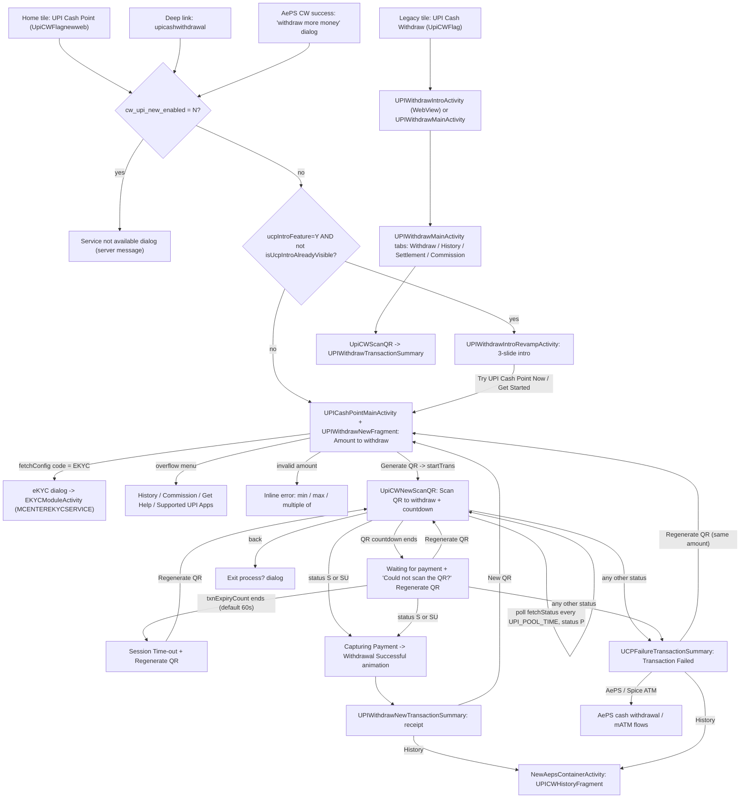
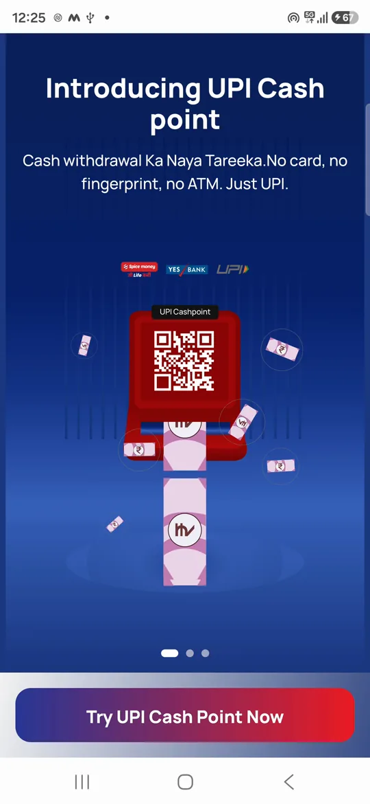
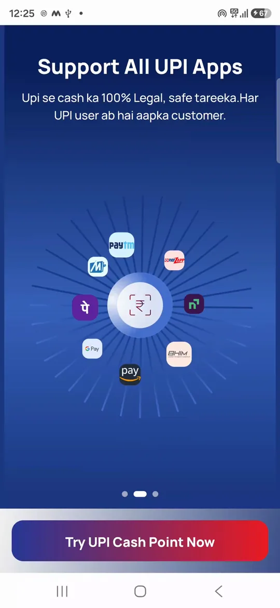
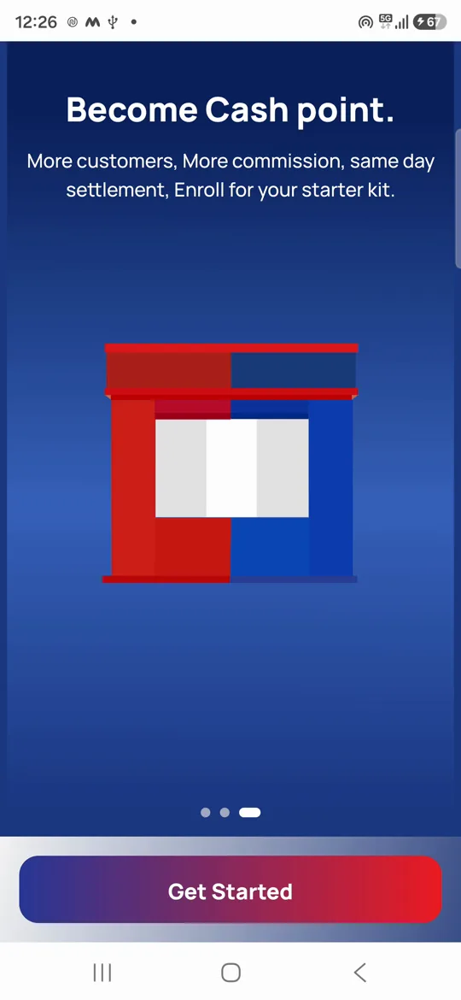
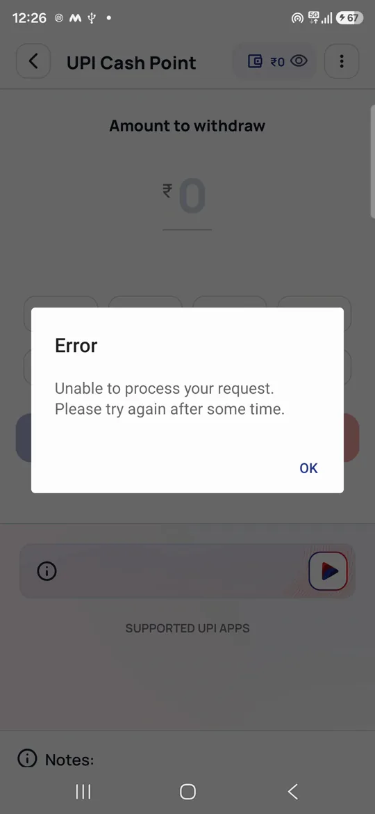

# 07 · UPI cash withdrawal (UPI Cash Point)

> **Confidence key:** ✅ confirmed in code · 🟡 inferred (naming, partial code) · ⬛ not visible in APK (backend, Flutter, partner SDK)

## Summary
- **Who / when:** Any adhikari who has the service switched on can use it. A walk-in customer wants cash but has no card and no Aadhaar biometric to hand. The adhikari keys in an amount and the app shows a **dynamic UPI QR**. The customer scans it with any UPI app and pays the adhikari. The adhikari then hands over the cash. The in-app pitch says "Cash withdrawal Ka Naya Tareeka. No card, no fingerprint, no ATM. Just UPI." ✅
- **Two generations live side by side:**
  - **UPI Cash Point (current)**: tile service code `UpiCWFlagnewweb`, tile name "UPI Cash Point" with a green "NEW" badge, backend `https://yblupi.spicemoney.com/upicashnw/api/v1/`. ✅
  - **UPI Cash Withdraw (legacy)**: tile service code `UpiCWFlag`, tile name "UPI Cash Withdraw", backend `.../upicash/api/v1/`. It asks for the customer's mobile number and the adhikari's settlement bank account. ✅
  - Both run on the `yblupi` host. The receipt's "powered by" logo falls back to `yes_bhim_powerby`. The legacy wallet-UPI QR uses `@yesbankltd` and refUrl yesbank.in. So the partner is very likely Yes Bank (BHIM/YBL). 🟡
- **Entry points:**
  - Home tile `UpiCWFlagnewweb` → `DashboardFragmentRevamp.navigateToServiceTile` → `onCwUpiNewClick()` ✅
  - Deep link `upicashwithdrawal` (handled in `DashboardActivityRevamp.hitDeeplinkService` and `onMessageEvent(DeepLinkEvent)`) ✅
  - The AePS cash-withdrawal screen's "withdraw more money" dialog, which lists UPI Cash Point as an alternative ✅
  - Legacy: tile `UpiCWFlag` or deep link `upicashwithdraw` → `onCwUpiClick()` ✅
  - This product is **not** routed through `ServiceActionHandler.handleTileClick`. It is dispatched by service name inside the dashboard fragment. ✅
- **Preconditions / gates:**
  1. Tile visibility, enabled flag and a "not available" message come from home-config `serviceDtls`, as `visibility|enabled|message|…`. They are stored as `cw_upi_new_visibility`, `cw_upi_new_enabled` and `cw_upi_new_message`. ✅
  2. Service-pack / attention dialog: if position 7 of the tile's detail string is "Y", `showServiceAttentionDialog` runs first. This is tied to `SPP_RESTRICTION` and `SERVICE_ATTENTIONMSG`. 🟡
  3. Server-side eKYC gate: `fetchConfig` can return `code = "EKYC"`, which forces the eKYC module. ✅
  4. Amount limits come from the server: `minAmt`, `maxAmt` and `amountMultipleOf`. The client defaults are ₹200 / ₹5,000 / multiples of ₹100. ✅
  5. Device: no biometric or printer is needed. The only gate is an internet check. ✅
- **Successful outcome:** a "Withdrawal successful" receipt showing amount, payer app, customer VPA, RRN, transaction reference and date/time. The adhikari can send a free WhatsApp receipt, share or download it. Print is hidden in code. The receipt can also show the commission earned and a voice confirmation. The wallet balance is flagged for refresh, which implies the adhikari's wallet is credited. 🟡

## Flow diagram

## Screen by screen
| # | Screen (class) | Layout | What the user sees | User action | API call(s) | Next → (condition) | Conf. |
|---|---|---|---|---|---|---|---|
| 1 | Home tile in `DashboardActivityRevamp` / `DashboardFragmentRevamp` | home grid tile | Icon `nd_tile_upi_cw` and name "UPI Cash Point". A green "NEW" badge shows until the first open (`CW_UPI_NEW_WEB`). When `ucpIntroFeature=Y` the tile plays an animated gif (`res/raw/ic_cash_point.gif`). | Tap tile | none (config already came from home API) | Row 2 if disabled; Row 3 if intro due; else Row 4 | ✅ |
| 2 | Service gates (dashboard dialogs) | `ServiceAttentionDialog` / `serviceNotAvailable` | (a) Service-pack attention dialog (title, message, expiry or free-period text from server). (b) The "not available" dialog with the server message `cw_upi_new_message` and an "OK" button. | OK / continue | none | Stays on home | ✅ (b) / 🟡 (a) |
| 3 | `UPIWithdrawIntroRevampActivity` | `activity_upiwithdraw_intro_revamp` | 3 swipeable Lottie slides (Lottie URLs from config `ucpIntroLottiesUrls`): "Introducing UPI Cash point / Cash withdrawal Ka Naya Tareeka. No card, no fingerprint, no ATM. Just UPI." · "Support All UPI Apps / Upi se cash ka 100% Legal, safe tareeka. Har UPI user ab hai aapka customer." · "Become Cash point. / More customers, More commission, same day settlement, Enroll for your starter kit." The CTA reads "Get Started" and then "Try UPI Cash Point Now". | Tap CTA | none | Row 4 | ✅ |
| 4 | `UPICashPointMainActivity` hosting `UPIWithdrawNewFragment` | `upi_cash_point_main_activity` + `upi_cash_withdrawal_new` | Title "UPI Cash Point" and wallet balance (₹, with an eye toggle; a split-wallet settlement balance if `settlementFlagSplitWalelt` = Y). "Amount to withdraw" field. Up to 8 server denomination chips (`upiDemonV1`) tagged "min. limit" / "max. limit". The amount is echoed in words. An orange note from `qrText`, a "You will earn ₹X commission on this transaction" strip (when `upiCPCommVisibility`=Y), "SUPPORTED UPI APPS" logos with "+58 Others", a SpiceTube "learn" stripe and "Notes:". CTA "Generate QR" stays disabled until the amount is valid. | Type amount or tap a chip | On open: `POST UPI_CW_NW_URL + fetchConfig` (token, bcAgentId, clientId, clientType=APP, reqMode=APP). If the commission plan version changed: `POST UPI_CW_NW_URL + fetchPlan` | Row 5 if `code=EKYC`; Row 7 when CTA tapped | ✅ |
| 5 | eKYC gate dialog → `EKYCModuleActivity` | MaterialDialog | Title "Error" with the server message, or "Something went wrong" if none. Button "OK". | OK | — | `ServiceActionHandler.handle("MCENTEREKYCSERVICE")` → `onMCenterEkycClick` → `EKYCModuleActivity` (only if `MCENTER_KYC_ENABLED`). The Cash Point screen closes. | ✅ |
| 6 | Overflow menu (popup `item_menu_upi_cashpoint`) | `item_menu_upi_cashpoint` | "History", "Commission" (only if `upiCPCommVisibility`=Y), "Get Help", "Supported UPI Apps". It **auto-opens once** on first visit (`UCPMBANIM`). | Tap item | — | History → Row 15; Commission → `NewAepsContainerActivity("commupicashpoint")` → `CommissionFragment`; Get Help → help videos for bot "UPICASHPOINT"; Supported apps → Row 6a | ✅ |
| 6a | `UCPSupportedAppsActivity` | `ucp_supported_apps_activity` | "Supported UPI Apps", a "Search by App Names" box and a list (from `payerAppsList` in fetchConfig). Empty state: "No Record found". | Search / back | none (cached list) | Back | ✅ |
| 7 | Amount validation (inline, Row 4) | `txtEdtError` | Red text with an error icon: "Please enter the valid amount" · "Minimum amount should be ₹{min}" · "Maximum amount should be ₹{max}" · "Amount should be multiple of {n}". Helper text: "Enter amount in multiples of ₹{n}". | Fix amount | — | Stays on Row 4 | ✅ |
| 8 | Generate QR (Row 4 CTA) | loading overlay | Loader. If offline: "no internet" toast. If the API errors: error toast. | Tap "Generate QR" | `POST UPI_CW_NW_URL + startTrans` (token, bcAgentId, clientId, `userAmount`, `userMobileNumber`="") → `transactionID`, `base64QRCode`, `otpCounter` (QR lifetime in seconds) | Row 9 on any non-null response | ✅ |
| 9 | `UpiCWNewScanQR`: QR state | `upi_cw_scan_qr_new` | "UPI Cash Point" header and "Scan QR to withdraw". Amount ₹X, QR image, "QR expiring in" mm:ss (default 30s if the server sends none), "Do not refresh the page", "SUPPORTED UPI APPS" and the aggregator logo. **Screen brightness is forced to 100%.** | Customer scans and pays in their UPI app; adhikari waits | Polls `POST UPI_CW_NW_URL + fetchStatus` (transactionID). The first poll fires after `appTransactionPoolTime` ms (default 10,000) and re-arms after every `P` response. | `P` → keep polling; `S`/`SU` → Row 12; other → Row 13; QR timer ends → Row 10 | ✅ |
| 10 | `UpiCWNewScanQR`: waiting state | same | QR hidden, processing Lottie, "Waiting for payment", a blue countdown (`txnExpiryCount`, default 60s) and "Could not scan the QR?" with a "Regenerate QR" button. | Wait / Regenerate QR | Polling continues; Regenerate → `startTrans` again with the same amount | Row 11 when the countdown ends; Row 9 on regenerate | ✅ |
| 11 | `UpiCWNewScanQR`: timeout state | same | Error icon, "Session Time-out", "Customer could not scan the QR or complete the payment within time.", a red 00:00 timer and "Regenerate QR". Polling stops. | Regenerate QR / back | `startTrans` | Row 9 | ✅ |
| 11a | Exit dialog | `new_alert_revamp_warning_popup` | "Exit process" / "Are you sure you want to exit process without accepting payment?" with Yes / No. It only shows while the QR is still live. | Yes → cancel timers and finish | none (no cancel API called) | Back to Row 4 | ✅ |
| 12 | `CommonNewDashSuccessScreen` (bottom sheet) | `common_new_success_screen` | "Capturing Payment" animation, then "Withdrawal Successful" | auto | — | Row 13s | ✅ |
| 13s | `UPIWithdrawNewTransactionSummary` | `upi_withdraw_final_layout` | "Withdrawal successful", ₹amount/- in figures and words, and Details (Payer App, Customer VPA, RRN, Trxn Reference No, Date & Time). "Customer Receipt": WhatsApp (FREE), Share, Download (Print exists but is hidden). Also a commission-received view, a 5-on-5 bonus banner (`bonus5on5Flag`), a subsidy banner, an advisory note, a video avatar ("POST_TXN_UPI_CP") and a voice confirmation of the amount in the chosen language. Bottom: "New QR", "History", "Help", "Home". | Share receipt / New QR / History | Receipt PDF via `WalletHistoryViewModel.h("UPI_CW_NW", txnId, docType)`; voice plan `VOICE_ALERT + voice/plan`; voice toggle `API_GW_URL + updateVoiceFeatureFlag/v1` (serviceName UPICW) | New QR → Row 4 (amount cleared); History → Row 15 | ✅ |
| 13 | `UCPFailureTransactionSummary` | `ucp_failure_transaction_summary` | "Transaction Failed" with the server `message` as status text, ₹amount and details (Payer App, Customer VPA, RRN, Ref No, Date & Time). "Select an option to proceed": **if `code=NVM`** it shows "Try from supported UPI App" with app logos and the payer app used. Then "Or withdraw cash using": **AePS** ("Customer's Aaadhar card required") or **Spice ATM** ("Customer's Debit card required"). Buttons "Regenerate QR", "New QR", "History", "Help", "Home". | Pick an option | none | Regenerate → Row 4, which auto-clicks Generate QR with the same amount (`regenerate=true`); AePS → `CASH_WITHDRAWAL` service; Spice ATM → `MATM` service; New QR → Row 4 cleared | ✅ (NVM meaning 🟡) |
| 15 | `NewAepsContainerActivity` → `UPICWHistoryFragment` | `new_hitory_update_fragment` | Title "History": transaction list with paging, pull-to-refresh, and server-defined filters (checkbox/radio/date/text). | Filter / scroll | `POST https://stats.spicemoney.com/historyService/fetch/history/transaction` (product = `upiProductName` from fetchConfig, fromDate, toDate, recordNo, filters) | Back | ✅ |
| L1 | Legacy intro `UPIWithdrawIntroActivity` | `aadhaar_pay_intro` (reused) | WebView of `UPI_CW_INTRO_URL` with a get-started CTA (sets `cw_upi_intro_done`) | Tap CTA | — | L2 | ✅ |
| L2 | Legacy `UPIWithdrawMainActivity` (tabs) + `UPIWithdrawFragment` | `upi_cashwithrawal_activity`, `upi_cash_withdrawal` | Tabs "Withdraw / History / Settlement / Commission". Withdraw tab: "Business Today / Business this Month", "Customer Details" with **customer Mobile Number**, "Enter Amount" with chips 100/500/1000/5000, "Generate QR to withdraw", "Settlement Mode" (bank A/c + IFSC, or "Spice Money Wallet"), "HOW TO USE?" video. A wallet-switch dialog says "Now Settle Money Directly In Your Wallet… Get OTP / Not Now — Please Note: Once settlement mode is changed to wallet you can't change back." | Enter mobile + amount, Generate QR, change bank | `UPI_CW_URL + fetchConfig`, `+ startTrans` (with `userMobileNumber`), `+ fetchStatus`; bank change `UPI_CW_NW_URL + onBoardSubAccUpdate` (bnkNO, ifscode) | `UpiCWScanQR` ("Scan below QR to withdraw", "QR code valid till") → `UPIWithdrawTransactionSummary` | ✅ (legacy screens skimmed) |

## Branches, errors and edge states
- **Service switched off** (`cw_upi_new_enabled = N`) → a "not available" dialog with the server-supplied message. Visibility is a separate flag, and the tile only renders when `fromNewApi` is set. · `DashboardFragmentRevamp.onCwUpiNewClick`, `DashboardActivityRevamp` (`UpiCWFlagnewweb` tile builder) ✅
- **Intro shown once** → only if `ucpIntroFeature=Y` and the agent has never transacted. fetchConfig's `isSuccTxn` sets `isUcpIntroAlreadyVisible`, and so does any success or failure result. · `onCwUpiNewClick`, `UPIWithdrawNewFragment.q0`, `UpiCWNewScanQR.D0` ✅
- **eKYC pending** → fetchConfig returns `code="EKYC"`. A dialog then routes to `EKYCModuleActivity` and the Cash Point screen closes. · `zn3` case 0, `fo3` default branch ✅
- **fetchConfig network/API error** → "Error" alert with the parsed message. The agent stays on an amount screen without limits (client defaults apply). · `zn3` case 0 ✅
- **Amount rules** → min/max/multiple messages (see Row 7). Leading zeros are rejected. Denomination chips come from the server. · `UPIWithdrawNewFragment.w0`, `s0`, `v0` ✅
- **QR expiry is two-stage** → the QR shows for `otpCounter` seconds (default 30). It is then hidden for a "Waiting for payment" grace window of `txnExpiryCount` (default 60s), while polling continues. Only then does "Session Time-out" appear. · `UpiCWNewScanQR.G0`, `H0` ✅
- **Pending** (`transactionStatus = "P"`) → keeps polling. There is no maximum poll count beyond the timeout. A poll **error** sets a flag that re-arms polling on the next QR-timer tick. After the QR timer has ended, an error therefore stops polling silently, and the UI waits for the timeout. · `UpiCWNewScanQR` observer `op3` case 0, `F0` ✅ (silent-stop consequence 🟡)
- **Success** = `transactionStatus` is `S` or `SU`. **Anything else** (failed, rejected, unknown) → the failure screen. No separate "pending/deemed" result screen exists for UPI Cash Point. · `op3` case 0 ✅
- **`code = NVM` on failure** → shows "Try from supported UPI App" and the payer app's logo. This suggests the customer paid from an unsupported or non-verified app. · `UCPFailureTransactionSummary.addKeyValues` ✅ (meaning 🟡)
- **Fallback cross-sell on failure** → AePS (Aadhaar) or Spice ATM (debit card) cash withdrawal. · `UCPFailureTransactionSummary.addClickListener$lambda$0$0/$0$1` ✅
- **Regenerate after failure** keeps the amount: the failure screen re-opens the main activity with `regenerate=true` and programmatically clicks "Generate QR". · `UPICashPointMainActivity.onNewIntent` ✅
- **Back while the QR is live** → an "Exit process" confirmation. No cancel API is called, so the server-side transaction stays open until it expires. · `UpiCWNewScanQR.B0` ✅ (server side ⬛)
- **startTrans response is not validated**: any non-null body opens the QR screen. The app does not check the response's `status`/`code` fields, so a soft failure could show a blank QR. · `zn3` case 1, `UpiCWNewScanQR.E0` 🟡
- **Reversal / refund**: there is no client code path for reversal, refund or a "deemed success" retry for UPI Cash Point. Any reversal would only appear in History. ⬛
- **Cash handover**: the app has **no "I have handed over cash" confirmation step and no customer OTP**. Success on the payment status ends the flow. ✅ (absence confirmed in UPI Cash Point classes)

## What we could not see
- Backend rules for limits, velocity, per-customer caps, fraud checks, and how the agent is credited (`amountToSettle`, split-wallet settlement, "same day settlement" claim). ⬛
- The meaning of status/code values beyond `P`, `S`, `SU`, `EKYC` and `NVM`, and the full fetchConfig `detailsList` contract. ⬛
- The Flutter asset `assets/flutter_assets/assets/gif/upi_cash_point.gif` is only listed in `AssetManifest.json`. The Flutter `libapp.so` is not in the base APK we decompiled, so we cannot tell which Flutter screen uses it. ⬛ The **native** home tile uses a different animation, `res/raw/ic_cash_point.gif`, loaded by `WidgetViewBinding.b()` when `ucpIntroFeature=Y`. ✅
- `CommissionFragment` content and the `fetchPlan` slab logic display (only the "You will earn ₹X…" strip is traced). 🟡
- Legacy `UpiCWScanQR` / `UPIWithdrawTransactionSummary` were only skimmed. Treat their details as 🟡.
- Decompilation note: the main jadx run crashed (OutOfMemory). `UPICashPointMainActivity`, `UCPFailureTransactionSummary`, `UPIWithdrawIntroRevampActivity`, `UPIWithdrawMainActivity`, `UpiCWScanQR`, `UPIWithdrawTransactionSummary`, the `UPICWHistoryFragment` / `UPIWithdrawFragment` / `UpiCwSettelmentFragment` fragments, `network/ApiInterface`, `UPIActivity` / `UPIBanking`, and lambdas `zn3` / `fo3` were therefore re-decompiled one class at a time into the scratchpad (`scratchpad/flow07/out/sources/...`). They are **not** in the main jadx sources dir.

**Scope notes (adjacent but different products):**
- `spice.mudra.activity.UPIActivity` / `UPIBanking` / `TransactionSummaryUPI` / `UPIScanQRCodeActivity` are the legacy **agent wallet top-up via UPI**, not customer cash withdrawal:
  - "Wallet Recharge" by sending a collect request to a VPA: `CORE_URL_OTP_TEMP + ppi/pg/upi/collect/v1`, with status from `ppi/pg/upi/check/txn/status/v1`.
  - A static agent QR, `upi://pay?pa=SPICED<mobile><clientId>@yesbankltd…`.
  - They are launched from the "UPI" option in AePS/mATM/BBPS screens. ✅
- `spice.mudra.merchant_cash` is **Merchant Cash**: adhikari ↔ distributor liquidity ("Cash Need / Cash Supply", "Move to Distributor", wallet-load requests). It is unrelated to customer UPI cash-out. ✅

## To verify in live capture (phase 4)
- Real values in fetchConfig: `minAmt`, `maxAmt`, `amountMultipleOf`, denomination list, `appTransactionPoolTime`, `txnExpiryCount`, and `otpCounter` from startTrans.
- Whether the QR is a standard UPI intent QR (scannable by any app) and what payee name or VPA the customer sees in their UPI app.
- The agent wallet balance change after success: credit timing and whether it lands in the main wallet or a split "settlement" wallet.
- Behaviour when the customer pays after "Session Time-out" (late success): does it appear in History, and is it auto-reversed?
- Back-out from a live QR, then check History for the orphaned transaction's status.
- Trigger `NVM` by paying from an unsupported app; capture the failure copy.
- Confirm that the first-visit overflow menu auto-opens and that "NEW" disappears after the first open.
- Check whether the eKYC gate is triggered for a non-eKYC'd agent.

## Evidence
Paths are relative to the jadx sources dir unless marked **[re-decompiled]**, which means `scratchpad/flow07/out/sources/`.
- `spice/mudra/newDashboard/fragments/DashboardFragmentRevamp.java`: `onCwUpiNewClick()` (~l.14969), `onCwUpiClick()` (~l.14919), `navigateToServiceTile()` (~l.13022), service-attention branch (~l.19768)
- `spice/mudra/newDashboard/activity/DashboardActivityRevamp.java`: tile builder for `UpiCWFlag` / `UpiCWFlagnewweb` (~l.9040–9080), `hitDeeplinkService$lambda$0` (~l.2374), `onMessageEvent(DeepLinkEvent)` (~l.21930), `ucpIntroFeature` / `ucpIntroLottiesUrls` prefs (~l.6796, ~l.13109)
- `spice/mudra/bindingadapters/WidgetViewBinding.java`: `b()` (tile gif `R.raw.ic_cash_point` for `UpiCWFlagnewweb`)
- `spice/mudra/newDashboard/utility/serviceHandling/ServiceActionHandler.java`: `MCENTEREKYCSERVICE` → `onMCenterEkycClick()` → `EKYCModuleActivity`
- `spice/mudra/upiwithdraw/fragment/UPIWithdrawNewFragment.java`: `i0()` fetchConfig, `j0()` startTrans, `q0()` config parsing, `u0()` listeners and denominations, `w0()` amount validation, `r0()` / `s0()` error copy
- `spice/mudra/upiwithdraw/fragment/UPIWithdrawNewFragment$attachObserver$3.java`: commission strip
- `spice/mudra/upiwithdraw/viewmodel/CommissionViewModel$observeAmount$1.java`: "You will earn ₹… commission on this transaction"
- `spice/mudra/upiwithdraw/activity/UpiCWNewScanQR.java`: `E0()` QR render, `G0()` QR timer, `F0()` poll timer, `H0()` state copy (Scan / Waiting / Session Time-out), `B0()` exit dialog, `D0()` failure handoff, `C0()` brightness, `onCreate` observers
- `defpackage/hq3.java` (default case): success → `UPIWithdrawNewTransactionSummary`; `defpackage/zf3.java` case 13: regenerate QR
- `spice/mudra/upiwithdraw/activity/UPIWithdrawNewTransactionSummary.java`: `parseAPIResponse()`, `addKeyValues()`, `addClickListener()` (print hidden), `fetchMiniPlanDetails()`, `hitVoiceAPI()`, `performGotoHomeClick()`, `performGotoHistoryClick()`
- `spice/mudra/upiwithdraw/activity/UCPSupportedAppsActivity.java`: list and search
- `spice/mudra/wallethistorynew/viewmodels/WalletRevampViewModel.java`: `F()` fetchConfig, `G()` fetchStatus, `H()` startTrans on `UPI_CW_NW_URL`; `D()`/`E()`/`I()` legacy on `UPI_CW_URL`; `l()` fetchPlan; `w()` onBoardSubAccUpdate
- `spice/mudra/wallethistorynew/viewmodels/WalletHistoryViewModel.java`: `o()` → `WALLET_HISTORY_URL` `walletServiceHistroy`
- `spice/mudra/utils/Constants.java`: `UPI_CW_URL`, `UPI_CW_NW_URL` (~l.9022–9026), `CW_UPI_*` pref keys (~l.1728–1743), `WALLET_HISTORY_URL`
- `spice/mudra/upipos/responses/UPITransactionInitiate.java`, `UPITransactionFetch.java`: response fields
- `spice/mudra/aeps/newAepsRevamp/activity/NewAepsContainerActivity.java`: `Companion.e()` history, `b()` help, fragment map (`historyupicashpoint`, `commupicashpoint`)
- `spice/mudra/aeps/newAepsRevamp/activity/TransactionCashWithdrawalRevamp.java`: `showDepositModeDialog()` (UPI Cash Point offered via "withdraw-more-money")
- **[re-decompiled]** `spice/mudra/upiwithdraw/activity/UPICashPointMainActivity.java`: `onCreate`, `onNewIntent` (regenerate / isNewQR), `showCustomMenu()`, `showSettlementSplitWallet()`
- **[re-decompiled]** `spice/mudra/upiwithdraw/activity/UPIWithdrawIntroRevampActivity.java`: intro slides and CTA copy
- **[re-decompiled]** `spice/mudra/upiwithdraw/activity/UCPFailureTransactionSummary.java`: `addKeyValues()` (NVM), `addClickListener$lambda$0$0/$0$1` (AePS / MATM), `performRegenerateClick()`, `performGotoHomeClick()`
- **[re-decompiled]** `defpackage/zn3.java` (fetchConfig, startTrans and fetchPlan observers), `defpackage/fo3.java` (generate-QR validation, eKYC route)
- **[re-decompiled]** `spice/mudra/network/ApiInterface.java`: `@POST("fetchConfig")`, `@POST("startTrans")`, `@POST("fetchStatus")`, `@POST("fetchPlan")`, `@POST("fetchComm")`, `@POST("onBoardSubAccUpdate")`, `@POST("historyService/fetch/history/transaction")`
- **[re-decompiled]** `spice/mudra/upiwithdraw/activity/UPIWithdrawMainActivity.java` (legacy tabs), `spice/mudra/upiwithdraw/fragment/UPIWithdrawFragment.java` (legacy with customer mobile), `UPICWHistoryFragment.java`, `UpiCwSettelmentFragment.java`
- **[re-decompiled]** `spice/mudra/activity/UPIActivity.java`, `UPIBanking.java` (legacy wallet recharge, out of scope); `spice/mudra/activity/UPIScanQRCodeActivity.java`, `TransactionSummaryUPI.java`
- Layouts (apktool `res/layout`): `upi_cash_point_main_activity`, `upi_cash_withdrawal_new`, `item_menu_upi_cashpoint`, `upi_cw_scan_qr_new`, `upi_withdraw_final_layout`, `ucp_failure_transaction_summary`, `ucp_supported_apps_activity`, `activity_upiwithdraw_intro_revamp`, `common_new_success_screen`, legacy `upi_cash_withdrawal`, `upi_cw_scan_qr`, `dialog_upiw_settle`, `fragment_upi_cw_settelment`

## Live capture (phase 4, staging, 13 Oct 2026)
Full notes: [captures/live](../captures/live/README.md).

| Step | Live result | Capture |
|---|---|---|
| Intro | 3 auto-advancing slides: "Introducing UPI Cash point… No card, no fingerprint, no ATM. Just UPI." / "Support All UPI Apps" / "Become Cash point… Enroll for your starter kit." ✅ |    |
| CTA | "Try UPI Cash Point Now" **steps through the slides** instead of skipping them; it becomes "Get Started" on the last one |  |
| Main | "Amount to withdraw ₹0" with the dialog "Error – Unable to process your request. Please try again after some time." Tapping OK **exits the feature** to home |  |

Not yet captured: amount entry, QR states, status polling, receipt. These need the staging UPI Cash Point backend.
