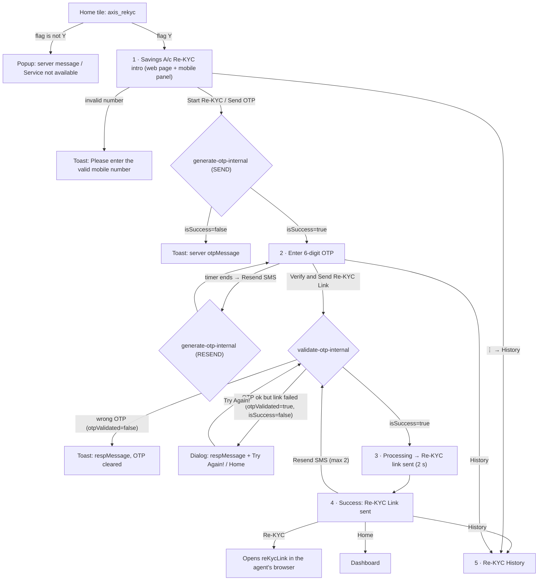

# 08 · Axis Savings A/c Re-KYC (assisted)

> **Confidence key:** ✅ confirmed in code · 🟡 inferred (naming, partial code) · ⬛ not visible in APK (backend, Flutter, partner SDK)

## Summary
- **Who / when:** an adhikari helps an existing **Axis Bank savings-account customer** whose KYC is due. The adhikari doesn't do the KYC in the app. They verify the customer's mobile with an OTP, and Axis then sends the customer an SMS link to finish Re-KYC on a bank web page. ✅
- **Entry points:**
  - Home tile with service code `axis_rekyc`, through `AxisRedirection.onAxisRekycClick()` ✅
  - The same OTP screen is reused by the **Axis dormant-account re-activation** flow (`ActivityAxisDormentIntro`, flow type `DORMANT`) ✅
- **Gates:** only the server preference `axis_rekyc` = `<x>|Y|<message>`. Anything other than `Y` shows `<message>` in a popup, or "Service not available" if there is no message. There are no eKYC, 2FA, device or balance checks in this flow. ✅
- **Successful outcome:** "Re-KYC Link sent". The customer gets an SMS link, the request appears in History as Pending, and the adhikari earns **₹10 commission** when the customer finishes Re-KYC. ✅ The commission figure is hard-coded in the layout.

## Flow diagram

## Screen by screen
| # | Screen (class) | Layout | What the user sees | User action | API call(s) | Next → (condition) | Conf. |
|---|---|---|---|---|---|---|---|
| 0 | Home tile → `AxisRedirection.onAxisRekycClick` | — | Axis Re-KYC tile on home | Tap | — (reads pref `axis_rekyc`) | Intro if the 2nd field is `Y`; otherwise an alert with the 3rd field as the message | ✅ |
| 1 | `ActivityIntroAxisRekyc` | `activity_axis_rekyc_intro` + `layout_axis_mobile_otp_bottom_panel` | Header **"Savings A/c Re-KYC"**; a scrollable web page (`axiscasa…/axisCasa/rekyc-landing-page.html`) explaining Re-KYC; bottom panel titled **"Start Re-KYC"** with **"Customer Mobile Number"** and **"Send OTP"** (dimmed until 10 digits); ⋮ menu → **History** | Enters the customer's mobile, taps Send OTP | `POST axisbank/generate-otp-internal` {mobile, action `SEND`, module `REKYC`} | OTP screen if `isSuccess=true`; otherwise a toast with `otpMessage`; API error → common error handler | ✅ (page content ⬛) |
| 1a | Validation | — | Toast **"Please enter the valid mobile number"** | — | — | Shown if the number doesn't start with 6–9 or contains 7 repeated digits (9999999, 8888888…) | ✅ |
| 2 | `ActivityAxisRekycOtp` | `activity_rekyc_axis_otp` | **"Enter 6 digit OTP sent to <mobile>"**; 6-box OTP; **"OTP Resend in mm:ss"** (duration from the server's `otpTime`), then **"Didn't receive OTP? Resend SMS"**; CTA **"Verify and Send Re-KYC Link"** (dormant flow: "Verify and Send Activation Link") | Customer reads the OTP aloud; adhikari enters it and taps the CTA | `POST axisbank/validate-otp-internal` {mobileNo, otp, otpId, aplRefId, module, appId, otpValidated} | See the branches; while waiting, an overlay shows **"Verifying Customer"** | ✅ |
| 2a | Resend | same | Timer resets | Resend SMS | `generate-otp-internal` (action `RESEND`) | Same screen, OTP cleared | ✅ |
| 2b | Wrong OTP | same | Toast with the server's `respMessage` (default "Something went wrong"); OTP boxes cleared | Re-enter | — | Same screen | ✅ |
| 2c | `RekycReAttemptDialog` | `dialog_rekyc_link_attempt` | The server's `respMessage` (default "Something went wrong!"); **"Try Again!"** / **"Home"** | Try Again! | Repeats `validate-otp-internal` with the **same OTP** and `otpValidated=true` | Back to the result handling | ✅ |
| 3 | Verify dialog (`G0`) | `dialog_rekyc_verify` | **"Processing"** animation, then **"Re-KYC link sent"** (dormant: "Re-Activation link sent") | — (2-second pause) | — | Success screen | ✅ |
| 4 | `ActivityAxisRekycSuccess` | `activity_rekyc_success` | Green header **"Re-KYC Link sent"**; **"An SMS with a link to do Re-KYC has been sent on customer's mobile number"**; timeline **"Re-KYC initiated"** · date-time · **"Pending"**; **Next Steps**: "1. Click on link — Open Link sent to customer mobile number", "2. Enter Details — Enter Axis Bank & Aadhaar Details", "3. Submit Details — Submit details and complete the Re-KYC"; **"You will earn ₹10 commission when customer completes the Re-KYC successfully."**; buttons **Resend SMS · Re-KYC · History · Home**. The header, date and footer text come from the server (`topMessage`, `dateTime`, `bottomMessage`) and replace these layout defaults | — | — | — | ✅ (server copy ⬛) |
| 4a | Resend SMS | same | — | Tap | Repeats `validate-otp-internal` with the saved request | After 2 resends: toast **"You have exceeded the maximum retry limit to generate the ReKYC link. Please start the process again"** | ✅ |
| 4b | Re-KYC button | — | Opens `reKycLink` in the phone's browser, on the **adhikari's** device | Tap | — | Axis web Re-KYC (not in the app) | ✅ / ⬛ |
| 4c | Home | — | — | Tap | — | Dashboard (clears the screen stack) | ✅ |
| 5 | `ActivityAxisRekycHistory` | `activity_axis_rekyc_history` | List of requests: customer mobile, date/time, activation status; search **"Search 'Mobile Number'"**; **Filter by date** (From/To); "Download Statement" label; empty state "No record found" | Search / filter | `POST axisbank/fetch-history-common` (module `REKYC`) | — | ✅ (status values ⬛) |

## Branches, errors and edge states
- **Service off:** a popup with the server's message from `axis_rekyc`; the flow never starts · `AxisRedirection.serviceEnableNot` ✅
- **OTP send fails:** a toast with `otpMessage`, and the user stays on the intro ✅
- **Wrong OTP vs link failure:** the server's `otpValidated` flag separates the two. A wrong OTP clears the boxes; a correct OTP where link generation failed opens the "Try Again!" dialog, which retries without a new OTP ✅
- **No internet:** toast "no internet" on resend, validate and Resend SMS ✅
- **Dormant re-activation reuses this flow:** the same OTP screen and API with module `DORMANT` and different labels, landing on `ActivityAxisDormantSuccess` ✅

## What we could not see
- What the intro web page says, and the Axis web Re-KYC journey the customer completes (Aadhaar and bank details) ⬛
- How "Pending" changes to completed, and when the ₹10 commission is paid. There is no in-app notification path for this; History is the only place to check ⬛
- The server-side cap on resends or OTP attempts, beyond the app's limit of 2 Resend SMS ⬛

## Observations for product
1. **The adhikari earns from Re-KYC but doesn't control completion.** The customer has to open the SMS link and finish alone. The app gives no way to follow up beyond History, which has no push notification or nudge.
2. **The "Re-KYC" button opens the customer's link on the adhikari's phone.** That's useful for doing it together at the counter, but the customer's Aadhaar and bank details then get typed on the agent's device. This is a policy and UX question worth confirming.
3. **Resend SMS re-runs the full validate call,** not a lightweight resend, and the app caps it at 2.
4. **Dead code:** `generateAxisRekycLink` (`axisbank/generate-link-common`) is defined but never called.
5. **History has a "Download Statement" label** but no download is wired up in this module 🟡.

## To verify in live capture (phase 4)
- What the landing web page says, and whether it scrolls the bottom panel out of view
- The real `topMessage` / `bottomMessage` copy on success
- History status values (Pending / Completed / Expired?) and whether a completed Re-KYC shows the commission
- Whether the customer's SMS arrives from Axis or Spice Money, and how long the link stays valid

## Evidence
- `spice/mudra/newDashboard/utility/serviceHandling/AxisRedirection.java`: `onAxisRekycClick`, `serviceEnableNot`, the `axis_rekyc` case in the tile switch
- `spice/mudra/axis/activity/rekyc/ActivityIntroAxisRekyc.java`: `onCreate` (title, web view URL, bottom panel)
- `spice/mudra/axis/common/AxisMobileOtpBottomPanelBinder.java`: `a()` (mobile validation)
- `defpackage/c.java` case 23 (send OTP), `defpackage/g.java` `o()` (intro → OTP), `defpackage/q.java` case 12 (OTP → success)
- `spice/mudra/axis/activity/rekyc/ActivityAxisRekycOtp.java`: observers for send/validate, `D0` (labels), `E0` (re-attempt), `F0` (timer), `G0` (verify dialog), `H0` (validate request)
- `spice/mudra/axis/activity/rekyc/ActivityAxisRekycSuccess.java`: `setListener` (Resend limit 2, Re-KYC link, History, Home)
- `spice/mudra/axis/activity/rekyc/ActivityAxisRekycHistory.java`, `fragment/DateFilterNewThemeDialog.java`
- `spice/mudra/network/ApiInterface.java`: `fetchOtpAxisRekyc`, `validateOtpAxisRekyc`, `generateAxisRekycHistory`, `generateAxisRekycLink`; base URL `Constants.AXIS_MASTER_DATA_API` = `https://axiscasa.spicemoney.com/axisCasa/`
