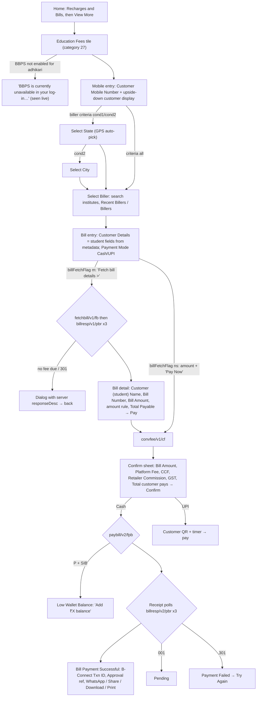

# 09 · Bill payment: Education Fees (BBPS)

> **Confidence key:** ✅ confirmed in code · 🟡 inferred (naming, partial code) · ⬛ not visible in APK (server data: billers, fields, amounts)
>
> **Built from:** the APK (v6.6.62) plus the generic BBPS engine mapped in [flow 05](05-bbps-bill-payment.md). The first four screens were seen live on staging on 13 Oct for Electricity, and they behave the same for every category.

## What is specific to education fees
- **There is no education-specific screen or logic in the app.** Education Fees is one server-defined BBPS category that runs on the same generic engine as Electricity or Water. ✅
- **Category identity:** `BBPSServiceEnum.EDUCATION_FEES`, category id **`27`**, text key `education`. The English name comes from the server's category list (`fetchmdmcategories`). The Hindi and Marathi label **"एजुकेशन फीस"** is hard-coded and set when the server name contains "Education". ✅ (`BBPSServiceEnum`, `DashboardFragmentRevamp$setBBPSData$1`)
- **It is a home-screen tile.** `KotlinCommonUtilityKt.q()` maps tile code `B-27` / `B_27` to the bundled icon **`nd_tile_education_fee`**. `DashboardFragmentRevamp.bbpsNodeCreation()` / `bbpsNodeCreationFromMDM()` turn the category into a home tile in **Recharges and Bills**, with service details `B|<criteria>|27|<name>`. The server's home layout decides whether it shows in the first rows or under View More. ✅
- **Everything else is decided by server metadata for each biller:** ⬛
  - which schools, colleges or boards appear;
  - whether a state or city must be picked first (`selectCriteria` all / cond1 / cond2);
  - the student fields (labels, input type, validation);
  - whether the bill is fetched (`billFetchFlag` m / ns);
  - the amount rule (`amountType` ADHOC / RANGE / ABOVE / BELOW);
  - whether UPI is allowed.
- **What education billers on BBPS typically look like** (🟡, industry norm, not in the APK):
  - institutes are listed by state and city;
  - the student is identified by a Student ID, Enrolment or Roll Number, sometimes with Date of Birth or Class;
  - the fee is fetched, then paid in full or above the fetched amount.

## Flow diagram

## Screen by screen
| # | Screen (class) | Layout | What the user sees | User action | API call(s) | Next → (condition) | Conf. |
|---|---|---|---|---|---|---|---|
| 1 | Home → **Recharges and Bills** tile "Education Fees" (or under **View More**) | home (`DashboardParentAdapter`, `DashboardTileAdapter`) | Home tile with the app's own icon **`nd_tile_education_fee`** (blue-to-red gradient mortarboard with ₹). The server's home layout includes tile code `B-27`, or appends the category from the BBPS list into the Recharges and Bills section. Visible or under View More depending on server order (on staging, 13 Oct, it was under View More) | Taps Education Fees | `bbpsservices/fetchmdmcategories/1.0/APP/{clientId}` (cached by `catVer`) | 2; or "BBPS unavailable" if not enabled for the ID | ✅ tile + icon / ⬛ position |
| 2 | `BBPSMobileEntryActivity` | `activity_bbps_mobile_entry` | Title "Education Fees", Bharat Connect logo, "Customer Mobile Number", **upside-down 7-segment customer display** once typed, Continue; History / Earnings / Commissions / Help / Complaints | Types the parent's mobile → Continue | — | 3 (state needed) or 4 | ✅ (live for Electricity) |
| 3 | `BBPSStateSelectionActivity` (+ `BBPSCitySelectionActivity` for cond2) | `activity_bbps_area_selection` | "Select State", search, list; "Current location" auto-pick | Picks a state (and a city) | — (local MDM) | 4 | ✅ / 🟡 whether education billers need it |
| 4 | `BBPSBillerSelectionActivity` | `activity_bbps_biller_selection` | "Select Biller", "Selected State" + Change, "Search an operator", "Recent Billers", "Billers", "Load more", "No biller found" | Searches and taps the school | `bbpsservices/fetchtopbillers/1.0/APP/{clientId}` | 5 | ✅ (institutes ⬛) |
| 5 | `BBPSBillEntryActivity` | `activity_bbps_bill_entry` | Institute name + Change; "Customer Details" = **student fields from biller params** (text / date picker / dropdown); "Bill Receipt will be sent on … Change"; "**Note:** Please check the old bill of customer and validate all details before proceeding"; Payment Mode Cash / UPI; CTA **"Fetch bill details >"** (fetch billers) or amount chips + "Pay Now" (no-fetch) | Fills student ID etc. → CTA | `fetchautofilldata` (if autofill) | 6 / 8 | ✅ (fields ⬛) |
| 6 | Fetch (loader) | progress | "Getting Bill, Please wait!", up to 3 polls × ~20 s | — | `bbpswsapi/app/ws/fetchbill/v1/fb` → `billresp/v1/pbr` | 7; "no bill due" / error dialog with `responseDesc` | ✅ |
| 7 | `BBPSBillDetailActivity` | `activity_bbps_bill_detail` | Customer Name (the student), Customer Mobile Number, Bill Number, Bill Amount, editable Amount + Minimum/Maximum Allowed (by `amountType`), View More (bill details from the institute, e.g. fee period ⬛), PAYMENT MODE, Total Payable, **Pay** | Confirms or edits amount → Pay | — | 8; amount-rule toasts | ✅ |
| 8 | `BBPSTransactionConfirmationDialog` | `bbps_transaction_confirmation_dialog` | "Confirm bill payment of ₹X"; Customer name; Mobile Number; Payment Mode; Bill Amount; Biller Platform Fee (Digital Fee); Customer convenience fee (editable, "View CCF Slab"); Retailer Commission; Gst Charges; APPLY COUPON; "Enable for all future payments"; **Total customer pays**; Confirm | Confirm | `bbpswsapi/app/ws/convfee/v1/cf` | 9 (Cash) / UPI QR | ✅ |
| 9 | Processing | progress | "Processing payment, Please wait!" | — | `bbpswsapi/app/ws/paybill/v2/fpb` | 10; **Low Wallet Balance** on `P`+`SIB` | ✅ |
| 9a | `BBPSLowWalletBalanceDialog` | `dialog_bbps_low_wallet_balance` | "Low Wallet Balance", "Add ₹{shortfall} to your wallet to complete this payment.", "Add ₹X balance" / Cancel | Add balance | — | Wallet | ✅ |
| 10 | `BBPSPaymentReceiptActivity` | `activity_bbps_bill_payment_receipt` | "Processing Payment / Please do not close this page", then green "**Bill Payment Successful**" (Inc all taxes), with Customer Name, Mobile, **B-Connect Txn ID**, Biller ID, **Approval/Biller reference no**, Consumer ID, Payment Mode, Bill Number, Bill amount, Conv. Fee, Platform Fee, Total; WhatsApp (Free) / Share / Download / Print; New Bill / History / Help / Home | Shares the receipt with the parent | polls `bbpswsapi/app/ws/billresp/v2/pbr` ×3 | yellow **Pending** (001) / red **Payment Failed** + Try Again (301) | ✅ |

## Product observations for education fees
1. **Placement on home is a server switch.** The app already ships the Education Fees home tile and icon. Whether it sits in the first rows or under View More is set by the server's home layout (on staging on 13 Oct it was under View More). It can be promoted in admission and term-fee season without an app release. ✅ / ⬛
2. **Fees are high-ticket, and the wallet isn't checked first.** The low-balance error only arrives after the pay call (`SIB`). For a ₹15,000–₹50,000 term fee, the adhikari learns at the very last step that the wallet is short. A balance check at the bill-detail step would save a failed attempt. ✅
3. **The receipt is the parent's proof of payment for the school.** The B-Connect Txn ID and Approval/Biller reference are the school's reconciliation keys. WhatsApp sharing is already the default, which fits.
4. **Upside-down customer display:** with parents paying at the counter, this display helps them confirm their number. ✅
5. **The service gate comes late** (seen live): if BBPS is off for the adhikari, they only find out after choosing the institute.

## What we could not see
Education billers and their fields, fetch rules, amount rules, convenience fee and commission slabs, and settlement are all server-side. Live capture needs a test ID with BBPS enabled, plus a staging education biller.

## Evidence
- `spice/mudra/bbps/enums/BBPSServiceEnum.java`: `EDUCATION_FEES("27","education")`
- `spice/mudra/newDashboard/fragments/DashboardFragmentRevamp$setBBPSData$1.java`: category loop, Hindi label "एजुकेशन फीस" for names containing "Education"
- Generic engine: see [flow 05](05-bbps-bill-payment.md#evidence) (`BBPSMobileEntryActivity`, `BBPSBillerSelectionActivity`, `BBPSBillEntryActivity`, `BBPSBillDetailActivity`, `BBPSTransactionConfirmationDialog`, `BBPSPaymentReceiptActivity`)
- Live staging captures for steps 1–4 (Electricity): [captures/live/05](../captures/live/05/)
