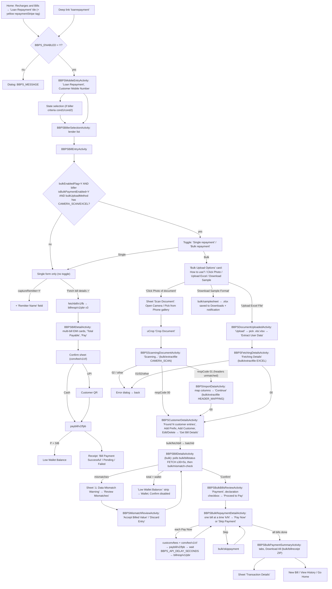

# 10 · Bill payment: Loan Repayment (BBPS), single and bulk

> **Confidence key:** ✅ confirmed in code · 🟡 inferred (naming, partial code) · ⬛ not visible in APK (backend, server data)
>
> **Built from:** the APK (v6.6.62), on top of the generic BBPS engine in [flow 05](05-bbps-bill-payment.md). Flow 05 already covers mobile entry, state/biller selection, the bill-entry form, fetch, the amount rules, the confirm sheet, UPI QR, low wallet and the receipt. This file maps only what is loan-specific, plus the whole **bulk repayment** module (`spice/mudra/bbps/bulkPayment/`). Screen-level copy for every screen and dialog is in [`10-loan-repayment-screens.json`](10-loan-repayment-screens.json). A clickable prototype of both paths is in [`prototypes/bbps-loan-repayment-prototype.html`](../prototypes/bbps-loan-repayment-prototype.html), with screenshots of every screen in [`captures/prototype/10-loan-repayment/`](../captures/prototype/10-loan-repayment/).

## Summary
- **Who / when:**
  - **Single repayment:** a walk-in borrower pays one loan EMI in cash, or by UPI QR if the adhikari is UPI-onboarded.
  - **Bulk repayment:** a microfinance-style collection. The adhikari has a list of many borrowers' EMIs (a printed EMI sheet, or an Excel file), pays them all from their wallet in one session, and collects cash from the group.
  - The bulk copy throughout is loan-specific: "Loan ID", "Agency Code", "EMI list", the "micro-finance agencies" prefix note, and the "Loan Repayment" sub-title.
- **What is loan-specific and what is the generic engine:**
  - **Generic (flow 05):** category id **`23`** (`BBPSServiceEnum.LOAN_REPAYMENT`, key `loanRepayment`) runs on the same mobile entry → biller → bill entry → fetch → bill detail → confirm → receipt engine as every other category. ✅
  - **Loan-flavoured, but driven by biller flags:**
    - the **Remitter Name** field (`captureRemitter=Y`);
    - **multi-bill EMI cards** (`selectionType` SINGLE / MULTIPLE / ALL, plus an "EMI amount" response tag);
    - the receipt's **Loan Number** row (shown when the category name contains "loan").
    - None of these check category 23. They key off biller metadata or the category *name*. ✅
  - **Bulk repayment:**
    - **Gate:** the "Single repayment / Bulk repayment" toggle is not keyed to category 23 either. ✅ It shows only when **all three** are true (`BBPSBillEntryActivity.updatePaymentTypeVisibility`):
      1. server home config `bulkEnabledFlag = Y` (HomeINIT key → `Constants.KEY_BULK_ENABLED_FLAG`), **and**
      2. biller `isBulkPaymentEnabled = Y`, **and**
      3. biller `bulkUploadMethod` contains `CAMERA_SCAN` **or** `EXCEL`.
    - **Hard-coded loan copy:** everything downstream is loan-worded. So in practice bulk is a loan / MFI feature, switched on per biller. 🟡
    - **Which options show:**
      - "Click Photo of document" shows if `bulkUploadMethod` contains `CAMERA_SCAN`.
      - "Upload Excel File" shows if it contains `EXCEL`. ✅
- **Entry points:**
  - **Home tile:** "Recharges and Bills" → **Loan Repayment** tile. ✅
    - Icon `nd_tile_bbps_loan` (`KotlinCommonUtilityKt.q("23")`).
    - Service details `B|<criteria>|23|<catName>`.
    - Hindi label "लोन रीपेमेंट".
  - **Yellow tag on the tile:** `DashboardFragmentRevamp.bbpsNodeCreation` adds a yellow tag (`TbBackColors.YELLOW_ROUND`) when `catDisplayName` equals "loan repayment". ✅
    - Its visibility and text come from server HomeINIT config key **`repaymentStripe`**, stored as `REPAYMENT_STRIPE`, format `"<tbvs>,<tbtxt>"` (`DashboardActivityRevamp.setInitResponse`).
    - The "Get Com.." seen live is that server text truncated. The full value (probably "Get Commission…") is ⬛.
  - **Deep link / notification action:** `loanrepayment` → `DashboardFragmentRevamp.navigateToBBPSelectedItem("Loan Repayment")` (`DashboardActivityRevamp.hitDeeplinkService`, `onMessageEvent(DeepLinkEvent)`). ✅
  - **History:** BBPS History → a bulk row → `BBPSBulkPaymentDetailsActivity` (`BBPSTransactionsAdapter`). ✅
- **Preconditions / gates:**
  - `BBPS_ENABLED=Y`; otherwise the `BBPS_MESSAGE` dialog shows (flow 05). ✅
  - **Bulk only:**
    - the three flags above;
    - camera permission (photo path);
    - wallet balance ≥ the batch total (a client-side pre-check that disables Confirm; see branches).
  - **Payment mode:** bulk is **cash / wallet only** (`paymentMode=CASH` is hard-coded in the bulk pay requests). ✅
- **Successful outcome:**
  - **Single:** the standard "Bill Payment Successful" receipt (flow 05 12a).
  - **Bulk:** a **Payment Summary** with All / Success / Failed / Skipped / Pending tabs, per-transaction details sheets and **Download All** (a ZIP of receipts in Downloads). ✅

## Flow diagram

## Screen by screen

### A. Single repayment (deltas over flow 05)
| # | Screen (class) | Layout | What the user sees | User action | API call(s) | Next → (condition) | Conf. |
|---|---|---|---|---|---|---|---|
| A1 | Home tile (`DashboardFragmentRevamp.bbpsNodeCreation`) | home tiles | "Loan Repayment" tile, icon `nd_tile_bbps_loan`, yellow tag with server text (seen live: "Get Com..") | Taps tile | `fetchmdmcategories` (cached) | A2; `BBPS_MESSAGE` dialog if BBPS is off | ✅ (tag text ⬛) |
| A2 | `BBPSMobileEntryActivity` | `activity_bbps_mobile_entry` | Title "Loan Repayment"; "Customer Mobile Number"; upside-down customer display; "Continue"; History / Earnings / Commissions / Help / Complaints / Bill Reminders cards | Enters the borrower's mobile | — | A3 or A4 by biller `selectCriteria` | ✅ |
| A3 | `BBPSStateSelectionActivity` | `activity_bbps_area_selection` | "Select State" (GPS auto-pick) | Picks a state | — | A4 | 🟡 (depends on lender criteria) |
| A4 | `BBPSBillerSelectionActivity` | `activity_bbps_biller_selection` | "Select Biller", "Search an operator", "Recent Billers", "Billers", "Load more", "No biller found" | Picks the lender (NBFC / MFI / bank) | `fetchtopbillers` | A5 | ✅ (lender list ⬛) |
| A5 | `BBPSBillEntryActivity` — **Single repayment** tab | `activity_bbps_bill_entry` | **If bulk is enabled for the biller:** segmented "Single repayment" (selected) / "Bulk repayment". "Customer Details"; dynamic loan fields (e.g. Loan Account Number, from biller params); **"Remitter Name"** + "This is the name of customer who is making the payment" (if `captureRemitter=Y`); "Bill Receipt will be sent on … Change"; "Note : Please check the old bill of customer and validate all details before proceeding"; "Payment Mode" Cash / UPI; CTA "Fetch bill details >" (or amount + "Pay Now" for no-fetch billers) | Fills the loan ID → CTA | `fetchautofilldata` (if autofill) | A6; or C1 if the Bulk tab is tapped | ✅ |
| A6 | Fetch loader | progress | "Getting Bill, Please wait!" | — | `bbpswsapi/app/ws/fetchbill/v1/fb` + `billresp/v1/pbr` ×3 | A7; error dialog (server `responseDesc`) | ✅ |
| A7 | `BBPSBillDetailActivity` | `activity_bbps_bill_detail`, `item_multiple_bill_card` | Customer Name, Customer Mobile Number, Remitter Name, Bill Number, "View More", "Bill Amount", editable "Amount" + "Minimum Allowed"/"Maximum Allowed". **Several EMIs:** a note (e.g. "We have found 3 Loan Repayments against this number. You can pay one Loan Repayment at a time.") and cards with radio (SINGLE) or checkbox (MULTIPLE), "Due: …", expandable "Bill amount" input "Amount". "PAYMENT MODE" Cash/UPI, "Total Payable", "Pay" | Picks EMI(s), edits amount → Pay | — | A8; toasts "Please select bill to pay", "Amount in {tag} is incorrect", "Entered amount must be a multiple of {n}", range messages | ✅ |
| A8 | `BBPSTransactionConfirmationDialog` | `bbps_transaction_confirmation_dialog` | "Confirm bill payment of ₹X", "You are paying for the following Bills" (multi-bill), fee rows, "Total customer pays", "Confirm" | Confirm | `convfee/v1/cf` | A9 (Cash) / UPI QR | ✅ |
| A9 | Pay + receipt (`BBPSPaymentReceiptActivity`) | `activity_bbps_bill_payment_receipt` | "Bill Payment Successful" / "Pending" / "Payment Failed"; **"Loan Number"** row with tap-to-copy ("Loan Number Copied" / "Loan Number Should not Blank") | Share / print / New Bill | `paybill/v2/fpb` (or `qpaybill/v2/qpb`), `billresp/v2/pbr` | — | ✅ (row visibility, see branches 🟡) |

### B. Bulk repayment
| # | Screen (class) | Layout | What the user sees | User action | API call(s) | Next → (condition) | Conf. |
|---|---|---|---|---|---|---|---|
| C1 | `BBPSBillEntryActivity` — **Bulk repayment** tab | `activity_bbps_bill_entry` (`bulk_payment_layout`) | Form and CTA hidden. "Bulk Upload Options" + "How to use?"; card "Click Photo of document" / "Capture image of the EMI list. We will read and fill the details for you automatically." (CAMERA_SCAN); card "Upload Excel File" / "Download and fill excel sheet and upload it" + "Download Sample Format" (EXCEL) | Picks an option | — | C2 / P1 / X1 / X3 | ✅ |
| C2 | "How to use?" bottom sheet | `bottom_sheet_bulk_repayment_guide` | "How Bulk Loan Repayment works?", a phone screenshot, a play button | Watch | — (video ID from the cached help-videos list `bulkBBPS`, en/hi) | YouTube app | ✅ |
| P1 | Scan options sheet | `bottom_sheet_bbps_scan_document` | "Scan Document"; "Open Camera" / "Capture a new image from your camera"; "Pick from Phone gallery" / "Select an existing image from your gallery" | Picks a source | — | Camera (needs CAMERA permission) or gallery → P2 | ✅ |
| P2 | uCrop | `UCropActivity` | Toolbar "Crop Document", free-style crop with 3×3 grid; output ≤ 2048×2048 | Crops → ✓ | — | P3; toast "Crop error: …" | ✅ |
| P3 | `BBPSScanningDocumentActivity` | `activity_bbps_scanning_document` | "Scanning Document", "Scanning...", "Extracting details from document", progress 50 → 100 % | Waits; back → "Exit Scanning" dialog | `bbpsservices/bulk/extractfile/1.0/APP/{clientId}` (multipart `file` + `data`: billerId, catId, state, city, fileName, requestType `CAMERA_SCAN`) | `00` → C3; `01` (columns not recognised) → P4; `02`/other → "Error" dialog; file checks (max 50 MB) | ✅ |
| P4 | `BBPSImportDataActivity` | `activity_bbps_import_data`, `item_column_mapping` | "Import Data"; "Extracted Columns from document"; "Below are the columns detected from your uploaded document/image. Map the extracted columns with the target field to proceed."; rows "Extracted Field" (spinner, "Select") → "Target Field" with "Mapped automatically" / "Mapped" / "Needs mapping" / "Mapping Optional"; "Continue" (enabled when every EXTERNAL field is mapped) | Maps columns → Continue | `bulk/extractfile` again, requestType `HEADER_MAPPING` + `extractId` + `headerMapping[]` | `00` → C3; error dialog | ✅ |
| X1 | Download sample | progress + system notification | "Getting download link..." → file `<Biller>_Sample_<yyyyMMdd_HHmmss>.xlsx` saved to Downloads, with a "Downloads" notification | — | `bbpsservices/bulk/samplesheet/1.0/APP/{clientId}` (billerId, catId, state, city) → base64 `excelBytes` | Stays on C1; toasts "Data is missing", "Failed to get download link…", "No file data found", "Download already in progress..." | ✅ |
| X3 | `BBPSDocumentUploadedActivity` | `activity_bbps_document_uploaded` | "Document Uploaded"; Excel icon + file name; link "Upload" (becomes "Reupload"); "Extract User Data" (disabled until a file is picked) | Upload → system picker (`*/*`) → Extract | — | X4; toast "Please select a valid Excel file (.xls or .xlsx)" | ✅ |
| X4 | `BBPSFetchingDetailsActivity` | `activity_bbps_fetching_details` | "Fetching Details" / "Fetching Details" / "Fetching bill details from the data" + progress | Waits | `bulk/extractfile` requestType `EXCEL` | `00` → C3; any other code → "Error" dialog (no column-mapping fallback on Excel) | ✅ |
| C3 | `BBPSCustomerDetailsActivity` | `activity_bbps_customer_details`, `item_bbps_customer_card` | Header "Found N customer entries"; biller + "Operator"; "Add Prefix to all Loan ID/Number" + "Add Prefix" (one-time tooltip: "Add prefix to all Loan ID/Number at once for required micro-finance agencies"); "Missed some Customers?" + "Add Customer"; red card "Some columns could not be detected" with an "Add" row per missing field; "Customer Details" list of cards (fields, "Edit", "Delete", inline "Missing: …" / "All fields are required"); CTA "Get Bill Details" | Fixes rows → Get Bill Details | `bbpsservices/bulk/fetchbill/1.0/APP/{clientId}` (agentMobileNo, billerId, billCategory, billerName, paymentMode, extractId, extractType, addPrefixConsent, prefixText, `bulkBillFetchDetails[]` {billerParam[], customerMobileNo, customerName}, responseType SYNC) | `batchId` → C4; "Error" dialog | ✅ |
| C3a | Add/Edit customer sheet | `bottom_sheet_bbps_add_edit_customer` | "Add Customer" / "Edit Customer"; dynamic inputs (required ones marked " **"); "Add" / "Edit" | Saves | — | C3; field errors; "Duplicate Data Found" dialog | ✅ |
| C3b | Delete dialog | `dialog_delete_bbps_customer` | "Delete Item" / "Are you sure you want to delete this item? This can’t be undone" / "Delete" / "Cancel" | Confirms | — | C3 | ✅ |
| C3c | Add Prefix sheet | `dialog_bbps_add_prefix` | "Add Prefix" (or "Edit Prefix"); input "Prefix"; "max 5 characters allowed" (server `addPrefixMaxLength`, default 5); consent "I confirm that I am manually adding/modifying the Loan Account Number prefix and verify its correctness."; button "Add Prefix" / "Update" (enabled only with text + consent) | Adds prefix | — | C3 (loan IDs shown as "PREFIX 12345") | ✅ |
| C3d | Add missing field dialog | `dialog_add_missing_field` | Title "Add Mobile Number"; "Add a common value for all customers" + "Enter Value"; "OR"; "Add individual values for each customer"; "Add" | Fills mobile numbers | — | C3; "Mobile number must be 10 digits" etc. | ✅ |
| C4 | `BBPSBillDetailsActivity` (bulk) | `activity_bbps_bill_details`, `item_bill_detail` | Progress dialog (default copy "Checking payment status..."), then "Bill Details"; per-bill card (loan ID, "Due Date: …", "Bill Id: …", "Bill Period: …", "₹amt", "Amount", "Edit"); footer "** The amount for each bill may vary after applying the CCF on the bill payment screen.", "Entries" N, "Entries Discarded", "Bill Amount" ₹total; "Low Wallet Balance:" strip; "Data mismatch—please verify before proceeding."; "Enable CCF for all"; "Payment Mode" "Cash"; "Confirm" | Reviews / edits amounts → Confirm | Polls `bbpsservices/bulk/billstatus/1.0/APP/{clientId}` (batchId, requestType FETCH, status ALL) every `bulkStatusFetchInterval` (default 5000 ms), up to `bulkStatusFetchMaxAttemps` (default 30), until `reCheckFlag=N`; then `bulk/mismatch-check/1.0/APP/{clientId}` (batchId, mappedData) | C5 (mismatches); C6 (Confirm); Wallet (low balance) | ✅ |
| C4a | Edit amount dialog | `dialog_edit_amount` | "Edit Amount", "Enter new amount", "Update" | Edits | — | C4; "Amount cannot be empty", "Amount must be greater than 0", "Amount cannot exceed 999,999,999.99", "No changes made to amount" | ✅ |
| C5 | Mismatch warning sheet | `bottom_sheet_mismatch_warning` | "⚠️ Data Mismatch Warning"; "We found discrepancies between your uploaded data and NPCI records."; "Some customer names and bill amounts don't match our system data. Please review and confirm before proceeding."; "We've cross-verified your data with NPCI records. Please resolve discrepancies to ensure successful payments."; "⚠️ Proceeding with unmatched data will result in failed transactions for those customers."; "Review Mismatches" | Review | — | C5a | ✅ |
| C5a | `BBPSMismatchReviewActivity` | `activity_bbps_mismatch_review`, `item_bbps_mismatch` | "Mismatching Values from Biller (NPCI)"; "We have found X mismatching values from Y bills"; columns "Extracted Value" / "Biller Value"; per row "Loan ID: …", Name / Amount pairs, "Discard Entry", "Accept Billed Value" | Accepts or discards each row | — | C4 (snackbar "Field matched successfully" when none are left) | ✅ |
| C6 | `BBPSBulkBillsReviewActivity` | `activity_bbps_bulk_bills_review`, `item_bulk_loan_bill` | "Payment"; biller + "Operator"; read-only list (loan ID, "Due Date", "Bill Id", "Bill Period", "₹", "AMOUNT"); the "** The amount…CCF…" note; checkbox "I have read, understood, and agree to the **declaration**"; "Proceed to Pay" | Ticks the declaration → Proceed | — | C6a (tap "declaration"); C7 | ✅ |
| C6a | Declaration sheet | `bottom_sheet_bulk_bbps_declaration` | "📋 IMPORTANT DECLARATION"; "By proceeding with this bulk payment, I confirm that:" + five ✓ lines (including "I understand that AI-assisted data extraction may contain errors" and "Any losses due to wrong payments will be borne by me"); "Okay" | Okay | — | C6 | ✅ |
| C7 | `BBPSBulkRepaymentDetailActivity` | `activity_bbps_bulk_bill_payment_detail` | "Payment confirmation" + sound toggle; progress bar + counter "k/N"; "View Payment Status"; biller + "Loan Repayment"; customer name; rows "Mobile Number", "Agency Code", "Bill Amount", "Biller Platform Fee (Digital Fee)", ☐ "CCF", "GST Charges", "Total"; "Retailer commission: ₹ x" + "VIEW SLABS"; instant-cashback note; zero-amount warning "This payment should be skipped as the amount is ₹0."; "Skip Payment" / "Pay Now" | Pays or skips each bill in turn | Per bill: `custconvfees/1.0/APP/{clientId}` + `bbpswsapi/app/ws/convfee/v1/cf` → `paybill/v2/fpb` (fetchBillRefId, CASH, custConvFee …) → wait `BBPS_API_DELAY_SECONDS` (default 5 s) → `billresp/v1/pbr`; skip: `bulk/skippayment/1.0/APP/{clientId}` (refid, batchId); CCF tick: `updtsettings/v1/us` | Next bill; after the last → C8. Voice clip (`bbpsTxnSonic`) on success if sound is on | ✅ |
| C7a | Payment status sheet | `bottom_sheet_bulk_bbps_payment_status` | "Payment Status"; "Payment Success" list (name, txn id, amount); "Payment In Process" list (remaining bills) | Close | — | C7 | ✅ |
| C7b | Exit confirm | AlertDialog | "Do you really want to exit?" or "You're currently skipping S bills from your N total, and so far, you've successfully paid P bills. Are you sure you want to exit?" Yes / No | — | — | Yes → leaves | ✅ |
| C8 | `BBPSBulkPaymentSummaryActivity` | `activity_bbps_bulk_payment_summary`, `item_bbps_transaction_status` | "Payment Summary", "hh:mma \| dd-MMM-yy"; tabs "All" / "Success" / "Failed" / "Skipped" / "Pending"; "Total Transactions: N" (per tab: "Successful…/Failed…/Skipped…/Pending Transactions: N"); rows "Transaction ID:\n…" + "Amount"; empty "No Record found" / "No transactions available for the selected filter"; bottom bar "New Bill" / "View History" / "Go Home" / "Download All" | Filters, opens a row, downloads | `bulk/billstatus` (requestType PAY, status ALL); `bulk/billreceipt/1.0/APP/{clientId}` → `{batchId}.zip` in Downloads | C8a; New Bill → home with BBPS mobile entry reopened; History | ✅ |
| C8a | Transaction details sheet | `bottom_sheet_transaction_details` | "Transaction Details"; "Loan Repayment"; "Loan Number", "B-Connect Txn ID", "Biller ID", "Approval/Biller Reference", "Customer Name", "Customer Mobile Number", "Consumer ID", "Payment Mode", "Payment Channel", "Bill ID", "Bill Date", "Bill Amount", "Customer Convenience Fee including GST", "Biller Platform Fee (Digital Fee)", "Total Amount", "Website URL", "Transaction Date", "GST Number", "Adhikari BBPS ID & Name"; copy icons ("Copied to clipboard") | Copies | — | — | ✅ |
| H1 | `BBPSBulkPaymentDetailsActivity` (from History) | `activity_bbps_bulk_payment_details`, `item_bulk_payment_details` | "Bulk Payment" / "Spice Money"; rows with a "Bulk Payment" tag, status, amount, receipt icon; "No Record found" | Opens | `bulk/billstatus` | — | ✅ |

## Branches, errors and edge states
- **Toggle visibility:** see the Summary. The toggle container is visible by default in XML and hidden by `updatePaymentTypeVisibility()`, which runs when biller details are set. ✅
  - A legacy radio toggle ("Single" / "Bulk Payment" + "Experimental" badge, `payment_type_toggle`) is permanently `gone`.
  - A debug "Autofill" button is force-hidden (`setupDebugAutofillButton`). ✅
- **Excel tap bug:** `initUploadExcelFileOption()` attaches the click listener only `if (mViewModel.s())`, i.e. only when `bulkUploadMethod` contains `CAMERA_SCAN`. ✅ (code) / 🟡 (impact)
  - **Result:** for an Excel-only biller the "Upload Excel File" card is visible, but tapping it does nothing. "Download Sample Format" still works.
- **Remitter name (single):**
  - Empty → "Please enter remitter name".
  - Fails the server gibberish regex (`gibberishRegex` from category MDM, stored as `regex_bbps_remitter`) → "Please enter valid remitter name", with a red ✕. A valid name gets a green ✓. ✅
- **Single multi-bill:**
  - The note copy depends on biller `selectionType`:
    - SINGLE → "We have found N {category}s against this number. You can pay one {category} at a time."
    - MULTIPLE → "We have found N {category}s. You can pay all {category} at once."
    - ALL → "We have found N {category}s against this {category}."
  - Validation errors: "Please select bill to pay", "Amount in {EMI tag name | selected option} is incorrect", "Entered amount must be a multiple of {amountMultiple}". ✅
- **Photo extraction codes:**
  - `00` → customers. ✅
  - `01` → column mapping (P4), or "No data found in the document" if no headers were extracted. ✅
  - `02` → the server's `respDesc` in an "Error" / "OK" dialog that closes the screen. ✅
  - `099` → logout. ✅
- **File checks** (shared view-model, so the Excel path shows "image" copy too):
  - "File not found: The selected file does not exist"
  - "Access denied: Cannot read the selected image file. Please check file permissions"
  - "Invalid file: The selected image file is empty"
  - "File too large: The selected image file is too large (max 50MB)"
  - "Memory error: The image file is too large to process"
  - "Permission denied: Cannot access the selected image file"
  - "Unexpected error: …"
  - "Invalid file path: No file selected" ✅
- **Excel types accepted:** `.xls .xlsx .xlsm .xltx .xltm .xlsb`. Anything else → toast "Please select a valid Excel file (.xls or .xlsx)". ✅
- **No client limit on row count, batch size or bill count** in the APK. Only the 50 MB file cap, the 2048 px crop and the prefix length (default 5) are client-side. Any row limit is server-side. ⬛
- **Customer validation before "Get Bill Details":**
  - Per-row reasons: "{field} (Required)", "(Minimum n characters required)", "(Maximum n characters allowed)", "(Numeric value required)", "(Invalid format)", "(Invalid alphanumeric format)".
  - The list scrolls to the first bad row.
  - Customer Name is validated only if `bulkBBPSNameValidationEnabled=y` (HomeINIT). ✅
- **Bulk fetch polling:**
  - Keeps bills whose status is SUCCESS or PENDING.
  - If some were dropped → dialog "Some bill entries were removed because the system couldn't retrieve the bill details."
  - If none remain → "No bill details found".
  - Max wait ≈ 30 × 5 s = 150 s (server-tunable).
  - The progress dialog reuses `dialog_progress`, whose default text is **"Checking payment status..."** during bill *fetch*. A copy mismatch. ✅
- **Mismatch check:** a non-empty `bulk/mismatch-check` payload → non-dismissable warning sheet. Confirm stays disabled while any mismatch remains. ✅
- **Wallet pre-check (bulk only):**
  - Confirm is disabled when the total is ≤ 0, the total > `INIT_BALANCE`, or mismatches remain.
  - "Low Wallet Balance:" shows when total > balance; tapping it opens the Wallet, and the balance refreshes on return.
  - This differs from single repayment, which relies on the server `SIB` code. ✅
  - During per-bill pay, `F01` / `SIB` → "Error" dialog with `responseDesc` (default "Payment failed"). ✅
- **Per-bill pay results:**
  - Toasts "Bill payment successful" or "Bill payment failed: {desc}".
  - "Invalid payment response", "Something went wrong".
  - "No internet connection. Please check your connection and try again." (dialog).
  - Skip: "Bill skipped." / "Processing last bill..." / "Failed to skip bill. Please try again." ✅
- **Summary:**
  - "Downloading receipts...", then "Files downloaded successfully to Downloads folder".
  - "No successful transactions to download receipts for".
  - "Storage permission is required to download files".
  - "No Internet" dialog. ✅
- **Back navigation:**
  - Import / customer screens: "Are you sure you want to go back?" (Yes / No).
  - Bulk bill details: "Confirm Exit" / "Are you sure you want to go back?".
  - Scanning: "Exit Scanning" / "Are you sure you want to exit the scanning process?" / "Yes, Exit" / "Cancel". ✅
- **Receipt "Loan Number" row (single):** inverted visibility. 🟡
  - One render path *hides* `linearLoanCopy` when the category name contains "loan", and *shows* it otherwise (`BBPSPaymentReceiptActivity` ~L598).
  - The same block fills `loanNumber` only for loan categories.
  - Likely an inverted condition: loan receipts may not show the Loan Number row. Verify live.

## What we could not see
- The full `repaymentStripe` tag text and which billers have `isBulkPaymentEnabled=Y` or a given `bulkUploadMethod` (biller MDM). ⬛
- The OCR / table-extraction engine behind `bulk/extractfile`: accuracy, supported layouts, row limits, and how `01` (header mismatch) is decided. ⬛
- The sample Excel columns (returned as base64 from `bulk/samplesheet`). ⬛
- How the server builds the mismatch list ("NPCI records" is the copy's claim), and whether skipped / discarded bills are reconciled. ⬛
- The YouTube "How to use" video (ID from the help-videos API). ⬛

## To verify in live capture (phase 4)
- Find a lender with bulk enabled. Capture the segmented toggle and which upload options appear. Test whether the Excel card is tappable for an Excel-only biller.
- Photograph a real MFI EMI sheet. Time the scan, and check the column-mapping screen and the customer list.
- Confirm the "Checking payment status..." copy shows during bulk bill fetch.
- Run a 3-bill batch with one mismatch and one skip. Capture the per-bill pay screen, the sound clip, the payment-status sheet, the exit dialog copy, the summary and the ZIP download.
- Check whether the single-path loan receipt shows the "Loan Number" row.

## Evidence
(paths relative to jadx `sources/`)
- `spice/mudra/bbps/enums/BBPSServiceEnum.java` (`LOAN_REPAYMENT` "23"); `BBPSServiceName.java`; `spice/mudra/utils/KotlinCommonUtilityKt.java` `q()` (~L4525, `nd_tile_bbps_loan`)
- `spice/mudra/newDashboard/fragments/DashboardFragmentRevamp.java`: `bbpsNodeCreation` (~L2131, `REPAYMENT_STRIPE` tag), `navigateToBBPSelectedItem` (~L12867), MDM save of `gibberishRegex` (~L16883); `DashboardFragmentRevamp$setBBPSData$1.java` (Hindi label)
- `spice/mudra/newDashboard/activity/DashboardActivityRevamp.java`: `setInitResponse` (`repaymentStripe` ~L10886, `bulkEnabledFlag` / `bulkStatusFetchMaxAttemps` ~L13021); deep-link `loanrepayment` (~L2355, ~L21898)
- `spice/mudra/utils/Constants.java`: `KEY_BULK_ENABLED_FLAG`, `KEY_BULK_STATUS_FETCH_INTERVAL`, `KEY_BULK_STATUS_FETCH_MAX_ATTEMPS`, `KEY_BULK_BBPS_NAME_VALIDATION_ENABLED`, `REPAYMENT_STRIPE`, `REGEX_BBPS_REMITTER`
- `spice/mudra/bbps/v2/bill/entry/BBPSBillEntryActivity.java`: `updatePaymentTypeVisibility` (~L4554), `selectRepaymentType` (~L3651), `setupSegmentedControl`, `initScanFullDocumentOption` / `initUploadExcelFileOption` (~L1932–1957), `callDownloadSampleAPI` / `handleDownloadSampleBase64`, `showScanDocumentBottomSheet` (~L4280), `launchCropImageActivity` / `getUcropOptions`, `showScanningScreen`, `checkRemitter` (~L4690), `lambda$initBulkBBPSHowToUseButton$31`; `spice/mudra/bbps/viewmodels/BBPSBillEntryViewModel.java` `s()` (CAMERA_SCAN), `n()` (selection type); `spice/mudra/bbps/models/BBPSBiller.java` (`isBulkPaymentEnabled`, `bulkUploadMethod`, `captureRemitter`)
- `spice/mudra/bbps/v2/bill/detail/BBPSBillDetailActivity.java` (multi-bill validation ~L428–530, `setMultipleBillNote` ~L2055); `MultipleBillsAdapter.java`
- `spice/mudra/bbps/v2/receipt/BBPSPaymentReceiptActivity.java` (~L598, ~L718–740, ~L2662 loan number)
- `spice/mudra/bbps/bulkPayment/`: `BBPSScanningDocumentActivity` (+`$navigateToUserDetails$1`), `a.java` (result routing), `BBPSFetchingDetailsActivity`, `BBPSDocumentUploadedActivity` + `defpackage/q1.l()` (file pick), `BBPSImportDataActivity`, `BBPSCustomerDetailsActivity` + `defpackage/bf0.java` / `z6.java`, `BBPSBillDetailsActivity`, `BBPSMismatchReviewActivity`, `BBPSBulkBillsReviewActivity`, `BBPSBulkRepaymentDetailActivity`, `BBPSBulkPaymentSummaryActivity`, `BBPSBulkPaymentDetailsActivity`; `dialogs/*` (AddEditCustomer, AddPrefix, AddMissingField, EditAmount, TransactionDetails); `viewmodels/*` (ScanningDocument + `$startScanning$1`, ImportData + `$mapColumnsToFields$1`, CustomerDetails + `$initiateBulkBillFetch$1`, BillDetails + `$startPollingForBillDetails$1`, BulkRepaymentDetail, BulkRepaymentStatus, Mismatch, EditAmount, BulkApi); `repository/BBPSRepository.java`, `repository/ExtractTableRequestType.java`, `repository/BBPSFieldType.java`; `utils/BBPSBulkPaymentUtils.java`, `utils/BbpsLoanPrefixUi.java`
- `spice/mudra/network/ApiInterface.java`: `bulk/extractfile`, `bulk/samplesheet`, `bulk/fetchbill`, `bulk/billstatus`, `bulk/mismatch-check`, `bulk/skippayment`, `bulk/billreceipt` (all `…/1.0/APP/{clientId}`), `paybill/v2/fpb`, `billresp/v1/pbr`, `convfee/v1/cf`, `custconvfees/1.0/APP/{clientId}`, `updtsettings/v1/us`
- Layouts: `activity_bbps_bill_entry`, `bottom_sheet_bulk_repayment_guide`, `bottom_sheet_bbps_scan_document`, `activity_bbps_scanning_document`, `activity_bbps_import_data`, `item_column_mapping`, `activity_bbps_document_uploaded`, `activity_bbps_fetching_details`, `activity_bbps_customer_details`, `item_bbps_customer_card`, `bottom_sheet_bbps_add_edit_customer`, `dialog_delete_bbps_customer`, `dialog_bbps_add_prefix`, `dialog_add_missing_field`, `activity_bbps_bill_details`, `item_bill_detail`, `dialog_edit_amount`, `bottom_sheet_mismatch_warning`, `activity_bbps_mismatch_review`, `item_bbps_mismatch`, `activity_bbps_bulk_bills_review`, `item_bulk_loan_bill`, `bottom_sheet_bulk_bbps_declaration`, `activity_bbps_bulk_bill_payment_detail`, `bottom_sheet_bulk_bbps_payment_status`, `activity_bbps_bulk_payment_summary`, `item_bbps_transaction_status`, `bottom_sheet_transaction_details`, `activity_bbps_bulk_payment_details`, `item_multiple_bill_card`, `dialog_progress`; `res/values/strings.xml`
