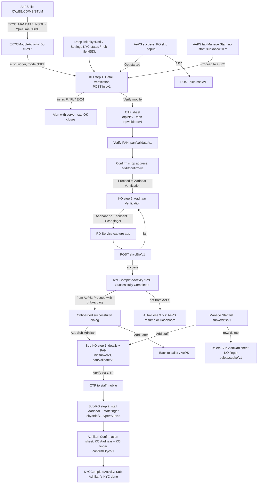

# 11 · NSDL eKYC onboarding for AePS (KO and Sub-KO)

> **Confidence key:** ✅ confirmed in code · 🟡 inferred (naming, partial code) · ⬛ not visible in APK (backend, server data, partner SDK)
>
> **Built from:** the APK (v6.6.62), packages `spice/mudra/nsdlekyc/ko` and `spice/mudra/nsdlekyc/subKO`, the use cases `domain/usecase/NSDL*`, `data_layer/repository/NSDLeKYCRepositoryImpl`, the eKYC hub `yblekyc/activity/EKYCModuleActivity` and the AePS gates in `ServiceActionHandler` (see [flow 03](03-aeps-cash-withdrawal.md)). Screen-level copy for every screen and dialog is in [`11-nsdl-aeps-onboarding-screens.json`](11-nsdl-aeps-onboarding-screens.json). A clickable prototype is in [`prototypes/aeps-nsdl-onboarding-prototype.html`](../prototypes/aeps-nsdl-onboarding-prototype.html), with screenshots of every screen in [`captures/prototype/11-nsdl-aeps-onboarding/`](../captures/prototype/11-nsdl-aeps-onboarding/).
>
> **Not this flow:** `spice/mudra/nsdl/*` (NSDL Payments Bank savings and current account opening for customers, iKit, LIC, Form 60) and `nsdl_ybl_rekyc/NsdlIdActiviation` (NSDL re-KYC / ID activation). Those are separate journeys.

## Summary
- **Who / when:** an adhikari (CSP agent) who must be onboarded with **NSDL Payments Bank** as a **KO** before AePS on the NSDL rail. Optionally, the KO then adds up to N **Sub-KOs** ("Sub-Adhikari", staff) who can transact and do daily 2FA on the KO's behalf.
  - **KO** = the adhikari himself. The screen header is "NSDL eKYC". Probably "Kiosk Operator" in bank BC terms 🟡 (the code never expands it).
  - **Sub-KO** = a staff member of the adhikari. Copy: "Sub-Adhikari", "Add staff", "Manage Staff". ✅
- **What the KO flow actually is:** a 2-step verification of details the server already holds, then Aadhaar biometric eKYC.
  - **Step 1, "Detail Verification":** verify the registered mobile by OTP, verify the PAN on file, confirm the shop address on file. All three values come pre-filled and read-only from the server.
  - **Step 2, "Aadhaar Verification":** type the Aadhaar number, accept the Aadhaar consent, scan a finger on an L1 RD device.
  - **No document is uploaded or photographed anywhere in this flow.** ✅ (see [Documents](#documents-and-details-the-adhikari-needs)).
- **Entry points** (✅ unless marked):
  1. **AePS tiles gate.** `AEPS_CW`, `AEPS_BE`, `AEPS_CD`, `AEPS_MINI`, `AEPS_STLM` call `ServiceActionHandler.hitNSDLEkycMandatePOPUp(true, <service>)`.
     - It runs when `O0()=="NA"` (no RBL eKYC route), the YBL mandate is not `Y` and `EKYC_MANDATE_NSDL` starts with `Y`.
     - It opens `EKYCModuleActivity` with `mode=<field 3>`, `autoTrigger=true`, `skipFlag=N` and `serviceName` (attached only when field 2 ≠ `Y`).
     - With `mode=NSDL`, the hub immediately opens `NSDLeKYCVerification` for result.
  2. **eKYC hub "Do eKYC"** (`EKYCModuleActivity`, deep link `ekycAll`). It lists server-driven bank modules. Tapping the module with `moduleCode=NSDL` opens the KO screen if `moduleAccessibility=Y`; otherwise it shows `moduleMessage`.
  3. **Account settings → KYC status:** the same module list in `AccountSettingActivity`, `NSDL` → KO screen.
  4. **Deep link `ekycNsdl`:** `DashboardActivityRevamp.hitDeeplinkService` → KO screen.
  5. **Settings to-do card** "Do NSDL eKYC / Increase success txns". Shown when the HomeINIT key `Nsdlekycflag` starts with `Y` (`SettingViewModel.getToDoDetails`). The click is routed via `PopupRedirection` service `Nsdlekycflag` → hub with `mode=NSDL`, `autoTrigger` 🟡 (click wiring not traced end to end).
  6. **AePS "Manage Staff" tab.** Shown when HomeINIT `NSDL_EKYC=Y`, in `NewAepsActivity` or the `NewAepsContainerActivity` tab `manage_staff`. With no staff and no KO yet, it shows "Proceed to eKYC" → KO screen.
  7. **Post-transaction KO popup** on the AePS success screens (CW revamp, CD revamp, legacy `TransactionConfirmationEkyc`). Server copy `skipPopupData` = `title|desc|primary|secondary`.
     - "Get started" → KO screen.
     - Optional "Skip" (`aeps_ko_skip=Y`) → `POST skip/nsdl/v1`.
- **Preconditions / gates:** logged in; an L1 biometric device and its RD Service app; internet. Server flags decide whether the mandate is shown. Session expiry is response code `099` → forced logout. ✅
- **Successful outcome:** "KYC Successfully Completed".
  - From AePS, the agent is offered "Proceed with onboarding" → "Onboarded successfully!" dialog → "Add Sub-Adhikari" or "Add Later".
  - The local pref `subkoflow=Y` is set. ✅
  - Whether AePS is then routed via NSDL is decided server-side ⬛.

## Flow diagram

## Screen by screen
API base for every NSDL KO/Sub-KO call: **`NSDL_EKYC_SPICEMONEY_CORE_URL = https://nsdlekyc.spicemoney.com/nsdlkosubko/ws/`**. ✅
- **Headers:** `mode=APP`, `lang`, `token`, `clientId`, `bcAgentId`, plus `CommonUtility.c0()` device headers.
- **Body:** `CommonUtility.Y()` common fields, `clientId`, plus the fields listed below (`NSDLeKYCRepositoryImpl`). ✅

| # | Screen (class) | Layout | What the user sees | User action | API call(s) | Next → (condition) | Conf. |
|---|---|---|---|---|---|---|---|
| 0a | eKYC hub `EKYCModuleActivity` | `ekyc_module_activity`, `ekyc_module_item` | Title "Do eKYC"; "Do your eKYC on respective banks and start using Spice Money services"; one row per server module (`moduleName`, `moduleSubTitle`, `moduleImage`), green tick when `moduleStatus=C`; bot FAB | Taps NSDL row (or auto-forwarded) | `POST https://dmt.spicemoney.com/scommyblekyc/ws/agent/homeInit/v1` body `reqFor=DASHBOARD` | KO screen (#1) when `moduleAccessibility=Y`, or `autoTrigger && mode=NSDL`; otherwise `moduleMessage` error | ✅ |
| 0b | KO popup on AePS success (`showKOonboardingDialog`) | `ko_skip_dialog` | Server text `skipPopupData`: title, description, primary, secondary (no defaults in layout) | Get started / Skip | Skip → `POST skip/nsdl/v1` (`GrahakVM.markKOSkipStatus` → `KOSkipUseCase`) | Get started → KO #1 and the success screen finishes; Skip → dismiss | ✅ |
| 0c | AePS tab "Manage Staff", empty (`ManageStaffFragment`) | `fragment_manage_staff` | "Add staff members to make business easy" + "Do NSDL eKYC, you will be able to add your staff members and they can login on your behalf and also do Two factor authentication" + **Proceed to eKYC** | Proceed to eKYC | `POST subko/dtls/v1` | KO #1 (when `subKoDetails` empty and local `subkoflow≠Y`) | ✅ |
| 1 | KO step 1 "Detail Verification" (`NSDLeKYCVerification`) | `activity_nsdl_ekycverification` (+ `layout_nsdl_stepper`, `layout_nsdl_ekyc_benefit`, `toolbar_spice_white`) | Header "NSDL eKYC"; stepper "1 Detail Verification", "2 Aadhaar Verification"; photo (server `selfie`), name, "Adhikari ID: {clientId}"; **Mobile Number** {mbNo} [Verify]; **PAN Number** {panNo} [Verify]; **Shop Address** {shopAddr} [Confirm]; **Proceed to Aadhaar Verification** (disabled); "BENEFITS OF eKYC" with 3 server items; "Powered by" + logo; Help; bot FAB | Taps Verify (mobile) | `POST init/v1` on open | Blocking alert (#1e) when `rs` is F/FL/EX01; OTP sheet (#2) after OTP init succeeds | ✅ |
| 1e | Init blocked alert (`AlertManagerKt.v`) | MaterialDialog | Server `responseDesc`, OK | OK | — | Screen closes (`finish`) | ✅ |
| 2 | OTP sheet (`OTPVerificationBottomSheet`) | `fragment_otp_verification_bottom_sheet` | "Enter OTP manually"; "We have sent a OTP to your registered number (+91){mobile}"; 6-box OTP; countdown mm:ss (120 s or `AXIS_CD_OTP_TIME`); **Submit**. "Didn't get the OTP? Resend OTP" stays hidden | Types 6-digit OTP, Submit | `POST otpinit/v1` (before the sheet) → `POST otpvalidate/v1` | Back to #1 with "Verified" (S/SU); toast `responseDesc` and Verify shown again (else); the sheet closes itself when the timer ends | ✅ |
| 3 | #1, PAN | same | PAN row "Verified" (green tick) | Taps Verify (PAN) | `POST pan/validate/v1` | Confirm (address) enabled on S/SU; toast + Verify again on fail | ✅ |
| 4 | #1, Address | same | Shop Address "Confirmed" | Taps Confirm | `POST addr/confirm/v1` | **Proceed to Aadhaar Verification** enabled on S/SU | ✅ |
| 5 | KO step 2 "Aadhaar Verification" (same activity, `constraintAadharVerification`) | same | "Confirm your identity"; **Doc type** dropdown (only "AADHAAR"); "Enter Aadhaar Number" (Aadhaar icon); checkbox "I Spice Money Adhikari accept the **Aadhaar Consent**"; note "Note: Input your Aadhaar number and verify with biometrics for essential security and regulatory compliance on daily login."; bottom bar with device icon, device name, "Change Device", **Scan finger** | Picks doc type, enters Aadhaar, ticks consent, Scan finger | — | Consent dialog (#5a); device picker (#5b); RD capture (#6) | ✅ |
| 5a | Aadhaar consent dialog (`AlertManagerKt.c`) | alert | Title "Customer Consent"; body = server HTML `aadharConcent`; **Agree and Continue** | Agree | — | Back to #5 (box **not** auto-ticked) | ✅ |
| 5b | Device picker (`SelectDeviceDialog`) | `aeps_device_list_new_revamped` | "Select Biometric Device"; device rows filtered to server `deviceListV2` (default MFS110 L1, Morpho L1, Startek/FM220U L1, Marc 11, Evolute eScan L1, VisionTek V600 L1, PB1000 L1, Evolute L1); "Add new device" | Picks device | — | #5 | ✅ |
| 5c | RD Service missing (`check_mantra_rd_services` dialog) | `check_mantra_rd_services` | "APPS REQUIRED"; "You may need to install one or more additional apps to fully support the guidelines mandated by UIDAI."; "{Mantra/Morpho/Startek/Marc11/VisionTek/Evolute escan L1/PB1000 L1/Evolute L1} RD Service"; "Not installed"/"Installed"; **INSTALL**, **Cancel** | Install (Play Store) | — | Dialog closes when the package install broadcast arrives | ✅ |
| 6 | RD capture (external RD app) | — | Vendor capture UI ⬛ | Places finger | `POST ekycBio/v1` | KYC complete (#7) on S/SU; toast with error (or logout on `099`) | ✅ / ⬛ UI |
| 7 | `KYCCompleteActivity` | `activity_kyccomplete` | Tick animation; "KYC Successfully Completed"; when from AePS: "Proceed with onboarding" | Proceed with onboarding / wait | — | From AePS → dialog #8. Otherwise auto-close after 3.5 s: returns `serviceName` to the caller (AePS resumes) when `skipFlag` is non-empty and ≠Y, else Dashboard | ✅ |
| 8 | Onboarded dialog (`NSDLErrorDialog`, type 1) | `fragment_nsdl_error_dialog` | Green tick; "Onboarded successfully!"; "Dear Adhikari, Please add your sub-Adhikari who can help you do authentication on your behalf"; **Add Sub-Adhikari**, **Add Later** | Choose | — | Add → Sub-KO #9; Later → back | ✅ |
| 9 | Sub-KO step 1 (`SubkoVerificationActivity`) | `activity_subko_verification` | Header "Add Sub-Adhikari"; stepper; "Sub- Adhikari Details"; Enter Name; Enter mobile number; Enter your Date of Birth; Enter Email ID (Optional); Enter PAN number [Verify]; "I agree to the **Terms and conditions**"; **Verify via OTP** (disabled) | Fills the form, Verify PAN, ticks T&C, Verify via OTP | `POST init/subko/v1` on open; `POST pan/validate/v1` (type=SubKo); `POST otpinit/v1` (type=SubKo) | T&C dialog (#9a); OTP sheet (#10); straight to #11 when init `step=1` | ✅ |
| 9a | T&C dialog | alert | "Terms & Conditions"; server HTML `subKoTc`; **Agree and Continue** | Agree | — | Ticks the T&C box | ✅ |
| 10 | OTP sheet (staff mobile) | `fragment_otp_verification_bottom_sheet` | Same copy, staff number | Submit | `POST otpvalidate/v1` (type=SubKo, step=1) | #11 on S/SU; response code `9901` = toast, sheet stays open; other fail = toast, sheet closes | ✅ |
| 11 | Sub-KO step 2 (same activity) | same | "Confirm your identity", Doc type (AADHAAR preselected), Enter Aadhaar Number (max 12), "I Spice Money Adhikari accept the Aadhaar Consent", note, device bar, **Scan finger** | Staff's Aadhaar, consent, staff's finger | `POST ekycBio/v1` (type=SubKo) | Parent confirm sheet #12 on SU; toast on fail | ✅ |
| 12 | Adhikari Confirmation (`FragmentKOVerification`) | `fragment_ko_bio` | Stepper "1 OTP verification", "2 Customer eKYC"; "Adhikari Confirmation"; "Dear Adhikari, you will be prompted to scan your finger for adding of Sub-Adhikari"; Doc type; Enter Aadhaar Number; consent; device bar; **Scan finger** | KO's own Aadhaar + KO's finger | `POST confirmEkyc/v1` (`parentagentauthtype=BIOAUTH`) | #13 on SU; alert with `responseDesc` on fail | ✅ |
| 13 | `KYCCompleteActivity` (`isFromKO=false`) | `activity_kyccomplete` | Server `responseDesc` of the staff eKYC, or "Sub-Adhikari's KYC done Successfully!" | — | — | From AePS: auto-close after 3.5 s → Manage Staff list refreshes; otherwise stays until back | ✅ |
| 14 | Manage Staff list (`ManageStaffFragment` + `AdapterManageStaff`) | `fragment_manage_staff`, `row_item_staff` | Rows: name, "ID: {employeeId}", view and delete; **Add staff** | Add / view / delete | `POST subko/dtls/v1` | Add → #9, or alert "You can add maximum 2 subko." when the count equals `subkoIdLimit`; view → #15; delete → #16 | ✅ |
| 15 | Staff detail (`StaffDetailFragment`) | `fragment_staff_detail` | "Sub-Adhikari Details"; Employee Name, Phone Number, Email ID, Employee ID, Pan Number, Aadhaar Number; **Okay** | Okay | — | #14 | ✅ |
| 16 | Delete staff (`DeleteStaffFragment`) | `layout_delete_subko` | "Delete Sub- Adhikari"; "Dear Adhikari, you will be prompted to scan your finger for deletion of Sub-Adhikari"; staff name and phone; device bar; **Scan finger** | KO's finger | `POST delete/subko/v1` (`subkoId`, `parentagentauthtype=BIOAUTH`) | #14 refreshed | ✅ |
| H | Help sheet (toolbar "Help") | `help_bottom_sheet` | "Helpline numbers": server `contactDetails[]` (role, mobileNumber) | Taps a number | — | — | ✅ |

### API reference (all `POST`, base above unless stated)
| Path | Called from | Request fields (besides the common body) | Response fields used |
|---|---|---|---|
| `init/v1` | KO open | — | `rs` (S/SU ok; F/FL/EX01 block), `rc` (`099` logout), `rd`, `payload.requestId`, `pidDtls` (PID options XML), `deviceListV2`, `cryptoKey`, `encryptPanFlag`, `mbNo`, `panNo` (decrypted with `cryptoKey` when `encryptPanFlag=Y`), `shopAddr`, `name`, `clientId`, `dob`, `selfie`, `contactDetails[]`, `iconDtls[]` (benefit `text`, enabled), `step` (1/2/3 resume), `aadharConcent` |
| `otpinit/v1` | KO Verify mobile; Sub-KO "Verify via OTP" | `mbNo`, `requestId`; Sub-KO adds `type=SubKo` | `rs`, `rd`, `payload.otprequestId` |
| `otpvalidate/v1` | OTP sheet Submit | `mbNo`, `step=1`, `requestId`, `otprequestId`, `otpHash` = Base64(SHA-512(OTP)); Sub-KO adds `type=SubKo` | `rs`, `rc` (`9901` = retry), `rd` |
| `pan/validate/v1` | KO Verify PAN | `panNumber` (AES with `cryptoKey` if `encryptPanFlag=Y`), `step=2`, `name`, `dob` (both from init), `requestId` | `rs`, `rd` |
| `pan/validate/v1` | Sub-KO Verify PAN | `panNumber`, `mobileNo`, `name`, `email`, `dob`, `type=SubKo` | `rs=SU`, `payload.requestId` (→ `EKYC_SUBKO_REQ_ID`), `rd` |
| `addr/confirm/v1` | KO Confirm address | `address`, `step=3`, `requestId` | `rs`, `rd` |
| `ekycBio/v1` | KO and Sub-KO Scan finger | `requestId`, `channeltxnid="IRISNSDL2LNHRF8OOGYRW085154DQCGBE"` (hard-coded), `bt=FMR`, `aadhaarno` (encrypted), `uidtype` (U if 12 digits else V), `pidblockdtls{certexpirydate,data,hmac,purpose=EKYC,skey,udc}`, `rddtls{dc,dpId,mc,mi,rdsId,rdsVer,udc}`; Sub-KO adds `type=SubKo` | `rs`, `rc`, `rd` |
| `init/subko/v1` | Sub-KO open | — | `aadharConcent`, `subKoTc`, `pidDtls`, `parentPidDtls`, `deviceList`, `cryptoKey`, `encryptPanFlag`, `requestId`, `journeyDetails{dob,email,moNo,panNo,panVerificationStatus}`, `contactDetails[]`, `step` |
| `confirmEkyc/v1` | Adhikari Confirmation | PID/RD blocks, `bt=FMR`, `type=SubKo`, `parentagentauthtype=BIOAUTH`, KO `aadhaarno`, `uidtype`, `requestId` | `rs=SU`, `rd` |
| `subko/dtls/v1` | Manage Staff | — | `payload.subKoDetails[]{name,phoneNo,email,employeeId,panNo,aadhaarNo,photo}`, `subkoIdLimit`, `parentPidDtls` |
| `delete/subko/v1` | Delete staff | PID/RD blocks, `clientID`, `parentagentauthtype=BIOAUTH`, `subkoId` (= `employeeId`), `type=SubKo` | `rs`, `rd` |
| `skip/nsdl/v1` | KO popup Skip | — | `rs` |
| `https://dmt.spicemoney.com/scommyblekyc/ws/agent/homeInit/v1` | eKYC hub | `reqFor=DASHBOARD` | `dashboardDtls[]{moduleCode,moduleName,moduleSubTitle,moduleImage,moduleStatus,moduleAccessibility,moduleMessage}`, `configFlags.updateAgentDet`, `footerData` |

## Documents and details the adhikari needs
**Short answer: no documents are uploaded.**
- The app collects no image, file, camera capture or document scan in NSDL KO or Sub-KO onboarding. ✅ (No camera, gallery or file-picker intent exists in `nsdlekyc/**`.)
- **KO (the adhikari himself):** proves identity in three ways:
  - an OTP on the registered mobile;
  - a server check of the PAN already on file against his name and DOB;
  - an Aadhaar fingerprint eKYC on an L1 RD device.
- **KO also confirms:** his shop address on file.
- **Sub-KO (staff):** the adhikari types the staff member's details and the staff member does an OTP check and a fingerprint eKYC. The adhikari then scans his own finger to approve.

| Item | How it's provided | Mandatory? | Validation / limits | Evidence | Conf. |
|---|---|---|---|---|---|
| **KO: registered mobile number** | Pre-filled from `init/v1` `mbNo`, read-only; verified by a 6-digit OTP sent to it | Yes (step 1, gates PAN) | OTP must be 6 digits ("Please enter valid OTP"); sent as SHA-512 hash; 120 s timer; no resend | `le2` case 8, `OTPVerificationBottomSheet`, `NSDLeKYCViewModel$otpInit/otpValidate` | ✅ |
| **KO: PAN** | Pre-filled from server `panNo` (may be AES-encrypted), read-only; agent taps **Verify** → server checks PAN + name + DOB from init | Yes (step 2, gates address) | No client validation, no PAN entry or image; the server returns pass/fail with `responseDesc` | `NSDLeKYCVerification.onClick (btnPanVerify)`, `NSDLeKYCViewModel$panValidate$1` | ✅ |
| **KO: name, DOB, photo, Adhikari ID** | Shown from server (`name`, `dob`, `selfie`, `clientId`); not editable, not captured | Used implicitly (name and DOB sent in the PAN check) | — | `le2` (init populate), `Payload` | ✅ |
| **KO: shop address** | Pre-filled `shopAddr`, read-only; **Confirm** sends it back | Yes (step 3, gates step 2) | None client-side; the server can reject | `NSDLeKYCViewModel.d()` → `addr/confirm/v1` | ✅ |
| **KO: Aadhaar number** | Typed (numeric). Doc type dropdown offers only "AADHAAR" (code also handles VID 16 / UID token 32, unreachable) | Yes | Numeric + Verhoeff checksum ("Please enter valid Customer Aadhaar Number"); with AADHAAR picked, max 12 and must be ≥12 ("Please enter Customer Aadhaar Number"). Sent encrypted, `uidtype=U` | `NSDLeKYCVerification.onClick (btnStartCapture)`, `d10` case 3 | ✅ |
| **KO: Aadhaar consent** | Checkbox "I Spice Money Adhikari accept the Aadhaar Consent"; link opens server HTML (`aadharConcent`) | Yes ("Please accept Aadhaar consent terms") | Consent text is server-driven ⬛ | `NSDLeKYCVerification.C0` | ✅ / ⬛ text |
| **KO: live fingerprint (Aadhaar biometric eKYC)** | Captured live through a UIDAI RD Service app on an **L1** device. List from server `deviceListV2`; default MFS110 L1, Morpho L1, Startek L1, Marc11, Evolute eScan L1, VisionTek V600 L1, Precision PB1000 L1, Evolute L1 | Yes | PID options from server `pidDtls`, fallback `fCount=1 fType=2 env=P timeout=10000 purpose eKYC (wadh)`. Errors: "Device not Ready", "Device not connected,Please connect the device properly", "Device not registered,Please register the device", Morpho "not registered… call 01203986786" | `NSDLeKYCViewModel` (`f80721t`, `C()`, `m()`, `c()`) | ✅ |
| **KO: RD Service app** | Installed from Play Store via the "APPS REQUIRED" dialog | Yes (to capture) | — | `NSDLeKYCViewModel.r()` | ✅ |
| **Sub-KO: staff name** | Typed | Yes ("Please enter a valid Name.") | Non-empty; editing it after PAN verify clears the PAN | `SubkoVerificationActivity.B0`, `init$1` watcher | ✅ |
| **Sub-KO: staff mobile** | Typed (numeric, max 10); then OTP to that number | Yes | `Patterns.PHONE`, ≥10 digits, not starting with 0 ("Please enter valid Mobile Number") | `B0()`, `NSDLSubKoViewModel$otpInit/otpValidate` | ✅ |
| **Sub-KO: staff DOB** | Date picker (dd/MM/yyyy), field not typeable | Yes ("Please enter your date of birth") | Age 18–80 ("Please enter age between 18 and 80") | `CommonUtility.s(…, false)` | ✅ |
| **Sub-KO: staff email** | Typed | **Optional** ("Enter Email ID (Optional)") | If filled, `Patterns.EMAIL_ADDRESS` ("Please enter a Valid Email Id") | `B0()` | ✅ |
| **Sub-KO: staff PAN** | Typed (caps, max 10) + **Verify** (server) | Yes | Regex `[A-Z]{5}[0-9]{4}[A-Z]{1}` ("Invalid PAN card number"; inline "Invalid PAN Number"); server checks it with name, DOB, mobile and email | `B0()`, `NSDLSubKoViewModel$panValidate$1` | ✅ |
| **Sub-KO: T&C** | Checkbox "I agree to the Terms and conditions" (server HTML `subKoTc`) | Yes ("Please accept Terms and Conditions") | Text server-driven ⬛ | `uf3` case 7 / default | ✅ / ⬛ text |
| **Sub-KO: staff Aadhaar + staff fingerprint** | Typed (max 12, Verhoeff) + consent + live capture (L0 or L1 devices from server `deviceList`) | Yes | Same messages as KO | `SubkoVerificationActivity.onClick (btnStartCapture)` | ✅ |
| **Sub-KO: KO's Aadhaar + KO's fingerprint** | Typed + live capture in "Adhikari Confirmation" | Yes (approval) | Same validation; server `confirmEkyc/v1` | `FragmentKOVerification` | ✅ |
| PAN card image, photo/selfie capture, shop photo, address proof, cancelled cheque/bank account, GST, IIBF/education certificate, police verification, KO email | **Not collected anywhere in this flow** | — | If NSDL needs any of these, they come from earlier onboarding (aob7, [flow 02](02-adhikari-onboarding.md)) or offline | absence in `nsdlekyc/**`, `domain/model/nsdlekyc/**` | ✅ (absence) / ⬛ backend needs |

**Server-driven parts** ⬛: the PAN, address, name, DOB and selfie that are verified (the agent's existing profile); the consent and T&C HTML; the benefits list (`iconDtls`); the device list; the PID options; whether the bank accepts the KO; the Sub-KO limit (`subkoIdLimit`).

## Fees, timelines, consent and declarations
- **Fees:** none shown or charged in this flow. ✅ No amount, wallet or payment call in `nsdlekyc/**`.
- **Timelines in UI:**
  - The OTP sheet counts down **120 s** (or `AXIS_CD_OTP_TIME`) and then closes itself.
  - The success screen auto-closes after **3.5 s**.
  - No SLA or "approval in N days" copy anywhere. ✅
- **Consents:**
  - "I Spice Money Adhikari accept the Aadhaar Consent" (server HTML in a "Customer Consent" dialog, button "Agree and Continue").
  - Sub-KO "I agree to the Terms and conditions" (server HTML in a "Terms & Conditions" dialog).
  - Static note "Note: Input your Aadhaar number and verify with biometrics for essential security and regulatory compliance on daily login." ✅ / ⬛ HTML content
- **UIDAI copy:** "You may need to install one or more additional apps to fully support the guidelines mandated by UIDAI." ✅

## Gates, flags and status values
- **HomeINIT keys** (`DashboardActivityRevamp.setInitResponse`) ✅:
  - `NSDLekycMandatepopup` → pref `EKYC_MANDATE_NSDL` = `Y|<resume>|<mode>`.
    - Field 1 `Y` = show the mandate.
    - Field 2 `Y` = do **not** pass `serviceName`, so no auto-resume of the AePS service.
    - Field 3 = hub mode (`NSDL`).
  - `Nsdlekycflag` → `Y|…` = Settings to-do card and popup redirection.
  - `NSDL_EKYC` = `Y` → "Manage Staff" tab in AePS.
  - `skipPopupData` (`title|desc|btn1|btn2`) → KO popup copy.
- **Other prefs** 🟡: `aeps_ko_skip` (show Skip), `skip_popup_visibility` (show the popup, reset to N once shown). The response that sets these two was not traced.
- **Tile gate order** (flow 03):
  1. RBL route (`O0()`).
  2. YBL mandate (`C1()`).
  3. NSDL mandate (`B1()`).
  4. AePS.
  - `B1()` returns (true,true) when the pref has no `|`, and `hitNSDLEkycMandatePOPUp` then does nothing, so the tile is a silent no-op. ✅
- **Init `rs`:**
  - `S`/`SU` → fill the screen and resume at `payload.step` (`1` = mobile verified, `2` = + PAN verified, `3` = + address confirmed; Proceed enabled).
  - `F`/`FL`/`EX01` → blocking alert with `responseDesc`, OK closes.
  - Anything else → toast.
  - `rc=099` → logout. ✅
- **Step calls:** `S`/`SU` = success. Sub-KO PAN, eKYC and parent checks need `SU` exactly (`S` alone is treated as failure in the activity observers). ✅
- **Hub:** `moduleStatus=C` = done (tick). `moduleAccessibility=Y` = can open. ✅
- **Intent extras:** `skipFlag` (`N` from the mandate; empty from other entries), `serviceName`, `isFromAEPS`, `isFromKO`. ✅
- **Local pref:** `subkoflow=Y`, written after a KO success on this device. It decides whether Manage Staff offers "Add staff" or "Proceed to eKYC". ✅

## Branches, errors and edge states
- **Init fails (F/FL/EX01)** → MaterialDialog with server text, OK closes the KO screen. · `le2` case 7 ✅
- **Each verify fails** → a toast with `responseDesc` and the button comes back. · `le2` cases 0, 1, default ✅
- **Back on the KO screen:**
  - `skipFlag=Y` → plain back.
  - Otherwise `RESULT_OK` + `serviceName` goes back to the hub, then to `ServiceActionHandler.handleResult`, which resumes the AePS service. · `NSDLeKYCVerification.backPressedCallback` ✅. See bug 3.
- **eKYC fail** → toast with the server message, or logout on `099`. · `le2` case 2 ✅
- **Morpho PID parse failure** → "Failed to parse Morpho PID DATA response." or the "Something wrong with Morpho device, please open Morpho app and click Refresh…" alert. · `NSDLeKYCViewModel$onResultComes$1$3` ✅
- **Sub-KO OTP `rc=9901`** → toast, sheet stays open for a retry. · `uf3` case 1 ✅
- **Sub-KO init `journeyDetails.panVerificationStatus=Y`** → the form is pre-filled (DOB, mobile, email, name, PAN with tick) and Verify via OTP is enabled. · `uf3` case 7 ✅
- **Sub-KO init `step=1`** → jumps straight to the staff Aadhaar step. · `uf3` case 7 ✅
- **Staff limit:** when the staff count equals `subkoIdLimit`, the alert "You can add maximum 2 subko." shows. · `n62` ✅

## Likely bugs / odd behaviour
1. **KO Aadhaar step does nothing for a valid Aadhaar unless "Doc type" is picked first.** ✅ (simple-mode decompile of `NSDLeKYCVerification.onClick` and `d10`)
   - The KO screen never preselects the dropdown (`f80680t=""`); Sub-KO and the parent sheet do call `performItemClick(0)`.
   - So the code takes the VID branch, and a 12-digit number fails the `length==16` test **with no toast**.
2. **The KO VID branch has no error message.** Any length other than 16 silently no-ops. Before a doc type is picked, the field also allows 50 characters. ✅
3. **The mandate is soft: back = continue.** With `skipFlag=N` (mandate path), back returns `RESULT_OK` + `serviceName`, so the agent lands in AePS without onboarding. Success with `skipFlag=N` also returns the service. Could be deliberate. 🟡 (behaviour of `handleResult` per flow 03)
4. **No OTP resend.** The resend layout is `gone` and its click handler (`ms0`) is empty. When the 120 s timer ends the sheet closes silently; the agent must tap Verify again. ✅
5. **The KO consent "Agree and Continue" does not tick the checkbox** (callback `z22` case 20 is a no-op). Sub-KO's does. ✅
6. **"You can add maximum 2 subko."** is hard-coded while the limit is server `subkoIdLimit`. The check is `==`, not `>=`. ✅
7. **"KO done" is a device-local pref (`subkoflow`).** After a reinstall or on a new phone, a fully onboarded KO with no staff is told to "Proceed to eKYC" again. 🟡
8. **Sub-KO success message.** `(desc == null || desc.length != 0) ? desc : fallback`: a null `responseDesc` shows blank text instead of the fallback. It also uses the staff-eKYC response, not the parent-confirm response. ✅
9. **Analytics.** The parent-confirm failure logs "Sub-Ko Onboarded Success". KO capture logs "Sub-Ko scan capture Button". ✅
10. **Hard-coded values.** `channeltxnid="IRISNSDL2LNHRF8OOGYRW085154DQCGBE"` is sent on every eKYC call. The fallback PID options carry a fixed `wadh`. 🟡 (may be expected by the backend)
11. **Dangling T&C text.** If `subKoTc` is empty, the checkbox reads "I agree to accept the " but is still required. ✅
12. **No way to fix wrong details on file.** Mobile, PAN and address are read-only on the KO screen; the only recourse is the Help sheet numbers. Product gap. ✅
13. **L0 devices for Sub-KO.** The Sub-KO default device list (used when the server sends none) includes L0 devices (MFS100, Morpho L0, Tatvik…); KO's default is L1-only. 🟡
14. **Layout typo.** "Procced with onboarding" in `activity_kyccomplete` (code overwrites it with the right text). ✅

## What we could not see
- What NSDL or the backend does after `ekycBio/v1`: bank approval, a pending state, how long until AePS on NSDL works, and whether any offline documents are needed. ⬛
- Content of the consent and T&C HTML, the benefits list, and the KO skip popup copy. ⬛
- Who sets `aeps_ko_skip` and `skip_popup_visibility`; what `skip/nsdl/v1` changes server-side. ⬛
- The RD Service vendor UIs. ⬛

## To verify in live capture (phase 4)
- On the KO Aadhaar step, enter a valid Aadhaar **without** opening "Doc type" and tap Scan finger: expect nothing to happen (bug 1).
- Back out of the mandatory KO from the AePS tile: does AePS open anyway (bug 3)?
- Wait out the OTP timer; confirm the sheet just closes and there is no resend.
- Capture the real consent and T&C HTML, the benefits list and the KO skip popup copy.
- Check the Manage Staff limit message against the real `subkoIdLimit`.
- Note the init `step` value for a part-done agent and confirm the resume state.

## Evidence
- `spice/mudra/nsdlekyc/ko/view/NSDLeKYCVerification.java`: `onCreate` (extras `skipFlag`, `serviceName`, `isFromAEPS`; doc list `["AADHAAR"]`), `onClick` (mobile, PAN, address, proceed, capture validation), `D0` (step resume), `C0` (consent), `backPressedCallback`.
- `defpackage/le2.java`: observers for init (case 7), OTP init (8), OTP validate (default), PAN (0), address (1), eKYC fail (2) and success (3 → `KYCCompleteActivity`, `subkoflow=Y`).
- `spice/mudra/nsdlekyc/ko/viewmodel/NSDLeKYCViewModel.java` (+ `$otpInit$1`, `$otpValidate$1`, `$panValidate$1`, `$addressValidate$1`, `$initData$1`, `$apiDoEkyc$1`, `$onResultComes$*`): PID options, device list, `c()` eKYC body, `r()` RD install dialog.
- `spice/mudra/nsdlekyc/ko/view/OTPVerificationBottomSheet.java`, `KYCCompleteActivity.java`, `NSDLErrorDialog.java`, `NSDLStepperClass.java`.
- `spice/mudra/nsdlekyc/subKO/view/SubkoVerificationActivity.java` (`B0` form validation, `onClick`), `defpackage/uf3.java` (observers), `FragmentKOVerification.java` + `defpackage/qr1.java`, `ManageStaffFragment.java` + `defpackage/n62.java`, `DeleteStaffFragment.java`, `StaffDetailFragment.java`, `AdapterManageStaff.java`, `defpackage/ht1.java` case 19, `defpackage/tn.java` cases 11 and 13.
- `spice/mudra/nsdlekyc/subKO/viewmodel/NSDLSubKoViewModel.java`: `N()` eKYC body, `O()` device routing, `c()` (K → delete, L → parent confirm, else staff eKYC).
- `spice/mudra/data_layer/repository/NSDLeKYCRepositoryImpl.java`; `spice/mudra/network/ApiInterface.java` (lines ~2885–2942); `spice/mudra/domain/usecase/NSDL*.java`, `KOSkipUseCase.java`; `spice/mudra/domain/model/nsdlekyc/*`.
- Entry points:
  - `spice/mudra/yblekyc/activity/EKYCModuleActivity.java` (`initiateObservers$lambda$0`, `onEkycListener` NSDL case).
  - `newDashboard/utility/serviceHandling/ServiceActionHandler.java` (`hitNSDLEkycMandatePOPUp`).
  - `newDashboard/activity/DashboardActivityRevamp.java` (`hitDeeplinkService$lambda$0` `ekycNsdl`; `setInitResponse` keys).
  - `newDashboard/activity/AccountSettingActivity.java`.
  - `newDashboard/viewmodel/SettingViewModel$getToDoDetails$1.java`.
  - `newDashboard/utility/serviceHandling/PopupRedirection.java`.
  - `aeps/newAepsRevamp/activity/TransactionCashWithdrawalRevamp.java` (`showKOonboardingDialog`).
  - `aeps/activity/NewAepsActivity.java`, `aeps/newAepsRevamp/activity/NewAepsContainerActivity.java` (Manage Staff tab).
- `utils/Constants.java`: `NSDL_EKYC_SPICEMONEY_CORE_URL`, `EKYC_MANDATE_NSDL`, `SUBKO_FLOW`, `KO_SKIP_POPUP`, `KO_SKIP_BUTTON_VISIBILITY`, `SKIP_POPUP_VISIBILITY`, `NSDL_EKYC`.
- Layouts: `activity_nsdl_ekycverification`, `fragment_otp_verification_bottom_sheet`, `activity_kyccomplete`, `fragment_nsdl_error_dialog`, `activity_subko_verification`, `fragment_ko_bio`, `fragment_manage_staff`, `fragment_staff_detail`, `layout_delete_subko`, `check_mantra_rd_services`, `aeps_device_list_new_revamped`, `ekyc_module_activity`, `help_bottom_sheet`.
