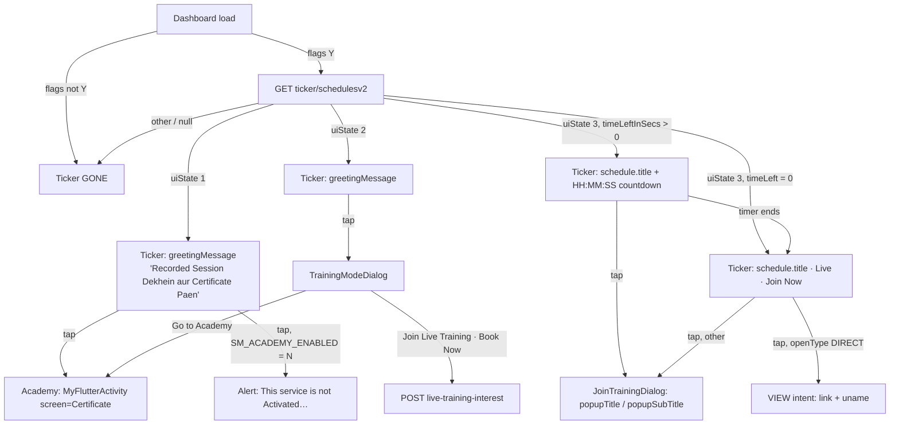

# 13 · Dashboard training ticker (today, and the time-bound proposal)

> **Confidence key:** ✅ confirmed in code · 🟡 inferred (naming, partial code) · ⬛ not visible in APK (backend, Flutter, partner SDK)

Source requirement: wiki page *CE – Time-Bound Training Ticker* (BRD1). Problem: the training ticker sits on the dashboard all day and pushes the second fold (Recharges and Bills) down. Proposal: show it only in an admin-set time slot; during a session it leads to the live session, otherwise to the Academy; outside the slot it is hidden.

Prototype: `prototypes/training-ticker-prototype.html` (published: https://claude.ai/artifact/4yUixS2ij7jpEwnLrSsxGx) · screenshots: `captures/prototype/13-training-ticker/` (33) · shots script: `scripts/render/shots13-training-ticker.mjs`.

## Summary
- **Who / when:** every logged-in adhikari on the revamped dashboard, every time the home screen loads. ✅
- **Where it sits:** the ticker is the `constraintAcademyTraining` include (`layout_academy_training_dashboard_v2`) inside the dashboard section row `row_item_dynamic_dashborad_parent_view_new`; it renders under the Banking Services card, directly above Recharges and Bills. Live capture `captures/live/01/home.webp` shows it at the bottom of the first fold with the Recharges and Bills heading cut off by the bottom nav. ✅
- **Gates:** both init flags `IIBF_SESSION__VISIBILITY == Y` and `iibfTickApiFlag == Y` (prefs written from `init/v2`), else the view is `GONE` and no call is made. ✅
- **Data:** `GET /iibf/trainingSession/ticker/schedulesv2` → `IIBFTrainingSessionV2 { data: { uiState, greetingMessage, hasScheduleToday, isBookedToday, optedDate, scheduleId, title, heading, message, schedule: { id, title, startTime, timeLeftInSecs, openType, link, popupTitle, popupSubTitle } } }`. Fetched once per app session and cached in a static field (`TrainingSessionNudge.f78559v`); other dashboard rows reuse it. ✅
- **Outcome:** the adhikari joins the live session (external link or dialog), books interest, or lands on the Academy (Flutter screen `Certificate`). ✅/⬛

## Flow diagram

## Screen by screen
| # | Screen (class) | Layout | What the user sees | User action | API call(s) | Next → (condition) | Conf. |
|---|---|---|---|---|---|---|---|
| 1 | `DashboardFragmentRevamp` + `TrainingSessionNudge` | `layout_academy_training_dashboard_v2` in `row_item_dynamic_dashborad_parent_view_new` | Gradient strip (`nd_bg_upcoming`: #c0c7f9→#ffe0e1 at 32%), play icon `nd_icon_play_gradient`, marquee text, right-hand arrow / countdown chips / "Live" badge + "Join Now" | taps the strip | `GET /iibf/trainingSession/ticker/schedulesv2` once on load | 2, 3, 4 or 5 by `uiState`; hidden otherwise | ✅ |
| 2 | Academy (`MyFlutterActivity`, extra `screen=Certificate`) | Flutter | Recorded videos and the certification program (app strings: "Become a 100% certified Adhikari", "RESUME TRAINING", "Training Certificates", "Go to Advance Training", "Download Certificate") | — | — | back → Home | ⬛ (Flutter) |
| 3 | `TrainingModeDialog` | `fragment_training_mode_dialog` | "Free Training Lo, Certificate Pao!" / "Select an option to continue" / "Join Live Training" + "Book Now" / "Watch Recorded Training & Get Free Certificate." + "You will be redirected to Spice Money Academy." + "Go to Academy" | Book Now · Go to Academy | `POST /iibf/trainingSession/live-training-interest` | 2 (Go to Academy) | ✅ |
| 4 | `JoinTrainingDialog` | `fragment_join_training_dialog` | "Live Training" (gradient #293895→#E12427), `popupTitle` e.g. "Join training at 3pm", `popupSubTitle` e.g. "Training 3 baje shuru hogi. Kripya 3 baje yahan click karein.", "Okay" | Okay | — | Home | ✅ |
| 5 | External link | Android `VIEW` intent | Meeting link; `?uname=<agent name>/<client id>` is appended unless the link already has `pwd` or `NA` | — | — | returns to app | ✅ |
| 6 | Not-activated alert | `AlertManagerKt.e` | `SM_ACADEMY_MESSAGE` or "This service is not Activated, Please contact Customer Support for further assistance" / "Ok" | Ok | — | Home | ✅ |

## Branches, errors and edge states
- **`uiState` 1 (no live session)** → greeting text, tap → Academy. Fallback copy "Free Training lo, certificate Pao" if `greetingMessage` is empty. No time check anywhere: the strip stays for as long as the dashboard lives. ✅
- **`uiState` 2 (bookable)** → same strip, tap → TrainingModeDialog. ✅
- **`uiState` 3** → `CountDownTimer(timeLeftInSecs)` drives `timerh:timerm:timers` (hours chip hidden when "00"); at 0 the group `gpLiveJoinNow` ("Live", "Join Now", arrow) replaces the timer. Title falls back to "Judein Training Session main". ✅
- **Countdown tap** → JoinTrainingDialog only (no booking). ✅
- **Live tap** → `openType == DIRECT` and non-blank `link` → external intent; else JoinTrainingDialog. ✅
- **Any other `uiState` or null `data`** → view GONE. This is the hook the proposal uses. ✅
- **Flags off** → GONE before any call. ✅

## Proposed behaviour (BRD) as built in the prototype
- `schedulesv2` additionally returns `visibility: { slotStart, slotEnd, slotDays, inSlot, hideAfterSecs }` from an admin-set slot (per day, editable without a release).
- Inside the slot: `uiState` 3 when a session is scheduled (countdown → Live → link), `uiState` 1 when none (Academy). Outside the slot: `uiState` 0 → hidden, so Recharges and Bills moves up by one strip (about 54 dp) and its heading clears the fold.
- `hideAfterSecs` lets the client collapse the strip when the slot ends without a refresh (see observation 1).

## Likely bugs / product observations
1. **The ticker never re-evaluates time.** `schedulesv2` is called once per app session and cached statically; the only clock on the client is the countdown. An adhikari who opens the app at 09:00 and keeps it open will still see the strip at 20:00, and one who opens it just before the slot never sees it. The proposal needs either a `hideAfterSecs`/`showAfterSecs` pair handled by a client timer, or a re-fetch on `onResume` / every N minutes. Requirement 5 (consistent server/device time) is best met by sending seconds-remaining, as the countdown already does, not wall-clock times. ✅
2. **A session that has ended still shows as `uiState` 3 until the timer hits 0 and then as "Live · Join Now" forever**, because nothing marks the end of the session; the server has to flip `uiState` on the next load. 🟡 (depends on backend)
3. **The strip renders inside every section row.** Only the row the server targets shows it, but a change to its visibility rule must be applied in `TrainingSessionNudge`, not per row. ✅
4. **The Academy certification gate on BBPS is dead code** (see flow 05), so the Academy link from the ticker is the only live path to certification on the dashboard. ✅
5. **`greetingMessage` is a marquee** (`setSelected(true)`): "Recorded Session Dekhein aur Certificate Paen" scrolls because it does not fit beside the icon and arrow at 14sp. ✅

## What we could not see
- The admin/CMS side of the slot and how `uiState` is decided today (server).
- The Academy Flutter screens (recorded videos, certification program): the prototype's Academy page is an approximation built from the app's own strings.
- Whether `live-training-interest` changes `uiState` on the next fetch.

## To verify in live capture (phase 4)
- Open the app before, during and after a scheduled session without killing it, and note whether the strip changes without a reload.
- Tap the strip in each state on staging and confirm the dialogs' copy and the external-link behaviour.

## Evidence
- `spice/mudra/newDashboard/utility/plugplay/TrainingSessionNudge.java`: constructor gate (~L697–716), `c()` uiState switch (~L748–796), `d()` Academy / not-activated (~L801–846), `e()` countdown and Live rendering + click handlers (~L852–1100), `f()` uiState 1/2 rendering and TrainingModeDialog (~L1102–1204).
- `spice/mudra/network/ApiInterface.java` L3342–3348: `ticker/schedules`, `ticker/schedulesv2`; `live-training-interest`.
- `spice/mudra/domain/model/dashboard/IIBFTrainingSessionV2.java`, `Data.java`, `Schedule.java`.
- `spice/mudra/activity/viewmodel/DashboardVM.java` ~L470–490: older v1 countdown (`trainingSession/ticker/schedules`), still present.
- `spice/mudra/training/JoinTrainingDialog.java`, `TrainingModeDialog.java`; layouts `fragment_join_training_dialog`, `fragment_training_mode_dialog`, `layout_academy_training_dashboard_v2`; drawables `nd_bg_upcoming`, `nd_icon_play_gradient`, `ds_clock_gradient`, `nd_badges`.
- `captures/live/01/home.webp`, `captures/live/05/00-home-bills.webp`: the strip in production with "Recorded Session Dekhein aur Certificate Paen".
