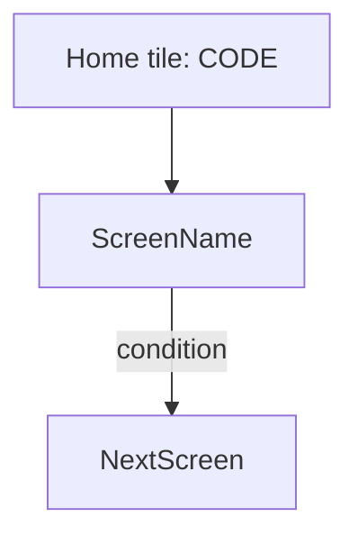

# <NN> · <Flow name>

> **Confidence key:** ✅ confirmed in code · 🟡 inferred (naming, partial code) · ⬛ not visible in APK (backend, Flutter, partner SDK)

## Summary
- **Who / when:** which adhikari segment uses this and why (one or two lines)
- **Entry points:** home tile code(s), deep links, other screens that launch it
- **Preconditions / gates:** login, KYC/eKYC mandate, onboarding threshold, device (biometric/printer), permissions, balance, feature flags
- **Successful outcome:** what the user ends with (receipt, balance change, account opened…)

## Flow diagram

## Screen by screen
| # | Screen (class) | Layout | What the user sees | User action | API call(s) | Next → (condition) | Conf. |
|---|---|---|---|---|---|---|---|
| 1 | `ClassName` | `layout_name` | title / key fields / CTA text (resolved from strings.xml) | taps X | `BASE + path` | Screen 2 (if …); Error dialog (if …) | ✅ |

## Branches, errors and edge states
- **<condition>** → what the user sees (screen/dialog, copy) · evidence

## What we could not see
- Server-side decisions, Flutter screens, SDK internals relevant to this flow

## To verify in live capture (phase 4)
- Concrete checks for a person driving the real app

## Evidence
- `spice/mudra/...java` (key methods / line refs)
